# JPEG XL Comparative Benchmark Report: C++ (libjxl) vs. C# (JxlSharp)

This report presents a fresh, apples-to-apples benchmark comparing the reference C++ implementation (`libjxl` v0.13.0) against the pure C# implementation (`JxlSharp` v0.15.1, both Release JIT and Native AOT) executed back-to-back on identical hardware, identical input images, and identical CLI parameters.

## Executive Summary

| Suite | Workload | Metric | C++ (libjxl) | C# (JxlSharp JIT) | C# (JxlSharp AOT) | JIT / C++ | AOT / C++ |
| :--- | :--- | :--- | ---: | ---: | ---: | ---: | ---: |
| Suite 1 | `flower.png` 14-codec effort sweep (16T seq) | Encode Geomean (MP/s) | 26.99 | 17.82 | 19.52 | 66.0% | 72.3% |
| Suite 1 | `flower.png` 14-codec effort sweep (16T seq) | Decode Geomean (MP/s) | 129.26 | 96.91 | 113.26 | 75.0% | 87.6% |
| Suite 2 | `flower.png` 8-codec single-threaded (1T) | Encode Geomean (MP/s) | 10.32 | 8.28 | 7.11 | 80.2% | 68.9% |
| Suite 2 | `flower.png` 8-codec single-threaded (1T) | Decode Geomean (MP/s) | 22.38 | 22.13 | 20.66 | 98.9% | 92.3% |
| Suite 3 | `flower.png` 14-codec parallel batch (16x16T)* | Encode Agg (MP/s) | 67.48 | 44.37 | **72.65** | 65.7% | **107.7%** |
| Suite 3 | `flower.png` 14-codec parallel batch (16x16T)* | Decode Agg (MP/s) | 377.02 | 260.71 | **434.71** | 69.1% | **115.3%** |
| Suite 4 | `flower_alpha.png` 6-codec RGBA (16T seq) | Encode Geomean (MP/s) | 27.50 | 8.56 | 9.88 | 31.1% | 35.9% |
| Suite 4 | `flower_alpha.png` 6-codec RGBA (16T seq) | Decode Geomean (MP/s) | 96.10 | 50.30 | 57.68 | 52.3% | 60.0% |
| Suite 4b | `hdr_room.png` 16-bit HLG HDR (`m:d0:1`, 16T) | Encode (MP/s) | 74.29 | 27.93 | 64.03 | 37.6% | 86.2% |
| Suite 5a | 5-image `wesaturate` corpus (16T seq) | Encode Geomean (MP/s) | 5.92 | 8.85 | **10.18** | 149.5% | **171.9%** |
| Suite 5a | 5-image `wesaturate` corpus (16T seq) | Decode Geomean (MP/s) | 59.61 | 37.59 | 43.49 | 63.1% | 73.0% |
| Suite 5b | 5-image `wesaturate` corpus (16x1T par)* | Encode Agg (MP/s) | 59.98 | 33.75 | 54.69 | 56.3% | 91.2% |
| Suite 5b | 5-image `wesaturate` corpus (16x1T par)* | Decode Agg (MP/s) | 297.94 | 87.82 | 176.30 | 29.5% | 59.2% |
| Suite 6 | Standalone `djxl` VarDCT `d1:e7` (16T, 30 reps) | Decode Geomean (MP/s) | 155.74 | 128.10 | **174.64** | 82.2% | **112.1%** |
| Suite 6 | Standalone `djxl` VarDCT `d1:e7` (1T, 10 reps) | Decode Geomean (MP/s) | 35.98 | 47.68 | **50.91** | 132.5% | **141.5%** |
| Suite 7 | Standalone `cjxl -d 1 -e 7` (16T, median of 3) | Wall Time (ms) | 337.3 | 735.3 | **238.1** | 45.9% | **141.7%** |
| Suite 7 | Standalone `cjxl -j 1 -e 7` JPEG transcode (16T, med 3) | Wall Time (ms) | 73.0 | 385.0 | 86.9 | 19.0% | 84.1% |

*Parallel batch suites (Suites 3 and 5b) normalize C++ `benchmark_xl` per-task throughput to aggregate throughput across outer worker threads so both tools use the same metric (see Section 1.3). For wall-time rows in Suite 7, higher percentage (`C++ Wall / C# Wall`) means faster execution.

---

## 1. Environment, Corpus & Methodology

### 1.1 Hardware & Software

- **Date**: 2026-11-22
- **CPU**: Intel Core i7-14700 (20 cores, 28 logical processors, AVX2/FMA)
- **Memory**: 63.7 GB RAM
- **OS**: Microsoft Windows 11 Pro (Build `10.0.26220`, `win-x64`)
- **C++ Reference (`libjxl`)**: v0.13.0 (`ef67fde2`, MSVC `19.51.36248.0`, Release build, `[_AVX2_,SSE2]`)
- **C# Implementation (`JxlSharp`)**: v0.15.1 (branch `fix/jpeg-transcode-modular-mode`, `net10.0` target, built with `.NET SDK 11.0.100`)
  - **Release JIT**: `dotnet build -c Release` (64-bit RyuJIT with Dynamic PGO and hardware intrinsics)
  - **Native AOT**: `dotnet publish -c Release -r win-x64` (`PublishAot=true`, `OptimizationPreference=Speed`, `IlcInstructionSet=native`)

### 1.2 Test Image Corpus

All input images come directly from the official `libjxl/testdata` repository:

| Image / Corpus | Dimensions | Pixels | Format | Source Size (Bytes) | Role |
| :--- | :---: | ---: | :--- | ---: | :--- |
| `flower.png` | `2268 x 1512` | 3.429 MP | 8-bit sRGB RGB | 4,330,524 | Primary reference photo (Suites 1, 2, 3, 6, 7) |
| `flower_alpha.png` | `2268 x 1512` | 3.429 MP | 8-bit sRGB RGBA | 5,522,161 | Alpha / extra-channel benchmark (Suites 4, 6, 7) |
| `hdr_room.png` | `676 x 449` | 0.304 MP | 16-bit Rec.2100 HLG RGB | 1,680,145 | 16-bit HDR benchmark (Suite 4b) |
| `wesaturate/500px/*.png` (5 images) | `500 x 500` each | 1.250 MP total | 3x RGB, 1x RGBA, 1x Grayscale | 1,545,069 | Multi-image mixed-format corpus (Suites 5a, 5b) |
| `flower.png.im_q85_420.jpg` | `2268 x 1512` | 3.429 MP | 4:2:0 JPEG (q85) | 546,797 | Lossless JPEG transcode & reconstruction (Suites 6, 7) |

### 1.3 Methodology & Fairness Notes

1. **Sequential Execution**: Every suite ran C++ `libjxl`, C# `JxlSharp` Release JIT, and C# `JxlSharp` Native AOT sequentially on the same machine with no concurrent benchmark processes.
2. **Identical Warmup & Aggregation (`SpeedStats`)**: Both `libjxl` (`tools/speed_stats.cc`) and `JxlSharp` (`src/JxlSharp.Tools/ToolsCommon.cs`) discard repetition 0 as warmup and compute the geometric mean over repetitions `1 .. N-1`.
3. **Parallel Batch Scaling (`--num_threads > 0`)**: For `--num_threads=0` (Suites 1, 2, 4, 4b, 5a), both `benchmark_xl` binaries compute `TotalInputPixels / (1e6 * TotalTime)`. When `--num_threads > 0` (Suites 3 and 5b), `libjxl` still divides by total summed per-task time (reporting per-task speed), whereas `JxlSharp` multiplies by `outer_threads = min(num_threads, total_tasks)` (reporting aggregate throughput). To compare like-for-like, C++ values in Suites 3 and 5b are multiplied by `outer_threads` (`14` in Suite 3, `16` in Suite 5b), and end-to-end wall times are reported alongside throughput.
4. **Byte-Identical Bitstreams for Standalone `djxl` (Suite 6)**: All `.jxl` test bitstreams for Suite 6 were generated once by C++ `cjxl` so every decoder processes the exact same compressed bytes.
5. **Cross-Decoder JPEG Verification (Suite 7)**: Every lossless JPEG transcode `.jxl` produced by C++, C# JIT, and C# AOT `cjxl -j 1` was decoded back to `.jpg` using C++ `djxl` and SHA-256 verified against the original input JPEG.
6. **Zero Errors**: Every `benchmark_xl` run reported `Bugs = 0` across all implementations, codecs, and images.

---

## 2. Suite 1: Reference Photo Effort Sweep (`flower.png`, 16 Inner Threads)

Command parameters: `--input flower.png --num_threads=0 --inner_threads=16 --encode_reps=5 --decode_reps=10`

Total wall time (including Butteraugli and SSIMULACRA2 scoring): C++ `44.84 s`, C# JIT `78.46 s`, C# AOT `80.48 s`.

### 2.1 Encoding & Decoding Throughput

| Codec | C++ Encode (MP/s) | JIT Encode (MP/s) | AOT Encode (MP/s) | JIT / C++ (Enc) | AOT / C++ (Enc) | C++ Decode (MP/s) | JIT Decode (MP/s) | AOT Decode (MP/s) | JIT / C++ (Dec) | AOT / C++ (Dec) |
| :--- | ---: | ---: | ---: | ---: | ---: | ---: | ---: | ---: | ---: | ---: |
| `jxl:d1:1` | 63.83 | 28.47 | 56.73 | 44.6% | 88.9% | 170.78 | 81.28 | **182.80** | 47.6% | **107.0%** |
| `jxl:d1:2` | 65.48 | 40.29 | 49.44 | 61.5% | 75.5% | 184.25 | 143.17 | 182.36 | 77.7% | 99.0% |
| `jxl:d1:3` | 45.00 | 26.47 | 27.03 | 58.8% | 60.1% | 141.38 | 139.60 | **141.59** | 98.7% | **100.2%** |
| `jxl:d1:4` | 40.69 | 25.80 | 24.94 | 63.4% | 61.3% | 142.12 | **142.25** | 134.98 | 100.1% | 95.0% |
| `jxl:d1:5` | 20.46 | 22.01 | **22.45** | 107.6% | **109.7%** | 140.91 | 135.54 | 140.01 | 96.2% | 99.4% |
| `jxl:d1:6` | 12.32 | 19.41 | **19.79** | 157.5% | **160.7%** | 149.67 | 120.50 | 138.17 | 80.5% | 92.3% |
| `jxl:d1:7` | 10.85 | 17.77 | **19.11** | 163.8% | **176.2%** | 152.00 | 118.06 | 132.21 | 77.7% | 87.0% |
| `jxl:d2:7` | 11.23 | 20.97 | **22.55** | 186.8% | **200.8%** | 148.66 | 108.97 | 139.87 | 73.3% | 94.1% |
| `jxl:d4:7` | 10.40 | 24.20 | **25.77** | 232.7% | **247.8%** | 125.47 | **139.26** | **129.93** | 111.0% | **103.6%** |
| `jxl:m:d0:1` | 189.00 | 90.60 | 151.58 | 47.9% | 80.2% | 215.60 | 85.51 | 92.37 | 39.7% | 42.8% |
| `jxl:m:d0:2` | 62.02 | 30.37 | 26.52 | 49.0% | 42.8% | 205.50 | 153.02 | 154.24 | 74.5% | 75.1% |
| `jxl:m:d0:3` | 43.45 | 22.30 | 23.63 | 51.3% | 54.4% | 76.28 | 52.46 | **77.85** | 68.8% | **102.1%** |
| `jxl:m:d0:5` | 13.30 | 2.44 | 2.11 | 18.4% | 15.9% | 59.40 | 38.39 | 50.23 | 64.6% | 84.6% |
| `jxl:m:d0:7` | 6.59 | 0.72 | 0.62 | 11.0% | 9.4% | 47.88 | 36.19 | 34.62 | 75.6% | 72.3% |
| **Aggregate (Geomean)** | **26.99** | **17.82** | **19.52** | **66.0%** | **72.3%** | **129.26** | **96.91** | **113.26** | **75.0%** | **87.6%** |

### 2.2 Compression Size & Quality Parity

| Codec | C++ Bytes | C# Bytes | Size Delta | C++ BPP | C# BPP | C++ SSIMULACRA2 | C# SSIMULACRA2 | C++ PSNR (dB) | C# PSNR (dB) | Bugs (C++/JIT/AOT) |
| :--- | ---: | ---: | ---: | ---: | ---: | ---: | ---: | ---: | ---: | :---: |
| `jxl:d1:1` | 519,216 | 719,188 | +38.5% | 1.211 | 1.678 | 87.68 | 89.84 | 45.26 | 48.31 | 0/0/0 |
| `jxl:d1:2` | 519,216 | 719,103 | +38.5% | 1.211 | 1.678 | 87.68 | 89.84 | 45.26 | 48.31 | 0/0/0 |
| `jxl:d1:3` | 489,718 | 661,507 | +35.1% | 1.142 | 1.543 | 87.68 | 89.84 | 45.26 | 48.31 | 0/0/0 |
| `jxl:d1:4` | 509,622 | 660,714 | +29.6% | 1.189 | 1.541 | 87.95 | 89.84 | 45.28 | 48.31 | 0/0/0 |
| `jxl:d1:5` | 493,648 | 663,053 | +34.3% | 1.152 | 1.547 | 88.99 | 89.86 | 46.37 | 48.32 | 0/0/0 |
| `jxl:d1:6` | 498,604 | 663,434 | +33.1% | 1.163 | 1.548 | 89.03 | 89.87 | 46.45 | 48.32 | 0/0/0 |
| `jxl:d1:7` | 499,160 | 664,439 | +33.1% | 1.164 | 1.550 | 89.02 | 89.81 | 46.51 | 48.33 | 0/0/0 |
| `jxl:d2:7` | 297,163 | 385,246 | +29.6% | 0.693 | 0.899 | 83.17 | 84.93 | 43.42 | 44.55 | 0/0/0 |
| `jxl:d4:7` | 171,347 | 219,734 | +28.2% | 0.400 | 0.513 | 72.12 | 75.40 | 40.55 | 41.21 | 0/0/0 |
| `jxl:m:d0:1` | 3,535,631 | 3,522,794 | -0.4% | 8.248 | 8.218 | 100.00 | 100.00 | 99.99 | 99.99 | 0/0/0 |
| `jxl:m:d0:2` | 3,196,504 | 3,291,079 | +3.0% | 7.457 | 7.678 | 100.00 | 100.00 | 99.99 | 99.99 | 0/0/0 |
| `jxl:m:d0:3` | 2,970,725 | 2,962,673 | -0.3% | 6.930 | 6.912 | 100.00 | 100.00 | 99.99 | 99.99 | 0/0/0 |
| `jxl:m:d0:5` | 2,842,537 | 2,883,817 | +1.5% | 6.631 | 6.728 | 100.00 | 100.00 | 99.99 | 99.99 | 0/0/0 |
| `jxl:m:d0:7` | 2,587,717 | 2,544,967 | -1.7% | 6.037 | 5.937 | 100.00 | 100.00 | 99.99 | 99.99 | 0/0/0 |
| **Aggregate** | **850,690** | **1,024,839** | **+20.5%** | **1.985** | **2.391** | **90.95** | **91.82** | **59.75** | **61.58** | **0/0/0** |

---

## 3. Suite 2: Reference Photo Single-Threaded (`flower.png`, 1 Inner Thread)

Command parameters: `--input flower.png --num_threads=0 --inner_threads=1 --encode_reps=3 --decode_reps=5`

Total wall time: C++ `37.31 s`, C# JIT `47.90 s`, C# AOT `52.98 s`.

| Codec | C++ Encode (MP/s) | JIT Encode (MP/s) | AOT Encode (MP/s) | JIT / C++ (Enc) | AOT / C++ (Enc) | C++ Decode (MP/s) | JIT Decode (MP/s) | AOT Decode (MP/s) | JIT / C++ (Dec) | AOT / C++ (Dec) |
| :--- | ---: | ---: | ---: | ---: | ---: | ---: | ---: | ---: | ---: | ---: |
| `jxl:d1:1` | 31.40 | 12.27 | 18.46 | 39.1% | 58.8% | 38.04 | 40.63 | **61.71** | 106.8% | **162.2%** |
| `jxl:d1:3` | 29.63 | 14.46 | 14.77 | 48.8% | 49.8% | 32.62 | 41.43 | **44.16** | 127.0% | **135.4%** |
| `jxl:d1:5` | 3.78 | **7.98** | **5.75** | 211.2% | **152.2%** | 30.62 | **46.21** | 29.06 | 150.9% | 94.9% |
| `jxl:d1:7` | 2.34 | **5.19** | 1.95 | 221.9% | 83.5% | 29.96 | **42.06** | **34.45** | 140.4% | **115.0%** |
| `jxl:m:d0:1` | 46.06 | 40.49 | 45.78 | 87.9% | 99.4% | 26.72 | 22.62 | 18.76 | 84.6% | 70.2% |
| `jxl:m:d0:2` | 17.52 | 11.93 | 9.37 | 68.1% | 53.5% | 27.38 | 21.69 | 19.79 | 79.2% | 72.3% |
| `jxl:m:d0:3` | 8.14 | 5.16 | 4.96 | 63.4% | 61.0% | 9.78 | 7.21 | 6.48 | 73.7% | 66.2% |
| `jxl:m:d0:5` | 2.39 | 1.20 | 1.00 | 50.3% | 41.8% | 7.72 | 4.97 | 5.06 | 64.3% | 65.5% |
| **Aggregate (Geomean)** | **10.32** | **8.28** | **7.11** | **80.2%** | **68.9%** | **22.38** | **22.13** | **20.66** | **98.9%** | **92.3%** |

---

## 4. Suite 3: Reference Photo Parallel Batch (`flower.png`, 16 Outer x 16 Inner Threads)

Command parameters: `--input flower.png --num_threads=16 --inner_threads=16 --encode_reps=3 --decode_reps=10`

Total wall time: C++ `12.03 s`, C# JIT `30.45 s`, C# AOT `27.76 s`. Because 14 codec tasks run in parallel (`outer_threads = 14`), C++ per-task `benchmark_xl` throughput is multiplied by `14` to match `JxlSharp` aggregate throughput.

| Codec | C++ Encode (Agg MP/s) | JIT Encode (Agg MP/s) | AOT Encode (Agg MP/s) | JIT / C++ (Enc) | AOT / C++ (Enc) | C++ Decode (Agg MP/s) | JIT Decode (Agg MP/s) | AOT Decode (Agg MP/s) | JIT / C++ (Dec) | AOT / C++ (Dec) |
| :--- | ---: | ---: | ---: | ---: | ---: | ---: | ---: | ---: | ---: | ---: |
| `jxl:d1:1` | 117.04 | 86.47 | 111.80 | 73.9% | 95.5% | 403.40 | 165.82 | **458.64** | 41.1% | **113.7%** |
| `jxl:d1:2` | 113.89 | 91.81 | 107.26 | 80.6% | 94.2% | 325.01 | 165.08 | **504.07** | 50.8% | **155.1%** |
| `jxl:d1:3` | 117.31 | 44.48 | 57.60 | 37.9% | 49.1% | 445.07 | 225.09 | **445.32** | 50.6% | **100.1%** |
| `jxl:d1:4` | 118.10 | 38.05 | 63.25 | 32.2% | 53.6% | 321.30 | 204.60 | **424.31** | 63.7% | **132.1%** |
| `jxl:d1:5` | 42.57 | 26.67 | **62.33** | 62.7% | **146.4%** | 323.92 | 305.52 | **448.62** | 94.3% | **138.5%** |
| `jxl:d1:6` | 27.10 | 28.08 | **60.55** | 103.6% | **223.4%** | 483.25 | 302.94 | 422.11 | 62.7% | 87.3% |
| `jxl:d1:7` | 24.43 | 26.21 | **56.45** | 107.3% | **231.1%** | 608.93 | 313.04 | 455.68 | 51.4% | 74.8% |
| `jxl:d2:7` | 27.30 | 34.51 | **60.35** | 126.4% | **221.1%** | 466.93 | 192.38 | 416.73 | 41.2% | 89.2% |
| `jxl:d4:7` | 23.14 | 42.91 | **61.19** | 185.4% | **264.4%** | 420.62 | 156.75 | 392.61 | 37.3% | 93.3% |
| `jxl:m:d0:1` | 828.25 | 193.83 | **1566.91** | 23.4% | **189.2%** | 508.00 | 474.45 | **518.72** | 93.4% | **102.1%** |
| `jxl:m:d0:2` | 154.92 | 131.84 | 146.58 | 85.1% | 94.6% | 504.83 | 377.39 | **551.43** | 74.8% | **109.2%** |
| `jxl:m:d0:3` | 114.21 | 94.37 | 110.01 | 82.6% | 96.3% | 184.60 | 192.06 | **292.02** | 104.0% | **158.2%** |
| `jxl:m:d0:5` | 40.95 | 14.30 | 15.41 | 34.9% | 37.6% | 219.81 | **360.17** | **357.76** | 163.8% | **162.8%** |
| `jxl:m:d0:7` | 20.57 | 8.51 | 8.52 | 41.4% | 41.4% | 320.98 | **491.17** | **466.96** | 153.0% | **145.5%** |
| **Aggregate (Geomean)** | **67.48** | **44.37** | **72.65** | **65.7%** | **107.7%** | **377.02** | **260.71** | **434.71** | **69.1%** | **115.3%** |

---

## 5. Suite 4: Alpha Channel & 16-Bit HDR Photos (16 Inner Threads)

### 5.1 Suite 4a: Alpha Channel Photo (`flower_alpha.png`, 8-bit RGBA)

Command parameters: `--input flower_alpha.png --num_threads=0 --inner_threads=16 --encode_reps=3 --decode_reps=10`

Total wall time: C++ `37.13 s`, C# JIT `42.54 s`, C# AOT `40.47 s`.

#### Encoding & Decoding Throughput

| Codec | C++ Encode (MP/s) | JIT Encode (MP/s) | AOT Encode (MP/s) | JIT / C++ (Enc) | AOT / C++ (Enc) | C++ Decode (MP/s) | JIT Decode (MP/s) | AOT Decode (MP/s) | JIT / C++ (Dec) | AOT / C++ (Dec) |
| :--- | ---: | ---: | ---: | ---: | ---: | ---: | ---: | ---: | ---: | ---: |
| `jxl:d1:1` | 43.17 | 11.53 | 13.01 | 26.7% | 30.1% | 138.21 | 57.51 | 76.11 | 41.6% | 55.1% |
| `jxl:d1:4` | 23.60 | 9.00 | 8.34 | 38.1% | 35.3% | 82.64 | 63.04 | 70.12 | 76.3% | 84.9% |
| `jxl:d1:7` | 7.82 | 2.19 | 1.98 | 28.0% | 25.3% | 81.49 | 56.99 | 53.83 | 69.9% | 66.1% |
| `jxl:m:d0:1` | 113.89 | 50.64 | **147.45** | 44.5% | **129.5%** | 158.82 | 77.24 | 77.61 | 48.6% | 48.9% |
| `jxl:m:d0:3` | 34.71 | 18.66 | 17.16 | 53.8% | 49.4% | 84.84 | 38.94 | 54.48 | 45.9% | 64.2% |
| `jxl:m:d0:5` | 13.74 | 1.83 | 1.71 | 13.3% | 12.4% | 62.80 | 26.06 | 30.32 | 41.5% | 48.3% |
| **Aggregate (Geomean)** | **27.50** | **8.56** | **9.88** | **31.1%** | **35.9%** | **96.10** | **50.30** | **57.68** | **52.3%** | **60.0%** |

#### Compression Size & Quality Parity

| Codec | C++ Bytes | C# Bytes | Size Delta | C++ BPP | C# BPP | C++ SSIMULACRA2 | C# SSIMULACRA2 | C++ PSNR (dB) | C# PSNR (dB) | Bugs (C++/JIT/AOT) |
| :--- | ---: | ---: | ---: | ---: | ---: | ---: | ---: | ---: | ---: | :---: |
| `jxl:d1:1` | 1,912,913 | 2,075,693 | +8.5% | 4.463 | 4.842 | 90.39 | 90.03 | 45.26 | 48.31 | 0/0/0 |
| `jxl:d1:4` | 1,813,089 | 2,016,885 | +11.2% | 4.230 | 4.705 | 90.47 | 90.03 | 45.28 | 48.31 | 0/0/0 |
| `jxl:d1:7` | 1,769,022 | 1,921,638 | +8.6% | 4.127 | 4.483 | 90.78 | 89.97 | 46.51 | 48.33 | 0/0/0 |
| `jxl:m:d0:1` | 5,054,077 | 5,054,075 | 0.0% | 11.791 | 11.791 | 100.00 | 100.00 | 99.99 | 99.99 | 0/0/0 |
| `jxl:m:d0:3` | 4,187,322 | 4,197,135 | +0.2% | 9.769 | 9.791 | 100.00 | 100.00 | 99.99 | 99.99 | 0/0/0 |
| `jxl:m:d0:5` | 4,057,858 | 4,145,691 | +2.2% | 9.467 | 9.671 | 100.00 | 100.00 | 99.99 | 99.99 | 0/0/0 |
| **Aggregate** | **2,841,976** | **2,985,047** | **+5.0%** | **6.630** | **6.964** | **95.28** | **94.87** | **67.58** | **69.51** | **0/0/0** |

### 5.2 Suite 4b: 16-Bit Rec.2100 HLG HDR Photo (`hdr_room.png`, 16-bit RGB)

Command parameters: `--input hdr_room.png --num_threads=0 --inner_threads=16 --encode_reps=5 --decode_reps=10`

Total wall time: C++ `1.71 s`, C# JIT `4.04 s`, C# AOT `2.02 s`.

#### Encoding & Decoding Throughput

| Codec | C++ Encode (MP/s) | JIT Encode (MP/s) | AOT Encode (MP/s) | JIT / C++ (Enc) | AOT / C++ (Enc) | C++ Decode (MP/s) | JIT Decode (MP/s) | AOT Decode (MP/s) | JIT / C++ (Dec) | AOT / C++ (Dec) |
| :--- | ---: | ---: | ---: | ---: | ---: | ---: | ---: | ---: | ---: | ---: |
| `jxl:d1:1` | 26.92 | 6.41 | 20.30 | 23.8% | 75.4% | 63.50 | 17.09 | **85.41** | 26.9% | **134.5%** |
| `jxl:d1:4` | 18.77 | 4.66 | 13.45 | 24.8% | 71.7% | 60.57 | 20.19 | **84.89** | 33.3% | **140.2%** |
| `jxl:d1:7` | 8.41 | 9.29 | **9.93** | 110.4% | **118.0%** | 59.79 | 39.73 | **87.19** | 66.4% | **145.8%** |
| `jxl:m:d0:1` | 74.29 | 27.93 | 64.03 | 37.6% | 86.2% | 86.08 | 39.11 | 40.27 | 45.4% | 46.8% |
| `jxl:m:d0:3` | 17.65 | 11.55 | 14.05 | 65.4% | 79.6% | 41.24 | 22.42 | 25.29 | 54.4% | 61.3% |
| **Aggregate (Geomean)** | **22.35** | **9.78** | **18.94** | **43.7%** | **84.7%** | **60.59** | **26.06** | **57.77** | **43.0%** | **95.4%** |

#### Compression Size & Quality Parity

| Codec | C++ Bytes | C# Bytes | Size Delta | C++ BPP | C# BPP | C++ SSIMULACRA2 | C# SSIMULACRA2 | C++ PSNR (dB) | C# PSNR (dB) | Bugs (C++/JIT/AOT) |
| :--- | ---: | ---: | ---: | ---: | ---: | ---: | ---: | ---: | ---: | :---: |
| `jxl:d1:1` | 69,636 | 102,786 | +47.6% | 1.835 | 2.709 | 86.04 | -61.28 | 47.51 | -263.74 | 0/0/0 |
| `jxl:d1:4` | 66,023 | 96,102 | +45.6% | 1.740 | 2.533 | 86.20 | -61.28 | 47.52 | -263.74 | 0/0/0 |
| `jxl:d1:7` | 68,030 | 97,763 | +43.7% | 1.793 | 2.577 | 86.49 | -61.17 | 47.64 | -263.26 | 0/0/0 |
| `jxl:m:d0:1` | 1,291,429 | 1,291,380 | 0.0% | 34.038 | 34.037 | 100.00 | 100.00 | 99.99 | 99.99 | 0/0/0 |
| `jxl:m:d0:3` | 1,235,669 | 1,235,620 | 0.0% | 32.569 | 32.567 | 100.00 | 100.00 | 99.99 | 99.99 | 0/0/0 |
| **Aggregate** | **218,595** | **273,877** | **+25.3%** | **5.762** | **7.219** | **91.75** | **100.00** | **64.02** | **99.99** | **0/0/0** |

Note: Following the v0.15.1 `IntensityTarget` default fix (`1000` nits for HLG, `10000` nits for PQ), Modular lossless (`jxl:m:d0:1` and `jxl:m:d0:3`) matches C++ with exact lossless parity (`SSIMULACRA2 = 100.00`, `PSNR = 99.99`, within `-0.004%` file size). Lossy VarDCT (`jxl:d1:*`) on 16-bit HLG HDR still exhibits a separate XYB/HLG quality regression (`PSNR = -263.74`, `SSIMULACRA2 = -61.28`) tracked as a follow-up.

---

## 6. Suite 5: Multi-Image Corpus (`wesaturate/500px/*.png`, 5 Images)

Corpus: 5 images (`500 x 500` each, `1.250 MP` total) covering 8-bit sRGB RGB, 8-bit sRGB RGBA, and 8-bit Grayscale.

### 6.1 Suite 5a: Sequential Tasks, 16 Inner Threads

Command parameters: `--input wesaturate/500px/*.png --num_threads=0 --inner_threads=16 --encode_reps=5 --decode_reps=10`

Total wall time: C++ `20.40 s`, C# JIT `18.95 s`, C# AOT `17.68 s`.

| Codec | C++ Encode (MP/s) | JIT Encode (MP/s) | AOT Encode (MP/s) | JIT / C++ (Enc) | AOT / C++ (Enc) | C++ Decode (MP/s) | JIT Decode (MP/s) | AOT Decode (MP/s) | JIT / C++ (Dec) | AOT / C++ (Dec) |
| :--- | ---: | ---: | ---: | ---: | ---: | ---: | ---: | ---: | ---: | ---: |
| `jxl:d1:1` | 8.51 | 8.74 | **17.51** | 102.7% | **205.8%** | 89.30 | 26.55 | 76.00 | 29.7% | 85.1% |
| `jxl:d1:3` | 7.30 | 11.90 | **15.34** | 163.0% | **210.2%** | 80.78 | 66.57 | **90.07** | 82.4% | **111.5%** |
| `jxl:d1:5` | 4.83 | **8.50** | **8.23** | 176.0% | **170.3%** | 57.20 | 60.01 | **61.84** | 104.9% | **108.1%** |
| `jxl:d1:7` | 3.57 | **6.01** | **4.97** | 168.3% | **139.1%** | 56.76 | 52.90 | 49.06 | 93.2% | 86.4% |
| `jxl:m:d0:1` | 12.91 | 16.00 | **28.97** | 123.9% | **224.3%** | 85.35 | 32.76 | 31.27 | 38.4% | 36.6% |
| `jxl:m:d0:2` | 7.49 | 16.42 | **16.61** | 219.1% | **221.7%** | 81.65 | 67.74 | 65.45 | 83.0% | 80.2% |
| `jxl:m:d0:3` | 6.55 | **12.42** | **11.57** | 189.8% | **176.8%** | 36.76 | 24.82 | 25.01 | 67.5% | 68.0% |
| `jxl:m:d0:5` | 2.23 | 2.18 | 1.89 | 97.4% | 84.8% | 26.55 | 12.91 | 12.04 | 48.6% | 45.4% |
| **Aggregate (Geomean)** | **5.92** | **8.85** | **10.18** | **149.5%** | **171.9%** | **59.61** | **37.59** | **43.49** | **63.1%** | **73.0%** |

### 6.2 Suite 5b: Parallel Tasks, 16 Outer x 1 Inner Thread

Command parameters: `--input wesaturate/500px/*.png --num_threads=16 --inner_threads=1 --encode_reps=5 --decode_reps=10`

Total wall time: C++ `2.95 s`, C# JIT `7.32 s`, C# AOT `4.29 s`. C++ per-task `benchmark_xl` throughput is multiplied by `16` (`outer_threads = 16`) for aggregate comparison.

| Codec | C++ Encode (Agg MP/s) | JIT Encode (Agg MP/s) | AOT Encode (Agg MP/s) | JIT / C++ (Enc) | AOT / C++ (Enc) | C++ Decode (Agg MP/s) | JIT Decode (Agg MP/s) | AOT Decode (Agg MP/s) | JIT / C++ (Dec) | AOT / C++ (Dec) |
| :--- | ---: | ---: | ---: | ---: | ---: | ---: | ---: | ---: | ---: | ---: |
| `jxl:d1:1` | 101.23 | 54.91 | 74.77 | 54.2% | 73.9% | 442.56 | 83.04 | 258.45 | 18.8% | 58.4% |
| `jxl:d1:3` | 91.25 | 37.92 | 62.18 | 41.6% | 68.1% | 385.25 | 82.61 | 283.05 | 21.4% | 73.5% |
| `jxl:d1:5` | 37.86 | 23.29 | **41.92** | 61.5% | **110.7%** | 343.73 | 86.35 | 225.36 | 25.1% | 65.6% |
| `jxl:d1:7` | 22.99 | 22.59 | **31.38** | 98.2% | **136.5%** | 376.74 | 79.12 | 260.59 | 21.0% | 69.2% |
| `jxl:m:d0:1` | 146.14 | 56.56 | **211.99** | 38.7% | **145.1%** | 351.84 | 147.19 | 187.61 | 41.8% | 53.3% |
| `jxl:m:d0:2` | 89.62 | 68.95 | 78.94 | 76.9% | 88.1% | 384.02 | 146.95 | 179.46 | 38.3% | 46.7% |
| `jxl:m:d0:3` | 70.94 | 32.91 | 47.31 | 46.4% | 66.7% | 166.19 | 57.27 | 85.59 | 34.5% | 51.5% |
| `jxl:m:d0:5` | 22.45 | 11.96 | 16.52 | 53.3% | 73.6% | 125.25 | 60.93 | 75.40 | 48.7% | 60.2% |
| **Aggregate (Geomean)** | **59.98** | **33.75** | **54.69** | **56.3%** | **91.2%** | **297.94** | **87.82** | **176.30** | **29.5%** | **59.2%** |

### 6.3 Multi-Image Corpus Compression Size & Quality Parity

| Codec | C++ Bytes | C# Bytes | Size Delta | C++ BPP | C# BPP | C++ SSIMULACRA2 | C# SSIMULACRA2 | C++ PSNR (dB) | C# PSNR (dB) | Bugs (C++/JIT/AOT) |
| :--- | ---: | ---: | ---: | ---: | ---: | ---: | ---: | ---: | ---: | :---: |
| `jxl:d1:1` | 264,614 | 318,693 | +20.4% | 1.694 | 2.040 | 88.03 | 90.74 | 51.06 | 54.98 | 0/0/0 |
| `jxl:d1:3` | 247,430 | 301,261 | +21.8% | 1.584 | 1.928 | 88.03 | 90.74 | 51.06 | 54.98 | 0/0/0 |
| `jxl:d1:5` | 239,854 | 307,575 | +28.2% | 1.535 | 1.968 | 88.01 | 90.88 | 51.85 | 55.16 | 0/0/0 |
| `jxl:d1:7` | 232,409 | 298,958 | +28.6% | 1.487 | 1.913 | 88.12 | 90.93 | 51.91 | 55.16 | 0/0/0 |
| `jxl:m:d0:1` | 1,410,284 | 1,402,878 | -0.5% | 9.026 | 8.978 | 100.00 | 100.00 | 99.99 | 99.99 | 0/0/0 |
| `jxl:m:d0:2` | 1,318,313 | 1,310,852 | -0.6% | 8.437 | 8.389 | 100.00 | 100.00 | 99.99 | 99.99 | 0/0/0 |
| `jxl:m:d0:3` | 1,149,186 | 1,141,725 | -0.6% | 7.355 | 7.307 | 100.00 | 100.00 | 99.99 | 99.99 | 0/0/0 |
| `jxl:m:d0:5` | 1,110,874 | 1,130,549 | +1.8% | 7.110 | 7.236 | 100.00 | 100.00 | 99.99 | 99.99 | 0/0/0 |
| **Aggregate** | **552,339** | **616,826** | **+11.7%** | **3.535** | **3.948** | **94.02** | **95.30** | **71.74** | **74.21** | **0/0/0** |

---

## 7. Suite 6: Standalone `djxl` Decoding on Byte-Identical Bitstreams

All input `.jxl` files were encoded once by C++ `cjxl` v0.13.0 so all three decoders process byte-identical bitstreams (`--disable_output`, except JPEG reconstruction which writes the reconstructed `.jpg` and verifies SHA-256 bit-exactness):

- `flower_d1_e7.jxl`: `499,092` bytes (`flower.png`, VarDCT `d1.0`, effort 7)
- `flower_m_d0_e2.jxl`: `3,196,436` bytes (`flower.png`, Modular lossless, effort 2)
- `flower_alpha_d1_e7.jxl`: `1,769,002` bytes (`flower_alpha.png`, VarDCT RGBA `d1.0`, effort 7)
- `flower_jpeg_transcode.jxl`: `456,100` bytes (`flower.png.im_q85_420.jpg`, lossless JPEG transcode, effort 7)

| Workload | Threads | Reps | C++ Geomean (MP/s) | C++ [Min, Max] | JIT Geomean (MP/s) | JIT [Min, Max] | AOT Geomean (MP/s) | AOT [Min, Max] | JIT / C++ | AOT / C++ |
| :--- | :---: | :---: | ---: | ---: | ---: | ---: | ---: | ---: | ---: | ---: |
| `flower_d1_e7.jxl` (VarDCT RGB) | 0 (1T) | 10 | 35.98 | [35.62, 36.82] | 47.68 | [7.30, 50.81] | **50.91** | [38.83, 52.28] | 132.5% | **141.5%** |
| `flower_d1_e7.jxl` (VarDCT RGB) | 8 | 30 | 147.19 | [140.16, 157.06] | 121.92 | [14.07, 161.79] | **163.29** | [110.52, 175.12] | 82.8% | **110.9%** |
| `flower_d1_e7.jxl` (VarDCT RGB) | 16 | 30 | 155.74 | [146.09, 175.61] | 128.10 | [15.61, 180.32] | **174.64** | [142.84, 185.05] | 82.2% | **112.1%** |
| `flower_m_d0_e2.jxl` (Modular RGB) | 0 (1T) | 10 | 28.75 | [27.59, 29.34] | 26.28 | [11.77, 27.78] | 25.83 | [23.46, 26.33] | 91.4% | 89.8% |
| `flower_m_d0_e2.jxl` (Modular RGB) | 16 | 30 | 200.74 | [175.95, 222.54] | 167.65 | [24.88, 228.25] | 164.76 | [95.46, 223.23] | 83.5% | 82.1% |
| `flower_alpha_d1_e7.jxl` (VarDCT RGBA) | 16 | 30 | 84.04 | [79.27, 98.09] | 51.90 | [13.59, 62.01] | 57.61 | [54.18, 61.89] | 61.8% | 68.6% |
| `flower_jpeg_transcode.jxl` (JPEG Recon) | 16 | 10 | 226.71 | [210.70, 231.92] | 82.13 | [16.84, 120.71] | 126.65 | [113.17, 128.65] | 36.2% | 55.9% |

Lossless JPEG reconstruction verification: original `flower.png.im_q85_420.jpg` (`546,797` bytes) and reconstructed outputs from C++ `djxl`, C# JIT `djxl`, and C# AOT `djxl` all matched bit-for-bit with SHA-256 `6AD9A79E9F26D2723EF954A0DCA774429606655AB7184F8AB400016F228CA2CE`.

---

## 8. Suite 7: Standalone `cjxl` End-to-End CLI Encoding (Median of 3 Trials)

Each command was executed 3 times end-to-end (process startup + input read/decode + JXL encode + file write). Table reports median wall time, median inner encoder throughput reported by `cjxl`, and output file size.

| Workload & Flags | C++ Wall (ms) | JIT Wall (ms) | AOT Wall (ms) | C++ Inner (MP/s) | JIT Inner (MP/s) | AOT Inner (MP/s) | AOT / C++ (Wall Speed) | AOT / C++ (Inner) | C++ Size (Bytes) | C# Size (Bytes) |
| :--- | ---: | ---: | ---: | ---: | ---: | ---: | ---: | ---: | ---: | ---: |
| `flower.png -d 1 -e 7 --num_threads=16` | 337.3 | 735.3 | **238.1** | 12.21 | 6.54 | **27.21** | **141.7%** | **222.9%** | 499,092 | 664,439 |
| `flower.png -d 1 -e 7 --num_threads=0` | 1285.2 | 1103.4 | **606.1** | 2.79 | 3.67 | **6.92** | **212.0%** | **248.2%** | 499,092 | 664,439 |
| `flower.png -d 1 -e 3 --num_threads=16` | 123.1 | 582.7 | 202.7 | 52.33 | 8.47 | 38.27 | 60.7% | 73.1% | 489,650 | 661,507 |
| `flower.png -m 1 -d 0 -e 1 --num_threads=16` | 76.1 | 293.1 | 117.5 | 190.32 | 28.20 | **284.41** | 64.8% | **149.4%** | 3,535,563 | 3,522,794 |
| `flower.png -m 1 -d 0 -e 3 --num_threads=16` | 133.6 | 452.2 | 234.0 | 45.42 | 12.45 | 28.13 | 57.1% | 61.9% | 2,970,657 | 2,962,673 |
| `flower_alpha.png -d 1 -e 7 --num_threads=16` | 409.3 | 1260.4 | 788.5 | 10.08 | 3.24 | 5.26 | 51.9% | 52.2% | 1,769,002 | 1,094,338 |
| `flower_alpha.png -m 1 -d 0 -e 1 --num_threads=16` | 99.8 | 345.1 | 145.9 | 151.09 | 22.46 | **169.82** | 68.4% | **112.4%** | 5,054,057 | 5,054,075 |
| `flower.png.im_q85_420.jpg -j 1 -e 7 --num_threads=16` | 73.0 | 385.0 | 86.9 | N/A | 10.48 | 55.40 | 84.1% | N/A | 456,100 | 457,170 |

Cross-decoder JPEG transcoding verification: C++ `djxl` decoded the `cjxl -j 1 -e 7` bitstreams produced by C++, C# JIT, and C# AOT to the exact original `flower.png.im_q85_420.jpg` bytes (all three matched SHA-256 `6AD9A79E9F26D2723EF954A0DCA774429606655AB7184F8AB400016F228CA2CE`, verified=`True`). C++ `cjxl -j 1` does not print an inner MP/s figure, so that cell is marked `N/A`.

---

## 9. Visual Comparison Charts

### 9.1 Suite 1 Encoding Throughput (`flower.png`, 16 Threads, MP/s)

```mermaid
xychart-beta
    title "Suite 1 Encode Throughput (flower.png, 16T): C++ (1) vs JIT (2) vs AOT (3) [MP/s]"
    x-axis ["d1:1", "d1:2", "d1:3", "d1:4", "d1:5", "d1:6", "d1:7", "d2:7", "d4:7", "m:d0:2", "m:d0:3"]
    y-axis "Throughput (MP/s)" 0 --> 80
    bar [63.83, 65.48, 45.00, 40.69, 20.46, 12.32, 10.85, 11.23, 10.40, 62.02, 43.45]
    bar [28.47, 40.29, 26.47, 25.80, 22.01, 19.41, 17.77, 20.97, 24.20, 30.37, 22.30]
    bar [56.73, 49.44, 27.03, 24.94, 22.45, 19.79, 19.11, 22.55, 25.77, 26.52, 23.63]
```

Note: `m:d0:1` fast lossless is omitted from the chart above due to scale (`189.00` C++, `90.60` JIT, `151.58` AOT MP/s).

### 9.2 Suite 1 Decoding Throughput (`flower.png`, 16 Threads, MP/s)

```mermaid
xychart-beta
    title "Suite 1 Decode Throughput (flower.png, 16T): C++ (1) vs JIT (2) vs AOT (3) [MP/s]"
    x-axis ["d1:1", "d1:2", "d1:3", "d1:4", "d1:5", "d1:6", "d1:7", "d2:7", "d4:7", "m:d0:1", "m:d0:2", "m:d0:3"]
    y-axis "Throughput (MP/s)" 0 --> 240
    bar [170.78, 184.25, 141.38, 142.12, 140.91, 149.67, 152.00, 148.66, 125.47, 215.60, 205.50, 76.28]
    bar [81.28, 143.17, 139.60, 142.25, 135.54, 120.50, 118.06, 108.97, 139.26, 85.51, 153.02, 52.46]
    bar [182.80, 182.36, 141.59, 134.98, 140.01, 138.17, 132.21, 139.87, 129.93, 92.37, 154.24, 77.85]
```

### 9.3 Suite 6 Standalone `djxl` Decoding Throughput (Identical Bitstreams, MP/s)

```mermaid
xychart-beta
    title "Suite 6 Standalone djxl (Identical Bitstreams): C++ (1) vs JIT (2) vs AOT (3) [MP/s]"
    x-axis ["d1:e7 1T", "d1:e7 8T", "d1:e7 16T", "m:e2 1T", "m:e2 16T", "alpha 16T", "jpg recon"]
    y-axis "Throughput (MP/s)" 0 --> 260
    bar [35.98, 147.19, 155.74, 28.75, 200.74, 84.04, 226.71]
    bar [47.68, 121.92, 128.10, 26.28, 167.65, 51.90, 82.13]
    bar [50.91, 163.29, 174.64, 25.83, 164.76, 57.61, 126.65]
```

---

## 10. Key Observations & Findings

1. **Native AOT Eliminates Startup & Warmup Overhead**: On short CLI invocations (`cjxl`, `djxl`) and low-rep workloads, Native AOT consistently outperforms Release JIT (e.g., `cjxl -d 1 -e 7` at 16T completes in `238.1 ms` on AOT vs `735.3 ms` on JIT and `337.3 ms` on C++).
2. **VarDCT Decoding on Identical Bitstreams**: In Suite 6 (`djxl` decoding the exact same C++-encoded `flower_d1_e7.jxl`), `JxlSharp` Native AOT leads or matches C++ `libjxl` across 1T (`141.5%`), 8T (`110.9%`), and 16T (`112.1%`), and reaches `82.1%` on 16T Modular lossless.
3. **Lossless JPEG Transcoding Fixed & Cross-Verified (v0.15.1)**: In Suite 7, `cjxl -j 1 -e 7` on 4:2:0 `flower.png.im_q85_420.jpg` completes in `86.9 ms` median on Native AOT vs `73.0 ms` on C++ (`84.1%` wall speed, `+0.2%` output size), reports exact JPEG dimensions (`2268 x 1512`), and round-trips bit-identically through C++ `djxl` (matching SHA-256).
4. **16-Bit HLG HDR Lossless Fixed (v0.15.1)**: On 16-bit Rec.2100 HLG `hdr_room.png` (Suite 4b), `JxlSharp` Modular lossless (`m:d0:1` and `m:d0:3`) now preserves the 1000-nit intensity target and achieves exact lossless quality (`SSIMULACRA2 = 100.00`, `PSNR = 99.99`, within `0.0%` of C++ size). Lossy VarDCT on 16-bit HLG HDR still shows a separate XYB/HLG quality regression tracked for a future fix.
5. **Multi-Image Corpus Efficiency**: On the 5-image `wesaturate` corpus (Suites 5a and 5b), `JxlSharp` Native AOT leads C++ in sequential 16T aggregate encode throughput (`171.9%`) and reaches `91.2%` in parallel 16x1T encode, with `59.2%` to `73.0%` of C++ decode throughput.
6. **Compression Density vs. Speed Trade-Off in VarDCT**: For Modular lossless (`m:d0:1..7`), `JxlSharp` matches `libjxl` file sizes within `-1.7%` to `+3.0%` at lossless `SSIMULACRA2 = 100.00`. For VarDCT lossy (`d1..d4`), `JxlSharp` currently emits `28%` to `39%` larger bitstreams than `libjxl` at the same distance target (yielding higher PSNR/SSIMULACRA2), which is important context when comparing VarDCT e5-e7 encode speeds.
7. **Remaining Performance Gaps**: Primary optimization opportunities for `JxlSharp` relative to `libjxl` are high-effort Modular encoding (`m:d0:5` at `15.9%`, `m:d0:7` at `9.4%`), RGBA alpha-channel encoding/decoding (Suite 4a: `35.9%` encode, `60.0%` decode), and lossless JPEG reconstruction speed (`55.9%` of C++, bit-exact SHA-256).
