# JPEG XL Comparative Benchmark Report: C++ (libjxl) vs. C# (JxlSharp)

This report presents a fresh, apples-to-apples benchmark comparing the reference C++ implementation (`libjxl` v0.13.0) against the pure C# implementation (`JxlSharp` v0.15.0, both Release JIT and Native AOT) executed back-to-back on identical hardware, identical input images, and identical CLI parameters.

## Executive Summary

| Suite | Workload | Metric | C++ (libjxl) | C# (JxlSharp JIT) | C# (JxlSharp AOT) | JIT / C++ | AOT / C++ |
| :--- | :--- | :--- | ---: | ---: | ---: | ---: | ---: |
| Suite 1 | `flower.png` 14-codec effort sweep (16T seq) | Encode Geomean (MP/s) | 28.70 | 18.93 | 21.73 | 65.9% | 75.7% |
| Suite 1 | `flower.png` 14-codec effort sweep (16T seq) | Decode Geomean (MP/s) | 133.38 | 100.75 | 107.62 | 75.5% | 80.7% |
| Suite 2 | `flower.png` 8-codec single-threaded (1T) | Encode Geomean (MP/s) | 11.61 | 9.89 | 10.61 | 85.2% | 91.4% |
| Suite 2 | `flower.png` 8-codec single-threaded (1T) | Decode Geomean (MP/s) | 25.46 | 25.88 | **27.37** | 101.6% | **107.5%** |
| Suite 3 | `flower.png` 14-codec parallel batch (16x16T)* | Encode Agg (MP/s) | 61.33 | 41.54 | 60.28 | 67.7% | 98.3% |
| Suite 3 | `flower.png` 14-codec parallel batch (16x16T)* | Decode Agg (MP/s) | 447.71 | 283.91 | 391.40 | 63.4% | 87.4% |
| Suite 4 | `flower_alpha.png` 6-codec RGBA (16T seq) | Encode Geomean (MP/s) | 24.79 | 6.99 | 8.43 | 28.2% | 34.0% |
| Suite 4 | `flower_alpha.png` 6-codec RGBA (16T seq) | Decode Geomean (MP/s) | 67.99 | 39.92 | 43.11 | 58.7% | 63.4% |
| Suite 5a | 5-image `wesaturate` corpus (16T seq) | Encode Geomean (MP/s) | 6.50 | 9.46 | **11.21** | 145.5% | **172.4%** |
| Suite 5a | 5-image `wesaturate` corpus (16T seq) | Decode Geomean (MP/s) | 56.94 | 35.98 | 41.40 | 63.2% | 72.7% |
| Suite 5b | 5-image `wesaturate` corpus (16x1T par)* | Encode Agg (MP/s) | 38.62 | 27.62 | **46.14** | 71.5% | **119.4%** |
| Suite 5b | 5-image `wesaturate` corpus (16x1T par)* | Decode Agg (MP/s) | 193.62 | 84.10 | 152.70 | 43.4% | 78.9% |
| Suite 6 | Standalone `djxl` VarDCT `d1:e7` (16T, 30 reps) | Decode Geomean (MP/s) | 127.99 | 119.84 | **164.83** | 93.6% | **128.8%** |
| Suite 6 | Standalone `djxl` VarDCT `d1:e7` (1T, 10 reps) | Decode Geomean (MP/s) | 34.71 | 45.81 | **49.32** | 132.0% | **142.1%** |
| Suite 7 | Standalone `cjxl -d 1 -e 7` (16T, median of 3) | Wall Time (ms) | 417.0 | 718.1 | **251.8** | 58.1% | **165.6%** |

*Parallel batch suites (Suites 3 and 5b) normalize C++ `benchmark_xl` per-task throughput to aggregate throughput across outer worker threads so both tools use the same metric (see Section 1.3).

---

## 1. Environment, Corpus & Methodology

### 1.1 Hardware & Software

- **Date**: 2026-11-21
- **CPU**: Intel Core i7-14700 (20 cores, 28 logical processors, AVX2/FMA)
- **Memory**: 63.7 GB RAM
- **OS**: Microsoft Windows 11 Pro (Build `10.0.26220`, `win-x64`)
- **C++ Reference (`libjxl`)**: v0.13.0 (`ef67fde2`, MSVC `19.51.36248.0`, Release build, `[_AVX2_,SSE2]`)
- **C# Implementation (`JxlSharp`)**: v0.15.0 (commit `f54615e`, `net10.0` target, built with `.NET SDK 11.0.100`)
  - **Release JIT**: `dotnet build -c Release` (64-bit RyuJIT with Dynamic PGO and hardware intrinsics)
  - **Native AOT**: `dotnet publish -c Release -r win-x64` (`PublishAot=true`, `OptimizationPreference=Speed`, `IlcInstructionSet=native`)

### 1.2 Test Image Corpus

All input images come directly from the official `libjxl/testdata` repository:

| Image / Corpus | Dimensions | Pixels | Format | Source Size (Bytes) | Role |
| :--- | :---: | ---: | :--- | ---: | :--- |
| `flower.png` | `2268 x 1512` | 3.429 MP | 8-bit sRGB RGB | 4,330,524 | Primary reference photo (Suites 1, 2, 3, 6, 7) |
| `flower_alpha.png` | `2268 x 1512` | 3.429 MP | 8-bit sRGB RGBA | 5,522,161 | Alpha / extra-channel benchmark (Suites 4, 6, 7) |
| `wesaturate/500px/*.png` (5 images) | `500 x 500` each | 1.250 MP total | 3x RGB, 1x RGBA, 1x Grayscale | 1,545,069 | Multi-image mixed-format corpus (Suites 5a, 5b) |
| `flower.png.im_q85_420.jpg` | `2268 x 1512` | 3.429 MP | 4:2:0 JPEG (q85) | 546,797 | Lossless JPEG transcode & reconstruction (Suites 6, 7) |

### 1.3 Methodology & Fairness Notes

1. **Sequential Execution**: Every suite ran C++ `libjxl`, C# `JxlSharp` Release JIT, and C# `JxlSharp` Native AOT sequentially on the same machine with no concurrent benchmark processes.
2. **Identical Warmup & Aggregation (`SpeedStats`)**: Both `libjxl` (`tools/speed_stats.cc`) and `JxlSharp` (`src/JxlSharp.Tools/ToolsCommon.cs`) discard repetition 0 as warmup and compute the geometric mean over repetitions `1 .. N-1`.
3. **Parallel Batch Scaling (`--num_threads > 0`)**: For `--num_threads=0` (Suites 1, 2, 4, 5a), both `benchmark_xl` binaries compute `TotalInputPixels / (1e6 * TotalTime)`. When `--num_threads > 0` (Suites 3 and 5b), `libjxl` still divides by total summed per-task time (reporting per-task speed), whereas `JxlSharp` multiplies by `outer_threads = min(num_threads, total_tasks)` (reporting aggregate throughput). To compare like-for-like, C++ values in Suites 3 and 5b are multiplied by `outer_threads` (`14` in Suite 3, `16` in Suite 5b), and end-to-end wall times are reported alongside throughput.
4. **Byte-Identical Bitstreams for Standalone `djxl` (Suite 6)**: All `.jxl` test bitstreams for Suite 6 were generated once by C++ `cjxl` so every decoder processes the exact same compressed bytes.
5. **Zero Errors**: Every `benchmark_xl` run reported `Bugs = 0` across all implementations, codecs, and images.

---

## 2. Suite 1: Reference Photo Effort Sweep (`flower.png`, 16 Inner Threads)

Command parameters: `--input flower.png --num_threads=0 --inner_threads=16 --encode_reps=5 --decode_reps=10`

Total wall time (including Butteraugli and SSIMULACRA2 scoring): C++ `39.67 s`, C# JIT `71.91 s`, C# AOT `68.69 s`.

### 2.1 Encoding & Decoding Throughput

| Codec | C++ Encode (MP/s) | JIT Encode (MP/s) | AOT Encode (MP/s) | JIT / C++ (Enc) | AOT / C++ (Enc) | C++ Decode (MP/s) | JIT Decode (MP/s) | AOT Decode (MP/s) | JIT / C++ (Dec) | AOT / C++ (Dec) |
| :--- | ---: | ---: | ---: | ---: | ---: | ---: | ---: | ---: | ---: | ---: |
| `jxl:d1:1` | 59.54 | 26.17 | 47.90 | 44.0% | 80.4% | 165.91 | 67.42 | **178.82** | 40.6% | **107.8%** |
| `jxl:d1:2` | 60.80 | 41.43 | 47.36 | 68.1% | 77.9% | 174.65 | 155.33 | 161.06 | 88.9% | 92.2% |
| `jxl:d1:3` | 49.47 | 29.58 | 28.84 | 59.8% | 58.3% | 179.79 | 145.25 | 137.40 | 80.8% | 76.4% |
| `jxl:d1:4` | 46.94 | 31.73 | 29.28 | 67.6% | 62.4% | 155.26 | 143.47 | 134.39 | 92.4% | 86.6% |
| `jxl:d1:5` | 21.21 | 23.26 | **23.27** | 109.7% | **109.7%** | 172.87 | 163.20 | 129.47 | 94.4% | 74.9% |
| `jxl:d1:6` | 13.62 | **21.73** | **21.24** | 159.5% | **156.0%** | 167.93 | 134.42 | 150.34 | 80.0% | 89.5% |
| `jxl:d1:7` | 13.27 | **21.02** | **19.95** | 158.4% | **150.4%** | 193.68 | 144.65 | 140.59 | 74.7% | 72.6% |
| `jxl:d2:7` | 13.05 | 24.17 | **24.58** | 185.3% | **188.4%** | 153.68 | **156.12** | 148.89 | 101.6% | 96.9% |
| `jxl:d4:7` | 11.31 | 26.62 | **27.11** | 235.4% | **239.7%** | 111.07 | **147.87** | **140.80** | 133.1% | **126.8%** |
| `jxl:m:d0:1` | 223.26 | 68.69 | **262.25** | 30.8% | **117.5%** | 172.15 | 94.66 | 97.23 | 55.0% | 56.5% |
| `jxl:m:d0:2` | 55.68 | 32.32 | 32.00 | 58.0% | 57.5% | 164.33 | 152.85 | 154.56 | 93.0% | 94.1% |
| `jxl:m:d0:3` | 39.78 | 23.80 | 24.80 | 59.8% | 62.3% | 77.19 | 54.46 | 56.65 | 70.6% | 73.4% |
| `jxl:m:d0:5` | 15.39 | 2.67 | 2.62 | 17.3% | 17.0% | 65.26 | 36.25 | 39.60 | 55.5% | 60.7% |
| `jxl:m:d0:7` | 7.13 | 0.77 | 0.76 | 10.8% | 10.7% | 50.97 | 24.31 | 27.19 | 47.7% | 53.3% |
| **Aggregate (Geomean)** | **28.70** | **18.93** | **21.73** | **65.9%** | **75.7%** | **133.38** | **100.75** | **107.62** | **75.5%** | **80.7%** |

### 2.2 Compression Size & Quality Parity

| Codec | C++ Bytes | C# Bytes | Size Delta | C++ BPP | C# BPP | C++ SSIMULACRA2 | C# SSIMULACRA2 | C++ PSNR (dB) | C# PSNR (dB) | Bugs (C++/JIT/AOT) |
| :--- | ---: | ---: | ---: | ---: | ---: | ---: | ---: | ---: | ---: | :---: |
| `jxl:d1:1` | 519,216 | 719,188 | +38.5% | 1.211 | 1.678 | 87.68 | 89.84 | 45.26 | 48.31 | 0/0/0 |
| `jxl:d1:2` | 519,216 | 719,103 | +38.5% | 1.211 | 1.678 | 87.68 | 89.84 | 45.26 | 48.31 | 0/0/0 |
| `jxl:d1:3` | 489,718 | 661,507 | +35.1% | 1.142 | 1.543 | 87.68 | 89.84 | 45.26 | 48.31 | 0/0/0 |
| `jxl:d1:4` | 509,622 | 660,714 | +29.6% | 1.189 | 1.541 | 87.95 | 89.84 | 45.28 | 48.31 | 0/0/0 |
| `jxl:d1:5` | 493,648 | 663,053 | +34.3% | 1.152 | 1.547 | 88.99 | 89.86 | 46.37 | 48.32 | 0/0/0 |
| `jxl:d1:6` | 498,604 | 663,434 | +33.1% | 1.163 | 1.548 | 89.03 | 89.87 | 46.45 | 48.32 | 0/0/0 |
| `jxl:d1:7` | 499,160 | 664,439 | +33.1% | 1.164 | 1.550 | 89.02 | 89.81 | 46.51 | 48.33 | 0/0/0 |
| `jxl:d2:7` | 297,163 | 385,246 | +29.6% | 0.693 | 0.899 | 83.17 | 84.93 | 43.42 | 44.55 | 0/0/0 |
| `jxl:d4:7` | 171,347 | 219,734 | +28.2% | 0.400 | 0.513 | 72.12 | 75.40 | 40.55 | 41.21 | 0/0/0 |
| `jxl:m:d0:1` | 3,535,631 | 3,522,794 | -0.4% | 8.248 | 8.218 | 100.00 | 100.00 | 99.99 | 99.99 | 0/0/0 |
| `jxl:m:d0:2` | 3,196,504 | 3,291,079 | +3.0% | 7.457 | 7.678 | 100.00 | 100.00 | 99.99 | 99.99 | 0/0/0 |
| `jxl:m:d0:3` | 2,970,725 | 2,962,673 | -0.3% | 6.930 | 6.912 | 100.00 | 100.00 | 99.99 | 99.99 | 0/0/0 |
| `jxl:m:d0:5` | 2,842,537 | 2,883,817 | +1.5% | 6.631 | 6.728 | 100.00 | 100.00 | 99.99 | 99.99 | 0/0/0 |
| `jxl:m:d0:7` | 2,587,717 | 2,544,967 | -1.7% | 6.037 | 5.937 | 100.00 | 100.00 | 99.99 | 99.99 | 0/0/0 |
| **Aggregate** | **850,690** | **1,024,839** | **+20.5%** | **1.985** | **2.391** | **90.95** | **91.82** | **59.75** | **61.58** | **0/0/0** |

---

## 3. Suite 2: Reference Photo Single-Threaded (`flower.png`, 1 Inner Thread)

Command parameters: `--input flower.png --num_threads=0 --inner_threads=1 --encode_reps=3 --decode_reps=5`

Total wall time: C++ `31.90 s`, C# JIT `38.08 s`, C# AOT `36.30 s`.

| Codec | C++ Encode (MP/s) | JIT Encode (MP/s) | AOT Encode (MP/s) | JIT / C++ (Enc) | AOT / C++ (Enc) | C++ Decode (MP/s) | JIT Decode (MP/s) | AOT Decode (MP/s) | JIT / C++ (Dec) | AOT / C++ (Dec) |
| :--- | ---: | ---: | ---: | ---: | ---: | ---: | ---: | ---: | ---: | ---: |
| `jxl:d1:1` | 30.25 | 11.82 | 18.51 | 39.1% | 61.2% | 37.71 | 40.03 | **60.27** | 106.2% | **159.8%** |
| `jxl:d1:3` | 28.56 | 15.78 | 15.82 | 55.2% | 55.4% | 36.28 | 49.32 | **54.29** | 135.9% | **149.6%** |
| `jxl:d1:5` | 5.22 | **10.46** | **9.79** | 200.5% | **187.7%** | 30.42 | 52.09 | **53.05** | 171.3% | **174.4%** |
| `jxl:d1:7` | 2.72 | **6.99** | **6.58** | 256.8% | **241.7%** | 36.70 | 50.43 | **52.57** | 137.4% | **143.3%** |
| `jxl:m:d0:1` | 53.77 | 55.98 | **57.82** | 104.1% | **107.5%** | 31.97 | 27.13 | 25.26 | 84.8% | 79.0% |
| `jxl:m:d0:2` | 19.99 | 12.10 | 15.00 | 60.5% | 75.0% | 29.34 | 26.48 | 24.66 | 90.2% | 84.0% |
| `jxl:m:d0:3` | 9.39 | 6.86 | 7.18 | 73.0% | 76.5% | 12.48 | 8.63 | 8.56 | 69.2% | 68.6% |
| `jxl:m:d0:5` | 2.66 | 1.45 | 1.37 | 54.4% | 51.4% | 9.89 | 6.27 | 6.47 | 63.4% | 65.4% |
| **Aggregate (Geomean)** | **11.61** | **9.89** | **10.61** | **85.2%** | **91.4%** | **25.46** | **25.88** | **27.37** | **101.6%** | **107.5%** |

---

## 4. Suite 3: Reference Photo Parallel Batch (`flower.png`, 16 Outer x 16 Inner Threads)

Command parameters: `--input flower.png --num_threads=16 --inner_threads=16 --encode_reps=3 --decode_reps=10`

Total wall time: C++ `11.76 s`, C# JIT `28.36 s`, C# AOT `28.93 s`. Because 14 codec tasks run in parallel (`outer_threads = 14`), C++ per-task `benchmark_xl` throughput is multiplied by `14` to match `JxlSharp` aggregate throughput.

| Codec | C++ Encode (Agg MP/s) | JIT Encode (Agg MP/s) | AOT Encode (Agg MP/s) | JIT / C++ (Enc) | AOT / C++ (Enc) | C++ Decode (Agg MP/s) | JIT Decode (Agg MP/s) | AOT Decode (Agg MP/s) | JIT / C++ (Dec) | AOT / C++ (Dec) |
| :--- | ---: | ---: | ---: | ---: | ---: | ---: | ---: | ---: | ---: | ---: |
| `jxl:d1:1` | 89.60 | 65.33 | 75.70 | 72.9% | 84.5% | 401.80 | 202.56 | 374.98 | 50.4% | 93.3% |
| `jxl:d1:2` | 97.87 | 73.87 | 85.48 | 75.5% | 87.3% | 461.93 | 219.04 | 387.85 | 47.4% | 84.0% |
| `jxl:d1:3` | 128.69 | 37.65 | 56.68 | 29.3% | 44.0% | 617.55 | 264.40 | 450.23 | 42.8% | 72.9% |
| `jxl:d1:4` | 87.49 | 34.16 | 57.64 | 39.0% | 65.9% | 418.80 | 228.09 | 397.27 | 54.5% | 94.9% |
| `jxl:d1:5` | 44.03 | 26.21 | **57.29** | 59.5% | **130.1%** | 408.98 | 341.59 | **426.68** | 83.5% | **104.3%** |
| `jxl:d1:6` | 29.57 | 27.67 | **60.55** | 93.6% | **204.8%** | 634.70 | 298.78 | 445.22 | 47.1% | 70.1% |
| `jxl:d1:7` | 28.80 | 24.28 | **54.15** | 84.3% | **188.0%** | 636.80 | 349.40 | 457.74 | 54.9% | 71.9% |
| `jxl:d2:7` | 31.44 | 34.67 | **64.16** | 110.3% | **204.1%** | 538.41 | 206.33 | 350.38 | 38.3% | 65.1% |
| `jxl:d4:7` | 24.46 | 50.41 | **63.44** | 206.1% | **259.4%** | 554.57 | 171.25 | 394.86 | 30.9% | 71.2% |
| `jxl:m:d0:1` | 341.28 | 225.38 | **495.16** | 66.0% | **145.1%** | 540.89 | 350.32 | 436.47 | 64.8% | 80.7% |
| `jxl:m:d0:2` | 98.01 | 97.24 | 94.41 | 99.2% | 96.3% | 580.38 | 529.54 | 399.86 | 91.2% | 68.9% |
| `jxl:m:d0:3` | 105.38 | 75.73 | 85.77 | 71.9% | 81.4% | 200.83 | 211.99 | **260.30** | 105.6% | **129.6%** |
| `jxl:m:d0:5` | 45.32 | 13.85 | 16.48 | 30.6% | 36.4% | 237.79 | **439.52** | **399.45** | 184.8% | **168.0%** |
| `jxl:m:d0:7` | 23.45 | 10.37 | 7.84 | 44.2% | 33.4% | 366.02 | **379.37** | 348.74 | 103.6% | 95.3% |
| **Aggregate (Geomean)** | **61.33** | **41.54** | **60.28** | **67.7%** | **98.3%** | **447.71** | **283.91** | **391.40** | **63.4%** | **87.4%** |

---

## 5. Suite 4: Alpha Channel Photo (`flower_alpha.png`, 8-bit RGBA, 16 Inner Threads)

Command parameters: `--input flower_alpha.png --num_threads=0 --inner_threads=16 --encode_reps=3 --decode_reps=10`

Total wall time: C++ `36.57 s`, C# JIT `45.31 s`, C# AOT `47.23 s`.

### 5.1 Encoding & Decoding Throughput

| Codec | C++ Encode (MP/s) | JIT Encode (MP/s) | AOT Encode (MP/s) | JIT / C++ (Enc) | AOT / C++ (Enc) | C++ Decode (MP/s) | JIT Decode (MP/s) | AOT Decode (MP/s) | JIT / C++ (Dec) | AOT / C++ (Dec) |
| :--- | ---: | ---: | ---: | ---: | ---: | ---: | ---: | ---: | ---: | ---: |
| `jxl:d1:1` | 36.55 | 10.34 | 10.86 | 28.3% | 29.7% | 96.25 | 37.61 | 61.36 | 39.1% | 63.7% |
| `jxl:d1:4` | 21.56 | 3.91 | 9.83 | 18.1% | 45.6% | 64.46 | 40.35 | 52.70 | 62.6% | 81.8% |
| `jxl:d1:7` | 6.63 | 2.41 | 1.30 | 36.4% | 19.5% | 67.76 | 45.86 | 40.77 | 67.7% | 60.2% |
| `jxl:m:d0:1` | 142.21 | 36.73 | 105.57 | 25.8% | 74.2% | 114.52 | 67.54 | 62.57 | 59.0% | 54.6% |
| `jxl:m:d0:3` | 30.39 | 17.48 | 16.97 | 57.5% | 55.8% | 52.56 | 40.07 | 36.67 | 76.2% | 69.8% |
| `jxl:m:d0:5` | 10.27 | 1.86 | 1.45 | 18.1% | 14.2% | 39.06 | 21.50 | 21.21 | 55.0% | 54.3% |
| **Aggregate (Geomean)** | **24.79** | **6.99** | **8.43** | **28.2%** | **34.0%** | **67.99** | **39.92** | **43.11** | **58.7%** | **63.4%** |

### 5.2 Compression Size & Quality Parity

| Codec | C++ Bytes | C# Bytes | Size Delta | C++ BPP | C# BPP | C++ SSIMULACRA2 | C# SSIMULACRA2 | C++ PSNR (dB) | C# PSNR (dB) | Bugs (C++/JIT/AOT) |
| :--- | ---: | ---: | ---: | ---: | ---: | ---: | ---: | ---: | ---: | :---: |
| `jxl:d1:1` | 1,912,913 | 2,075,693 | +8.5% | 4.463 | 4.842 | 90.39 | 90.03 | 45.26 | 48.31 | 0/0/0 |
| `jxl:d1:4` | 1,813,089 | 2,016,885 | +11.2% | 4.230 | 4.705 | 90.47 | 90.03 | 45.28 | 48.31 | 0/0/0 |
| `jxl:d1:7` | 1,769,022 | 1,921,638 | +8.6% | 4.127 | 4.483 | 90.78 | 89.97 | 46.51 | 48.33 | 0/0/0 |
| `jxl:m:d0:1` | 5,054,077 | 5,054,075 | 0.0% | 11.791 | 11.791 | 100.00 | 100.00 | 99.99 | 99.99 | 0/0/0 |
| `jxl:m:d0:3` | 4,187,322 | 4,197,135 | +0.2% | 9.769 | 9.791 | 100.00 | 100.00 | 99.99 | 99.99 | 0/0/0 |
| `jxl:m:d0:5` | 4,057,858 | 4,145,691 | +2.2% | 9.467 | 9.671 | 100.00 | 100.00 | 99.99 | 99.99 | 0/0/0 |
| **Aggregate** | **2,841,976** | **2,985,047** | **+5.0%** | **6.630** | **6.964** | **95.28** | **94.87** | **67.58** | **69.51** | **0/0/0** |

---

## 6. Suite 5: Multi-Image Corpus (`wesaturate/500px/*.png`, 5 Images)

Corpus: 5 images (`500 x 500` each, `1.250 MP` total) covering 8-bit sRGB RGB, 8-bit sRGB RGBA, and 8-bit Grayscale.

### 6.1 Suite 5a: Sequential Tasks, 16 Inner Threads

Command parameters: `--input wesaturate/500px/*.png --num_threads=0 --inner_threads=16 --encode_reps=5 --decode_reps=10`

Total wall time: C++ `18.95 s`, C# JIT `17.81 s`, C# AOT `15.91 s`.

| Codec | C++ Encode (MP/s) | JIT Encode (MP/s) | AOT Encode (MP/s) | JIT / C++ (Enc) | AOT / C++ (Enc) | C++ Decode (MP/s) | JIT Decode (MP/s) | AOT Decode (MP/s) | JIT / C++ (Dec) | AOT / C++ (Dec) |
| :--- | ---: | ---: | ---: | ---: | ---: | ---: | ---: | ---: | ---: | ---: |
| `jxl:d1:1` | 8.47 | 8.58 | **15.04** | 101.4% | **177.6%** | 75.81 | 20.95 | 62.83 | 27.6% | 82.9% |
| `jxl:d1:3` | 8.20 | 12.41 | **13.97** | 151.4% | **170.4%** | 71.11 | 63.26 | **79.63** | 89.0% | **112.0%** |
| `jxl:d1:5` | 5.52 | 8.92 | **8.96** | 161.7% | **162.4%** | 57.18 | 56.63 | 51.21 | 99.0% | 89.6% |
| `jxl:d1:7` | 3.70 | **7.25** | **6.75** | 195.9% | **182.3%** | 56.74 | 49.66 | 50.42 | 87.5% | 88.9% |
| `jxl:m:d0:1` | 11.71 | 16.86 | **39.74** | 143.9% | **339.3%** | 79.90 | 32.67 | 35.15 | 40.9% | 44.0% |
| `jxl:m:d0:2` | 9.71 | **19.40** | **19.34** | 199.8% | **199.2%** | 86.46 | 67.95 | 61.33 | 78.6% | 70.9% |
| `jxl:m:d0:3` | 8.53 | 12.22 | **12.78** | 143.2% | **149.8%** | 36.38 | 25.62 | 23.10 | 70.4% | 63.5% |
| `jxl:m:d0:5` | 2.32 | **2.33** | 2.00 | 100.4% | 86.2% | 25.14 | 13.24 | 13.41 | 52.7% | 53.3% |
| **Aggregate (Geomean)** | **6.50** | **9.46** | **11.21** | **145.5%** | **172.4%** | **56.94** | **35.98** | **41.40** | **63.2%** | **72.7%** |

### 6.2 Suite 5b: Parallel Tasks, 16 Outer x 1 Inner Thread

Command parameters: `--input wesaturate/500px/*.png --num_threads=16 --inner_threads=1 --encode_reps=5 --decode_reps=10`

Total wall time: C++ `4.33 s`, C# JIT `7.73 s`, C# AOT `4.84 s`. C++ per-task `benchmark_xl` throughput is multiplied by `16` (`outer_threads = 16`) for aggregate comparison.

| Codec | C++ Encode (Agg MP/s) | JIT Encode (Agg MP/s) | AOT Encode (Agg MP/s) | JIT / C++ (Enc) | AOT / C++ (Enc) | C++ Decode (Agg MP/s) | JIT Decode (Agg MP/s) | AOT Decode (Agg MP/s) | JIT / C++ (Dec) | AOT / C++ (Dec) |
| :--- | ---: | ---: | ---: | ---: | ---: | ---: | ---: | ---: | ---: | ---: |
| `jxl:d1:1` | 64.19 | 36.68 | 58.19 | 57.1% | 90.7% | 296.88 | 74.98 | 219.66 | 25.3% | 74.0% |
| `jxl:d1:3` | 59.14 | 24.28 | 52.64 | 41.1% | 89.0% | 246.82 | 75.32 | 215.18 | 30.5% | 87.2% |
| `jxl:d1:5` | 24.00 | 17.30 | **30.77** | 72.1% | **128.2%** | 217.06 | 75.41 | 197.96 | 34.7% | 91.2% |
| `jxl:d1:7` | 14.30 | 20.35 | **25.70** | 142.2% | **179.7%** | 238.46 | 76.59 | 202.62 | 32.1% | 85.0% |
| `jxl:m:d0:1` | 89.18 | 52.76 | **175.04** | 59.2% | **196.3%** | 244.00 | 132.08 | 172.03 | 54.1% | 70.5% |
| `jxl:m:d0:2` | 63.06 | 51.14 | **71.39** | 81.1% | **113.2%** | 262.75 | 145.28 | 165.37 | 55.3% | 62.9% |
| `jxl:m:d0:3` | 45.07 | 34.98 | 44.95 | 77.6% | 99.7% | 101.57 | 62.90 | 79.37 | 61.9% | 78.1% |
| `jxl:m:d0:5` | 14.99 | 11.45 | **15.08** | 76.4% | **100.6%** | 79.94 | 63.54 | 69.04 | 79.5% | 86.4% |
| **Aggregate (Geomean)** | **38.62** | **27.62** | **46.14** | **71.5%** | **119.4%** | **193.62** | **84.10** | **152.70** | **43.4%** | **78.9%** |

### 6.3 Multi-Image Corpus Compression Size & Quality Parity

| Codec | C++ Bytes | C# Bytes | Size Delta | C++ BPP | C# BPP | C++ SSIMULACRA2 | C# SSIMULACRA2 | C++ PSNR (dB) | C# PSNR (dB) | Bugs (C++/JIT/AOT) |
| :--- | ---: | ---: | ---: | ---: | ---: | ---: | ---: | ---: | ---: | :---: |
| `jxl:d1:1` | 264,614 | 318,693 | +20.4% | 1.694 | 2.040 | 88.03 | 90.74 | 51.06 | 54.98 | 0/0/0 |
| `jxl:d1:3` | 247,430 | 301,261 | +21.8% | 1.584 | 1.928 | 88.03 | 90.74 | 51.06 | 54.98 | 0/0/0 |
| `jxl:d1:5` | 239,854 | 307,575 | +28.2% | 1.535 | 1.968 | 88.01 | 90.88 | 51.85 | 55.16 | 0/0/0 |
| `jxl:d1:7` | 232,409 | 298,958 | +28.6% | 1.487 | 1.913 | 88.12 | 90.93 | 51.91 | 55.16 | 0/0/0 |
| `jxl:m:d0:1` | 1,410,284 | 1,402,878 | -0.5% | 9.026 | 8.978 | 100.00 | 100.00 | 99.99 | 99.99 | 0/0/0 |
| `jxl:m:d0:2` | 1,318,313 | 1,310,852 | -0.6% | 8.437 | 8.389 | 100.00 | 100.00 | 99.99 | 99.99 | 0/0/0 |
| `jxl:m:d0:3` | 1,149,186 | 1,141,725 | -0.6% | 7.355 | 7.307 | 100.00 | 100.00 | 99.99 | 99.99 | 0/0/0 |
| `jxl:m:d0:5` | 1,110,874 | 1,130,549 | +1.8% | 7.110 | 7.236 | 100.00 | 100.00 | 99.99 | 99.99 | 0/0/0 |
| **Aggregate** | **552,339** | **616,826** | **+11.7%** | **3.535** | **3.948** | **94.02** | **95.30** | **71.74** | **74.21** | **0/0/0** |

---

## 7. Suite 6: Standalone `djxl` Decoding on Byte-Identical Bitstreams

All input `.jxl` files were encoded once by C++ `cjxl` v0.13.0 so all three decoders process byte-identical bitstreams (`--disable_output`, except JPEG reconstruction which writes the reconstructed `.jpg` and verifies SHA-256 bit-exactness):

- `flower_d1_e7.jxl`: `499,092` bytes (`flower.png`, VarDCT `d1.0`, effort 7)
- `flower_m_d0_e2.jxl`: `3,196,436` bytes (`flower.png`, Modular lossless, effort 2)
- `flower_alpha_d1_e7.jxl`: `1,769,002` bytes (`flower_alpha.png`, VarDCT RGBA `d1.0`, effort 7)
- `flower_jpeg_transcode.jxl`: `456,100` bytes (`flower.png.im_q85_420.jpg`, lossless JPEG transcode, effort 7)

| Workload | Threads | Reps | C++ Geomean (MP/s) | C++ [Min, Max] | JIT Geomean (MP/s) | JIT [Min, Max] | AOT Geomean (MP/s) | AOT [Min, Max] | JIT / C++ | AOT / C++ |
| :--- | :---: | :---: | ---: | ---: | ---: | ---: | ---: | ---: | ---: | ---: |
| `flower_d1_e7.jxl` (VarDCT RGB) | 0 (1T) | 10 | 34.71 | [33.07, 36.90] | 45.81 | [6.23, 49.41] | **49.32** | [40.91, 51.57] | 132.0% | **142.1%** |
| `flower_d1_e7.jxl` (VarDCT RGB) | 8 | 30 | 124.59 | [112.24, 149.89] | 112.96 | [12.65, 150.68] | **130.83** | [82.00, 161.31] | 90.7% | **105.0%** |
| `flower_d1_e7.jxl` (VarDCT RGB) | 16 | 30 | 127.99 | [71.80, 147.88] | 119.84 | [13.15, 177.79] | **164.83** | [133.76, 179.84] | 93.6% | **128.8%** |
| `flower_m_d0_e2.jxl` (Modular RGB) | 0 (1T) | 10 | 27.90 | [26.34, 28.72] | 24.25 | [10.87, 27.29] | 24.79 | [22.77, 25.73] | 86.9% | 88.9% |
| `flower_m_d0_e2.jxl` (Modular RGB) | 16 | 30 | 151.56 | [126.15, 191.99] | 131.68 | [22.07, 162.12] | **153.55** | [94.01, 194.78] | 86.9% | **101.3%** |
| `flower_alpha_d1_e7.jxl` (VarDCT RGBA) | 16 | 30 | 76.29 | [71.65, 90.90] | 49.27 | [11.77, 59.58] | 56.14 | [52.11, 59.95] | 64.6% | 73.6% |
| `flower_jpeg_transcode.jxl` (JPEG Recon) | 16 | 10 | 216.99 | [197.29, 225.73] | 78.18 | [13.14, 110.30] | 122.00 | [106.45, 124.97] | 36.0% | 56.2% |

Lossless JPEG reconstruction verification: original `flower.png.im_q85_420.jpg` (`546,797` bytes) and reconstructed outputs from C++ `djxl`, C# JIT `djxl`, and C# AOT `djxl` all matched bit-for-bit with SHA-256 `6AD9A79E9F26D2723EF954A0DCA774429606655AB7184F8AB400016F228CA2CE`.

---

## 8. Suite 7: Standalone `cjxl` End-to-End CLI Encoding (Median of 3 Trials)

Each command was executed 3 times end-to-end (process startup + PNG decode + JXL encode + file write). Table reports median wall time, median inner encoder throughput reported by `cjxl`, and output file size.

| Workload & Flags | C++ Wall (ms) | JIT Wall (ms) | AOT Wall (ms) | C++ Inner (MP/s) | JIT Inner (MP/s) | AOT Inner (MP/s) | AOT / C++ (Wall Speed) | AOT / C++ (Inner) | C++ Size (Bytes) | C# Size (Bytes) |
| :--- | ---: | ---: | ---: | ---: | ---: | ---: | ---: | ---: | ---: | ---: |
| `flower.png -d 1 -e 7 --num_threads=16` | 417.0 | 718.1 | **251.8** | 10.13 | 6.38 | **24.93** | **165.6%** | **246.0%** | 499,092 | 664,439 |
| `flower.png -d 1 -e 7 --num_threads=0` | 1317.5 | 1127.8 | **610.1** | 2.72 | 3.62 | **6.89** | **215.9%** | **253.7%** | 499,092 | 664,439 |
| `flower.png -d 1 -e 3 --num_threads=16` | 124.4 | 597.8 | 208.1 | 49.01 | 8.30 | 36.74 | 59.8% | 75.0% | 489,650 | 661,507 |
| `flower.png -m 1 -d 0 -e 1 --num_threads=16` | 75.3 | 303.3 | 125.1 | 185.17 | 27.58 | **282.73** | 60.2% | **152.7%** | 3,535,563 | 3,522,794 |
| `flower.png -m 1 -d 0 -e 3 --num_threads=16` | 136.2 | 477.5 | 227.8 | 43.37 | 12.17 | 30.93 | 59.8% | 71.3% | 2,970,657 | 2,962,673 |
| `flower_alpha.png -d 1 -e 7 --num_threads=16` | 511.4 | 1445.8 | 847.5 | 7.79 | 2.99 | 4.85 | 60.3% | 62.2% | 1,769,002 | 1,094,338 |
| `flower_alpha.png -m 1 -d 0 -e 1 --num_threads=16` | 90.6 | 347.5 | 161.0 | 146.98 | 22.73 | **161.28** | 56.3% | **109.7%** | 5,054,057 | 5,054,075 |
| `flower.png.im_q85_420.jpg -j 1 -e 7 --num_threads=16` | 81.3 | 398.3 | 89.6 | N/A | N/A | N/A | 90.7% | N/A | 456,100 | 457,170 |

Note: On lossless JPEG transcoding (`-j 1`), C++ `cjxl` omits inner MP/s from stdout; all three outputs (`libjxl`, `JxlSharp` JIT, and `JxlSharp` AOT) reconstruct bit-for-bit back to the original JPEG (SHA-256 `6AD9A79E9F26D2723EF954A0DCA774429606655AB7184F8AB400016F228CA2CE`).

---

## 9. Visual Comparison Charts

### 9.1 Suite 1 Encoding Throughput (`flower.png`, 16 Threads, MP/s)

```mermaid
xychart-beta
    title "Suite 1 Encode Throughput (flower.png, 16T): C++ (1) vs JIT (2) vs AOT (3) [MP/s]"
    x-axis ["d1:1", "d1:2", "d1:3", "d1:4", "d1:5", "d1:6", "d1:7", "d2:7", "d4:7", "m:d0:2", "m:d0:3"]
    y-axis "Throughput (MP/s)" 0 --> 70
    bar [59.54, 60.80, 49.47, 46.94, 21.21, 13.62, 13.27, 13.05, 11.31, 55.68, 39.78]
    bar [26.17, 41.43, 29.58, 31.73, 23.26, 21.73, 21.02, 24.17, 26.62, 32.32, 23.80]
    bar [47.90, 47.36, 28.84, 29.28, 23.27, 21.24, 19.95, 24.58, 27.11, 32.00, 24.80]
```

Note: `m:d0:1` fast lossless is omitted from the chart above due to scale (`223.26` C++, `68.69` JIT, `262.25` AOT MP/s).

### 9.2 Suite 1 Decoding Throughput (`flower.png`, 16 Threads, MP/s)

```mermaid
xychart-beta
    title "Suite 1 Decode Throughput (flower.png, 16T): C++ (1) vs JIT (2) vs AOT (3) [MP/s]"
    x-axis ["d1:1", "d1:2", "d1:3", "d1:4", "d1:5", "d1:6", "d1:7", "d2:7", "d4:7", "m:d0:1", "m:d0:2", "m:d0:3"]
    y-axis "Throughput (MP/s)" 0 --> 220
    bar [165.91, 174.65, 179.79, 155.26, 172.87, 167.93, 193.68, 153.68, 111.07, 172.15, 164.33, 77.19]
    bar [67.42, 155.33, 145.25, 143.47, 163.20, 134.42, 144.65, 156.12, 147.87, 94.66, 152.85, 54.46]
    bar [178.82, 161.06, 137.40, 134.39, 129.47, 150.34, 140.59, 148.89, 140.80, 97.23, 154.56, 56.65]
```

### 9.3 Suite 6 Standalone `djxl` Decoding Throughput (Identical Bitstreams, MP/s)

```mermaid
xychart-beta
    title "Suite 6 Standalone djxl (Identical Bitstreams): C++ (1) vs JIT (2) vs AOT (3) [MP/s]"
    x-axis ["d1:e7 1T", "d1:e7 8T", "d1:e7 16T", "m:e2 1T", "m:e2 16T", "alpha 16T", "jpg recon"]
    y-axis "Throughput (MP/s)" 0 --> 240
    bar [34.71, 124.59, 127.99, 27.90, 151.56, 76.29, 216.99]
    bar [45.81, 112.96, 119.84, 24.25, 131.68, 49.27, 78.18]
    bar [49.32, 130.83, 164.83, 24.79, 153.55, 56.14, 122.00]
```

---

## 10. Key Observations & Findings

1. **Native AOT Eliminates Startup & Warmup Overhead**: On short CLI invocations (`cjxl`, `djxl`) and low-rep workloads, Native AOT consistently outperforms Release JIT (e.g., `cjxl -d 1 -e 7` at 16T completes in `251.8 ms` on AOT vs `718.1 ms` on JIT and `417.0 ms` on C++).
2. **VarDCT Decoding on Identical Bitstreams**: In Suite 6 (`djxl` decoding the exact same C++-encoded `flower_d1_e7.jxl`), `JxlSharp` Native AOT exceeds C++ `libjxl` across 1T (`142.1%`), 8T (`105.0%`), and 16T (`128.8%`), and matches C++ on 16T Modular lossless (`101.3%`).
3. **Single-Threaded Performance**: In Suite 2 (`flower.png`, 1T), `JxlSharp` Native AOT achieves `91.4%` of C++ aggregate encode throughput and `107.5%` of C++ aggregate decode throughput.
4. **Multi-Image Corpus Efficiency**: On the 5-image `wesaturate` corpus (Suites 5a and 5b), `JxlSharp` Native AOT leads C++ in aggregate encode throughput (`172.4%` sequential 16T, `119.4%` parallel 16x1T) while reaching `72.7%` to `78.9%` of C++ decode throughput.
5. **Compression Density vs. Speed Trade-Off in VarDCT**: For Modular lossless (`m:d0:1..7`), `JxlSharp` matches `libjxl` file sizes within `-1.7%` to `+3.0%` at lossless `SSIMULACRA2 = 100.00`. For VarDCT lossy (`d1..d4`), `JxlSharp` currently emits `28%` to `39%` larger bitstreams than `libjxl` at the same distance target (yielding higher PSNR/SSIMULACRA2), which is important context when comparing VarDCT e5-e7 encode speeds.
6. **Remaining Performance Gaps**: Primary optimization opportunities for `JxlSharp` relative to `libjxl` are high-effort Modular encoding (`m:d0:5` at `17.0%`, `m:d0:7` at `10.7%`), RGBA alpha-channel encoding/decoding (Suite 4: `34.0%` encode, `63.4%` decode), lower-effort VarDCT encoding (`d1:3` and `d1:4` at `58%` to `62%`), and lossless JPEG reconstruction speed (`56.2%` of C++, bit-exact SHA-256).
7. **Observed Edge Case During Corpus Screening**: On 16-bit HDR `hdr_room.png`, `JxlSharp` `benchmark_xl` encoded matching lossless byte sizes (`1,291,373` vs `1,291,429` bytes) but reported anomalous HDR comparator metrics (`SSIMULACRA2 = -44.77`, `PSNR = 26.93`), so `hdr_room.png` was excluded from the main SDR parity suites.
