# JPEG XL Comparative Benchmark & Optimization Report: C++ (`libjxl`) vs. `.NET` (`JxlSharp`)

## 1. Benchmark Methodology & Environment

All benchmarks were executed according to the official [`libjxl/doc/benchmarking.md`](https://github.com/libjxl/libjxl/blob/main/doc/benchmarking.md) specification on the same hardware and input image corpus:

- **Reference Image**: [`flower.png`](https://github.com/libjxl/testdata/blob/73695d303670c90e4d506ea89d9901b081385089/jxl/flower/flower.png?raw=true) ($2268 \times 1512 = 3{,}429{,}216\text{ pixels} \approx 3.429\text{ MP}$, 8-bit RGB)
- **C++ Implementation (`libjxl` v0.13.0)**:
- **`.NET` Implementation (`JxlSharp`)**:
  - Runtime: `.NET 10.0` (`Release` 64-bit JIT with Dynamic PGO and `win-x64` Native AOT with `<IlcInstructionSet>native</IlcInstructionSet>`)

---

## Suite 1: Single-Image Decoding Speed (`djxl` on `flower.png`, `d1.0`)

Command executed (`2268 x 1512`, VarDCT `d1.0` `compressed.jxl`, `--disable_output`):

| Configuration | Threads | Geomean (MP/s) | `[Min, Max]` (MP/s) | Wall Time (ms) | Speedup vs. `.NET` Baseline | `.NET` / C++ Ratio |
| :--- | :---: | ---: | ---: | ---: | ---: | ---: |
| **C++ `djxl` (Single-Threaded)** | `0` (1T) | **35.81** | `[35.47, 36.78]` | ~95.8 ms | — | — |
| **`.NET` `djxl` Baseline** | `0` (1T) | **14.84** | `[4.90, 15.63]` | ~220.0 ms | $1.00\times$ | 41.4% |
| **`.NET` `djxl` Final (Imp #4)** | `0` (1T) | **17.15** | `[4.90, 18.14]` | **201.1 ms** | **$1.16\times$** | **47.9%** |
| **C++ `djxl` (Multi-Threaded)** | `8` | **142.81** | `[138.84, 160.00]` | ~24.0 ms | — | — |
| **`.NET` `djxl` Baseline** | `8` | **15.01** | `[4.50, 15.81]` | 219.99 ms | $1.00\times$ | 10.5% |
| **`.NET` `djxl` After Imp #1** | `8` | **44.92** | `[8.89, 66.13]` | 57.20 ms | $2.99\times$ | 31.5% |
| **`.NET` `djxl` After Imp #2** | `8` | **58.45** | `[9.53, 75.69]` | 48.19 ms | $3.89\times$ | 40.9% |
| **`.NET` `djxl` After Imp #3 / #4** | `8` | **63.97** | `[10.97, 82.69]` | **41.74 ms** | **$4.26\times$ (geomean) / $5.27\times$ (wall)** | **44.8% (geomean) / 57.9% (peak)** |

---

## Suite 2: Lossy VarDCT Effort Sweep (`benchmark_xl`, 8 Inner Threads)

### Canonical Suite 2 (`--num_threads=0 --inner_threads=8 --encode_reps=5 --decode_reps=10`)

| Codec | C++ Encode (MP/s) | `.NET` Baseline Encode (MP/s) | `.NET` Final Encode (MP/s) | `.NET` Encode Speedup | `.NET` / C++ Encode Ratio | C++ Decode (MP/s) | `.NET` Baseline Decode (MP/s) | `.NET` Final Decode (MP/s) | `.NET` Decode Speedup | `.NET` / C++ Decode Ratio |
| :--- | ---: | ---: | ---: | ---: | ---: | ---: | ---: | ---: | ---: | ---: |
| **`jxl:lightning:d1`** (e1) | 63.25 | 9.46 | **14.59** | **$1.54\times$** | 23.1% | 157.37 | 20.51 | **52.72** | **$2.57\times$** | 33.5% |
| **`jxl:thunder:d1`** (e2) | 61.83 | 10.58 | **19.99** | **$1.89\times$** | 32.3% | 149.36 | 20.87 | **85.26** | **$4.09\times$** | **57.1%** |
| **`jxl:falcon:d1`** (e3) | 58.33 | 8.84 | **17.02** | **$1.93\times$** | 29.2% | 153.94 | 20.05 | **84.31** | **$4.20\times$** | **54.8%** |
| **`jxl:cheetah:d1`** (e4) | 53.62 | 8.83 | **17.39** | **$1.97\times$** | 32.4% | 154.91 | 20.90 | **80.89** | **$3.87\times$** | **52.2%** |
| **`jxl:hare:d1`** (e5) | 21.61 | 3.64 | **11.39** | **$3.13\times$** | **52.7%** | 157.42 | 20.78 | **61.82** | **$2.97\times$** | 39.3% |
| **`jxl:wombat:d1`** (e6) | 14.15 | 1.52 | **6.10** | **$4.00\times$** | **43.1%** | 163.56 | 20.15 | **72.59** | **$3.60\times$** | 44.4% |
| **`jxl:squirrel:d1`** (e7) | 12.69 | 1.46 | **6.61** | **$4.54\times$** | **52.1%** | 155.19 | 20.47 | **74.65** | **$3.65\times$** | 48.1% |
| **`jxl:cheetah:d2`** (e4, d2) | 59.74 | 9.73 | **17.91** | **$1.84\times$** | 30.0% | 157.93 | 12.64 | **50.67** | **$4.01\times$** | 32.1% |
| **Aggregate (Geomean)** | **36.02** | **5.29** | **12.78** | **$2.42\times$** | **35.5%** | **156.16** | **19.32** | **69.11** | **$3.58\times$** | **44.3%** |

### 7-Codec Parallel Suite (`--num_threads=8 --inner_threads=8`, `jxl:d1:lightning..squirrel`)

| Codec (`jxl:d1:*`) | C++ Encode (MP/s) | `.NET` Baseline Encode (MP/s) | `.NET` Imp #4 Encode (MP/s) | Encode Speedup | C++ Decode (MP/s) | `.NET` Baseline Decode (MP/s) | `.NET` Imp #1 Decode (MP/s) | `.NET` Imp #3/#4 Peak Decode (MP/s) | Decode Speedup |
| :--- | ---: | ---: | ---: | ---: | ---: | ---: | ---: | ---: | ---: |
| **`lightning`** | 42.19 | 4.08 | **11.42** | **$2.80\times$** | 124.21 | 20.51 | 75.87 | **75.87** | **$3.70\times$** |
| **`thunder`** | 41.34 | 3.84 | **11.37** | **$2.96\times$** | 125.95 | 20.87 | 78.60 | **85.26** | **$4.09\times$** |
| **`falcon`** | 36.11 | 3.67 | **9.93** | **$2.71\times$** | 132.49 | 20.05 | 78.00 | **84.31** | **$4.20\times$** |
| **`cheetah`** | 33.90 | 3.64 | **9.67** | **$2.66\times$** | 133.48 | 20.90 | 79.25 | **80.89** | **$3.87\times$** |
| **`hare`** | 22.97 | 3.39 | **7.06** | **$2.08\times$** | 133.12 | 20.78 | 79.68 | **79.68** | **$3.83\times$** |
| **`wombat`** | 11.49 | 2.45 | **5.36** | **$2.19\times$** | 131.69 | 20.15 | 79.58 | **89.98** | **$4.47\times$** |
| **`squirrel`** | 10.42 | 2.57 | **5.36** | **$2.09\times$** | 133.05 | 20.47 | 79.29 | **90.63** | **$4.43\times$** |
| **Aggregate (Geomean)** | **25.25** | **3.32** | **8.22** | **$2.48\times$** | **130.52** | **19.32** | **78.60** | **83.65** | **$4.33\times$** |

---

## Suite 3: Lossy VarDCT Single-Threaded (`--num_threads=0 --inner_threads=0`)

| Codec | C++ Encode (MP/s) | `.NET` Baseline Encode (MP/s) | `.NET` Final Encode (MP/s) | `.NET` Encode Speedup | `.NET` / C++ Encode Ratio | C++ Decode (MP/s) | `.NET` Baseline Decode (MP/s) | `.NET` Final Decode (MP/s) | `.NET` Decode Speedup | `.NET` / C++ Decode Ratio |
| :--- | ---: | ---: | ---: | ---: | ---: | ---: | ---: | ---: | ---: | ---: |
| **`jxl:lightning:d1`** | 30.95 | 3.58 | **4.24** | **$1.18\times$** | 13.7% | 37.25 | 20.31 | **23.56** | **$1.16\times$** | **63.2%** |
| **`jxl:falcon:d1`** | 28.59 | 3.85 | **4.39** | **$1.14\times$** | 15.4% | 35.78 | 19.70 | **23.45** | **$1.19\times$** | **65.5%** |
| **`jxl:wombat:d1`** | 3.22 | 1.23 | **1.72** | **$1.39\times$** | **53.2%** | 36.33 | 19.75 | **23.52** | **$1.19\times$** | **64.7%** |
| **`jxl:cheetah:d2`** | 30.35 | 3.89 | **4.78** | **$1.23\times$** | 15.8% | 36.40 | 12.73 | **13.56** | **$1.07\times$** | 37.3% |
| **Aggregate (Geomean)** | **17.15** | **2.85** | **3.52** | **$1.23\times$** | **20.5%** | **36.44** | **17.81** | **20.49** | **$1.15\times$** | **56.2%** |

---

## Suite 4: Modular Mode (`jxl:m:d0:*`) Progression (Multi-Threaded, 8 Threads)

### 7-Codec Modular Lossless Suite (`--num_threads=8 --inner_threads=8`, `jxl:m:d0:lightning..squirrel`)

| Codec (`jxl:m:d0:*`) | C++ Encode (MP/s) | `.NET` Baseline Encode (MP/s) | `.NET` Imp #2 Encode (MP/s) | `.NET` Imp #4 Encode (MP/s) | `.NET` Encode Speedup | `.NET` / C++ Encode Ratio | C++ Decode (MP/s) | `.NET` Baseline Decode (MP/s) | `.NET` Imp #1 Decode (MP/s) | `.NET` Imp #2 Decode (MP/s) | `.NET` Decode Speedup | `.NET` / C++ Decode Ratio |
| :--- | ---: | ---: | ---: | ---: | ---: | ---: | ---: | ---: | ---: | ---: | ---: | ---: |
| **`lightning`** | 45.98 | 14.12 | 33.76 | **64.83** | **$4.59\times$** | **141.0% (faster than C++)** | 120.76 | 19.60 | 95.88 | **150.25** | **$7.67\times$** | **124.4% (faster than C++)** |
| **`thunder`** | 42.20 | 15.46 | 32.51 | **57.53** | **$3.72\times$** | **136.3% (faster than C++)** | 123.51 | 18.00 | 76.22 | **166.96** | **$9.28\times$** | **135.2% (faster than C++)** |
| **`falcon`** | 47.58 | 11.12 | 54.99 | **54.99** | **$4.95\times$** | **115.6% (faster than C++)** | 79.13 | 5.69 | 15.96 | **157.85** | **$27.74\times$** | **199.5% (faster than C++)** |
| **`cheetah`** | 26.86 | 6.49 | 10.67 | **11.43** | **$1.76\times$** | 42.6% | 75.83 | 5.20 | 26.64 | **148.72** | **$28.60\times$** | **196.1% (faster than C++)** |
| **`hare`** | 15.32 | 4.08 | 7.43 | **7.83** | **$1.92\times$** | **51.1%** | 65.43 | 4.50 | 27.62 | **152.93** | **$33.98\times$** | **233.7% (faster than C++)** |
| **`wombat`** | 10.89 | 3.50 | 10.02 | **10.02** | **$2.86\times$** | **92.0%** | 61.29 | 4.01 | 26.26 | **144.36** | **$36.00\times$** | **235.5% (faster than C++)** |
| **`squirrel`** | 6.84 | 2.07 | 8.21 | **8.21** | **$3.97\times$** | **120.0% (faster than C++)** | 59.89 | 3.57 | 22.97 | **126.97** | **$35.57\times$** | **212.0% (faster than C++)** |
| **Aggregate (Geomean)** | **22.91** | **6.45** | **18.23** | **20.69** | **$3.21\times$** | **90.3%** | **81.15** | **8.22** | **34.59** | **149.30** | **$18.16\times$** | **184.0% (faster than C++)** |

---

### Post-Profiler Throughput Results (16 Threads & 1 Thread vs. C++ `libjxl`)

#### Multi-Threaded `benchmark_xl` (`16` Inner Threads)

| Codec | C++ `libjxl` Encode (MP/s) | `.NET` Baseline Encode (MP/s) | `.NET` Pre-Profiler Encode (MP/s) | `.NET` Post-Profiler Encode (MP/s) | `.NET` Encode Speedup vs. Baseline | C++ `libjxl` Decode (MP/s) | `.NET` Baseline Decode (MP/s) | `.NET` Pre-Profiler Decode (MP/s) | `.NET` Post-Profiler Decode (MP/s) | `.NET` Decode Speedup vs. Baseline | `.NET` / C++ Decode Ratio |
| :--- | ---: | ---: | ---: | ---: | ---: | ---: | ---: | ---: | ---: | ---: | ---: |
| **`jxl:d1:1`** | 89.20 | 3.74 | 16.03 | **19.29** | **$5.16\times$** | 232.98 | 9.57 | 99.64 | **96.06** | **$10.04\times$** | 41.2% |
| **`jxl:d1:2`** | 82.97 | 3.76 | 17.64 | **19.43** | **$5.17\times$** | 237.45 | 9.65 | 95.88 | **97.68** | **$10.12\times$** | 41.1% |
| **`jxl:d1:3`** | 70.11 | 3.59 | 16.64 | **19.28** | **$5.37\times$** | 253.78 | 9.21 | 124.94 | **128.66** | **$13.97\times$** | 50.7% |
| **`jxl:d1:4`** | 53.39 | 3.43 | 16.37 | **17.01** | **$4.96\times$** | 247.37 | 9.57 | 127.14 | **129.84** | **$13.57\times$** | 52.5% |
| **`jxl:d1:5`** | 26.86 | 2.86 | 18.66 | **17.85** | **$6.24\times$** | 244.41 | 9.62 | 230.89 | **251.12** | **$26.10\times$** | **102.7% (faster than C++)** |
| **`jxl:d1:6`** | 15.86 | 1.37 | 18.69 | **21.53** | **$15.72\times$** | 247.53 | 9.53 | 227.64 | **309.04** | **$32.43\times$** | **124.8% (faster than C++)** |
| **`jxl:d1:7`** | 14.12 | 1.35 | 17.78 | **19.88** | **$14.73\times$** | 249.43 | 9.62 | 320.23 | **533.21** | **$55.43\times$** | **213.8% ($2.14\times$ C++)** |
| **`jxl:d4:7`** | 15.49 | 1.54 | 15.10 | **16.77** | **$10.89\times$** | 257.10 | 10.67 | 131.69 | **137.55** | **$12.89\times$** | 53.5% |
| **`jxl:m:d0:1`** | 98.41 | 12.19 | 38.68 | **46.60** | **$3.82\times$** | 222.84 | 17.61 | 184.42 | **180.46** | **$10.25\times$** | **81.0%** |
| **`jxl:m:d0:2`** | 76.50 | 12.27 | 36.38 | **42.27** | **$3.45\times$** | 236.44 | 17.81 | 186.26 | **188.85** | **$10.60\times$** | **79.9%** |
| **`jxl:m:d0:3`** | 42.19 | 6.45 | 31.32 | **33.09** | **$5.13\times$** | 95.34 | 5.66 | 116.84 | **120.47** | **$21.28\times$** | **126.4% (faster than C++)** |
| **`jxl:m:d0:5`** | 13.70 | 2.30 | 9.48 | **14.10** | **$6.13\times$** | 270.09 | 6.23 | 202.07 | **331.48** | **$53.21\times$** | **122.7% (faster than C++)** |
| **`jxl:m:d0:7`** | 5.29 | 0.65 | 6.23 | **9.02** | **$13.88\times$** | 238.13 | 4.90 | 151.96 | **284.45** | **$58.05\times$** | **119.5% (faster than C++)** |
| **Aggregate (13 Codecs)** | **32.78** | **2.57** | **17.30** | **20.73** | **$8.07\times$** | **209.26** | **8.79** | **151.17** | **187.14** | **$21.29\times$** | **89.4%** |

#### Single-Threaded `benchmark_xl` (`1` Inner Thread)

| Codec | C++ `libjxl` 1T Encode (MP/s) | `.NET` Baseline 1T Encode (MP/s) | `.NET` Post-Profiler 1T Encode (MP/s) | `.NET` / C++ 1T Encode Ratio | C++ `libjxl` 1T Decode (MP/s) | `.NET` Baseline 1T Decode (MP/s) | `.NET` Post-Profiler 1T Decode (MP/s) | `.NET` / C++ 1T Decode Ratio |
| :--- | ---: | ---: | ---: | ---: | ---: | ---: | ---: | ---: |
| **`jxl:d1:1`** | 20.89 | 3.68 | **16.39** | **78.5%** | 50.25 | 9.53 | **69.51** | **138.3% (faster than C++)** |
| **`jxl:d1:3`** | 16.51 | 3.51 | **15.94** | **96.5%** | 42.21 | 9.15 | **68.39** | **162.0% (faster than C++)** |
| **`jxl:d1:7`** | 3.43 | 1.34 | **5.88** | **171.4% (faster than C++)** | 39.32 | 9.48 | **118.96** | **302.5% ($3.03\times$ C++)** |
| **`jxl:m:d0:1`** | 19.65 | 12.15 | **56.10** | **285.5% ($2.86\times$ C++)** | 59.14 | 17.50 | **55.95** | **94.6%** |
| **`jxl:m:d0:3`** | 13.43 | 6.42 | **22.00** | **163.8% (faster than C++)** | 34.45 | 5.62 | **23.58** | 68.4% |
| **Aggregate (5 Codecs)** | **12.69** | **4.28** | **18.01** | **141.9% (faster than C++)** | **51.72** | **9.58** | **59.51** | **115.1% (faster than C++)** |

#### Standalone `djxl` & `cjxl` CLI (`flower_d1.jxl` / `flower.png`)

| Workload | C++ `libjxl` | `.NET` Baseline | `.NET` Pre-Profiler | `.NET` Post-Profiler | Total `.NET` Speedup |
| :--- | ---: | ---: | ---: | ---: | ---: |
| **`djxl` 16T (Decompress-Only, 30 reps)** | 198.48 MP/s | 9.84 MP/s | 55.02 MP/s | **69.23 MP/s (peak 86.21 MP/s, 39.87 ms)** | **$7.04\times$ (+25.8% from profiler pass)** |
| **`djxl` 16T (Decompress + PPM Write, 30 reps)** | 81.91 MP/s | 9.07 MP/s | 54.78 MP/s | **69.15 MP/s (peak 87.89 MP/s, 39.71 ms)** | **$7.62\times$ (+26.2% from profiler pass; 84.4% of C++)** |
| **`djxl` 1T (Decompress-Only, 10 reps)** | 44.85 MP/s | 2.23 MP/s | 15.16 MP/s | **16.37 MP/s (peak 17.46 MP/s)** | **$7.34\times$ (+8.0% from profiler pass)** |
| **`cjxl -d 1 -e 7` 16T (End-to-End CLI)** | 3.74 MP/s (0.916 s) | 0.91 MP/s (3.768 s) | 2.34 MP/s (1.466 s) | **2.34 MP/s (2.75 MP/s inner, 1.467 s)** | **$2.57\times$ (62.6% of C++)** |

---

## Suite 5: Aggressive Inlining, Tier-1 Optimization & Native AOT Progression (Steps 0–3)

### 1. Step-by-Step `benchmark_xl` Throughput (`--num_threads=0 --inner_threads=16 --encode_reps=3 --decode_reps=10`)

- **Step 0 (Baseline JIT)**: Standard `.NET 10.0` Release build prior to hot-path inlining and AOT configuration.
- **Step 1 (Primitives & Transforms JIT)**: `MethodImplOptions.AggressiveInlining` applied to `JxlSharp.Base` primitives (`Status`, `StatusOr<T>`, `Rect`, `ImagePlane<T>`, `Image3<T>`, `PaddedBytes`, `ImageOps`, `SimdUtil`, `Transpose`, `MatrixOps`), `BitWriter`, `ANSSymbolReader`, `EncAns`, `Convolve`, and 1D DCT/IDCT butterflies in `DecTransforms` / `EncTransforms`.
- **Step 2 (Full Hot-Path Inlining + Tier-1 `AggressiveOptimization` JIT)**: Separated large switch-dispatch transform arms and `stackalloc`-bearing methods into `[MethodImpl(MethodImplOptions.AggressiveOptimization)]` while inlining leaf helpers across `GaussBlur`, `Butteraugli`, `EncVarDctHeuristics`, `EncClusterAndContextMap`, `ModularEncoding`, `ModularTransform`, `EncModularEncoding`, `EncModularMaAndTransforms`, `DecGroup`, `EncFrameAndJpeg`, `PassesStateAndOutputStages`, `RenderPipeline`, `EncXybAndExternal`, and `JxlCms`.
- **Step 3 (Native AOT + `IlcInstructionSet=native`)**: `<IsAotCompatible>true</IsAotCompatible>` enabled across all 8 library projects and `<PublishAot>true</PublishAot>`, `<OptimizationPreference>Speed</OptimizationPreference>`, `<IlcInstructionSet>native</IlcInstructionSet>` enabled on all CLI executables (`dotnet publish -c Release -r win-x64`).

| Codec | Step 0 Encode (MP/s) | Step 1 Encode (MP/s) | Step 2 Encode (MP/s) | Step 3 AOT Encode (MP/s) | Step 3 vs. Step 0 (Encode) | Step 0 Decode (MP/s) | Step 1 Decode (MP/s) | Step 2 Decode (MP/s) | Step 3 AOT Decode (MP/s) | Step 3 vs. Step 0 (Decode) |
| :--- | ---: | ---: | ---: | ---: | ---: | ---: | ---: | ---: | ---: | ---: |
| **`jxl:d1:1`** | 11.512 | 10.785 | 17.987 | **36.909** | **+220.6% ($3.21\times$)** | 72.803 | 53.537 | 81.195 | **124.086** | **+70.4%** |
| **`jxl:d1:2`** | 32.276 | 28.623 | 32.378 | **35.899** | **+11.2%** | 119.439 | 100.252 | **125.733** | 123.626 | **+3.5%** |
| **`jxl:d1:3`** | 26.494 | 22.525 | 26.338 | 25.152 | -5.1% | 115.122 | 94.149 | 112.929 | **118.562** | **+3.0%** |
| **`jxl:d1:4`** | 28.340 | 23.743 | 27.180 | 27.473 | -3.1% | 126.342 | 93.770 | 112.014 | 122.451 | -3.1% |
| **`jxl:d1:5`** | 20.692 | 20.421 | **21.194** | 20.860 | **+0.8%** | 104.048 | 100.476 | 116.449 | **125.448** | **+20.6%** |
| **`jxl:d1:6`** | 13.654 | 11.243 | **14.225** | 13.636 | -0.1% | 115.226 | 104.969 | **116.140** | 115.788 | **+0.5%** |
| **`jxl:d1:7`** | 13.468 | 11.265 | **13.689** | 13.129 | -2.5% | 121.505 | 96.809 | 115.916 | 113.272 | -6.8% |
| **`jxl:m:d0:1`** | 41.014 | 47.870 | 44.137 | **51.160** | **+24.7%** | 102.744 | 101.050 | **136.375** | 127.932 | **+24.5%** |
| **`jxl:m:d0:2`** | 35.414 | 34.885 | 39.187 | **40.864** | **+15.4%** | 117.275 | 112.018 | 97.102 | **121.717** | **+3.8%** |
| **`jxl:m:d0:3`** | 27.148 | 30.020 | 29.328 | **31.356** | **+15.5%** | 53.618 | 53.172 | 51.376 | **58.871** | **+9.8%** |
| **Aggregate (10 Codecs)** | **23.024** | **21.530** | **24.779** | **27.231** | **+18.3%** | **101.757** | **88.393** | **103.253** | **112.881** | **+10.9%** |

### 2. Standalone `djxl` Decoder Progression (`flower_bench_d1.jxl`, `--disable_output`)

| Metric | Step 0 (Baseline JIT) | Step 1 (Primitives JIT) | Step 2 (Full Inlined JIT) | Step 3 (Native AOT + Inlined) | Step 3 vs. Step 0 |
| :--- | ---: | ---: | ---: | ---: | ---: |
| **16 Threads Geomean (30 reps)** | 80.647 MP/s | 74.195 MP/s | 86.479 MP/s | **102.389 MP/s** | **+27.0%** |
| **16 Threads Min / First-Rep** | 12.409 MP/s | 13.639 MP/s | 13.761 MP/s | **78.237 MP/s** | **+530.5% ($6.30\times$)** |
| **16 Threads Max (Peak)** | 105.134 MP/s | 90.926 MP/s | **109.329 MP/s** | 109.111 MP/s | **+3.8%** |
| **16 Threads Wall Time** | 38.29 ms | 39.15 ms | **33.39 ms** | 33.86 ms | **-11.6%** |
| **1 Thread Geomean (10 reps)** | 17.614 MP/s | 17.811 MP/s | **18.091 MP/s** | 18.080 MP/s | **+2.6%** |
| **1 Thread Min / First-Rep** | 4.859 MP/s | 5.899 MP/s | 6.111 MP/s | **17.347 MP/s** | **+257.0% ($3.57\times$)** |
| **1 Thread Max (Peak)** | 18.565 MP/s | 18.831 MP/s | 18.918 MP/s | **18.983 MP/s** | **+2.3%** |
| **1 Thread Wall Time** | 202.53 ms | 201.46 ms | **181.26 ms** | 182.95 ms | **-9.7%** |

### 3. `dotnet-trace` CPU Profiler Comparison Across Steps 0–3
Profiled workload: `benchmark_xl --input flower.png --codec=jxl:d1:2,jxl:d1:7,jxl:m:d0:1,jxl:m:d0:3 --num_threads=0 --inner_threads=16 --encode_reps=2 --decode_reps=5`

| Profiler Metric / Hotspot Method | Step 0 (Baseline) | Step 1 (Primitives + DCT) | Step 2 (Full Hot-Path Inlining) | Step 3 (Native AOT) | Change (Step 0 -> Step 2 / Step 3) |
| :--- | ---: | ---: | ---: | ---: | :--- |
| **Total Trace Wall Duration (`endValue`)** | 20,976.88 ms | 20,771.85 ms | 22,977.73 ms | **18,506.95 ms** | **-11.8% wall time in Native AOT** |
| **Total Active Codec CPU Time Units** | 55,699.33 | 55,829.66 | **48,157.69** | Native (`UNMANAGED_CODE_TIME`) | **-13.5% total CPU time units** |
| `DecTransforms.ComputeScaledDCT` (Incl) | 3,875.5 (6.96%) | 2,521.2 (4.52%) | **1,795.5 (3.73%)** | Native | **-53.7% CPU units** |
| `DecTransforms.ComputeScaledIDCT` (Incl) | 2,201.3 (3.95%) | 1,487.8 (2.66%) | **806.7 (1.68%)** | Native | **-63.4% CPU units** |
| `DecGroup.ProcessSingleVarBlock` (Incl) | 3,191.6 (5.73%) | 2,471.0 (4.43%) | **1,115.9 (2.32%)** | Native | **-65.0% CPU units** |
| `GaussBlur.FastGaussian1D` (Excl) | 1,130.7 (2.03%) | 1,180.5 (2.11%) | **161.6 (0.34%)** | Native | **-85.7% CPU units** |
| `AcStrategyHeuristics.QuantizeAndDequantize8x8` (Excl) | 1,147.4 (2.06%) | 1,132.2 (2.03%) | **0.0 (0.00%)** | Native | **100% inlined into `ForwardAndRoundtrip8x8`** |
| `EncEntropyCoder.TokenizeBlockAllChannels` (Excl) | 724.1 (1.30%) | 644.6 (1.15%) | **< 148.0 (< 0.30%)** | Native | **> -79.6% CPU units** |
| `EncAns.WriteAnsTokens` (Excl) | 640.4 (1.15%) | 433.9 (0.78%) | **389.0 (0.81%)** | Native | **-39.3% CPU units** |
| `Butteraugli.PaddedMaltaUnit` (Incl) | 1,910.5 (3.43%) | 1,912.6 (3.43%) | **1,740.6 (3.61%)** | Native | **-8.9% CPU units (`MaltaUnitLF`/`HF` 100% inlined)** |
| `EncModularEncoding.EncodeWpLutChannel` (Excl) | 1,343.1 (2.41%) | 1,196.6 (2.14%) | **1,191.5 (2.47%)** | Native | **-11.3% CPU units** |

---

## Suite 6: Deep Profiler & SIMD Architecture Optimization (Steps 4–5 — Release JIT & Native AOT)

### 1. Architectural Optimizations Guided by Isolated `dotnet-trace` Profiles

- **Step 4 (Decoder Entropy, BitReader, Modular Gradient LUT & SIMD Output Stage)**:
  - Branchless 56-bit unaligned refill (`BitReader.Refill`), flat array-backed ANS/Huffman LUTs (`ANSSymbolReader`, `HuffmanDecodingData`), and loop-unswitched `GetBlockFromBitstream.DecodeChannelPasses` (`DecGroup`).
  - Specialized row-pointer `ModularEncoding.DecodeGradLutRowsAns` inner loop and `Vector256<float>` / `Vector128<float>` `ModularFrameDecoder.ConvertSingleRowFastSimd`.
  - `Vector128<float>` / `Vector128.Narrow` RGB planar-to-interleaved `byte`/`ushort` conversion in `WriteToOutputStage.StoreFloatRowSimd` (`~44x` faster output stage).
- **Step 5 (Register-Resident 2D DCT/IDCT/AFV SIMD, Convolution SIMD, VarDCT Heuristics SIMD, XYB SIMD & `[ThreadStatic]` Modular Tree Reuse)**:
  - Zero-scratch, in-register `Vector256<float>` / `Vector128<float>` fast-paths in `DecTransforms` (`8x8`, `4x8`, `8x4`, `4x4` forward & inverse scaled DCT, tiled `8x8` `TransposeTiled8x8Avx`, 2-accumulator FMA `AFVIDCT4x4`) and `EncTransforms` (2-accumulator FMA `AFVDCT4x4` and `StoreHalfSubblock4x8`), plus gating unused `stackalloc` scratch buffers behind `Avx.IsSupported ? Span<float>.Empty : stackalloc ...` to eliminate `>75 MB/frame` of `.LocalsInit` zeroing.
  - `Vector256<float>` 8-pixel `Convolve.Symmetric5InteriorRow`, eliminating per-pixel border/mirror dispatch across 99.8% of every row (`8.11x` faster `Symmetric5Row`).
  - `Vector256<float>` `AcStrategyHeuristics` (`Load8x8Block`, `QuantizeAndDequantize8x8Avx`, `Compute8x8LossAvx` replacing transcendental `MathF.Pow(x, 0.125f)` with 3 hardware `MathF.Sqrt` instructions) and `EncChromaFromLuma` (`FindBestMultiplier`, `ComputeBlockDcFast`, `ExtractBlockCoeffsFast`).
  - `Vector256<float>` `EncXyb.LinearRGBRowToXYBAvx` (`FastMath.CubeRootAndAddSimd`) and `Vector128<float>` `ConvertSrgbSpanToLinearSimd` (`TfSrgb.DisplayFromEncoded`).
  - `[ThreadStatic]` reusable `List<FlatDecisionNode>` and `Queue<int>` in `ModularEncoding.FilterTree`, eliminating 100% of `AddWithResize` heap allocations during Modular DAG MA-tree expansion.

### 2. 10-Codec Sequential `benchmark_xl` Progression (`--num_threads=0 --inner_threads=16 --encode_reps=3 --decode_reps=10`)

| Codec | C++ Encode | Step 0 JIT Encode | Step 3 AOT Encode | **Step 5 JIT Encode** | **Step 5 AOT Encode** | Best C# / C++ (Encode) | C++ Decode | Step 0 JIT Decode | Step 3 AOT Decode | **Step 5 JIT Decode** | **Step 5 AOT Decode** | Best C# / C++ (Decode) |
| :--- | ---: | ---: | ---: | ---: | ---: | ---: | ---: | ---: | ---: | ---: | ---: | ---: |
| **`jxl:d1:1`** | 53.49 | 11.512 | 36.909 | 34.792 | **47.642** | **89.1% (AOT)** | 142.26 | 72.803 | **124.086** | 102.571 | 111.420 | **78.3% (Step 5 AOT)** |
| **`jxl:d1:2`** | 54.64 | 32.276 | 35.899 | 41.401 | **49.210** | **90.1% (AOT)** | 140.48 | 119.439 | 123.626 | **150.828** | **140.988** | **107.4% JIT / 100.4% AOT** |
| **`jxl:d1:3`** | 45.35 | 26.494 | 25.152 | **38.900** | 33.668 | **85.8% (JIT)** | 124.18 | 115.122 | 118.562 | **148.245** | **131.186** | **119.4% JIT / 105.6% AOT** |
| **`jxl:d1:4`** | 43.68 | 28.340 | 27.473 | **35.168** | 33.102 | **80.5% (JIT)** | 144.88 | 126.342 | 122.451 | **144.900** | 128.582 | **100.0% (JIT)** |
| **`jxl:d1:5`** | 18.64 | 20.692 | 20.860 | **31.800** | **26.793** | **170.6% JIT / 143.7% AOT** | 153.56 | 104.048 | 125.448 | **153.330** | 123.572 | **99.9% (JIT)** |
| **`jxl:d1:6`** | 12.21 | 13.654 | 13.636 | **29.421** | **21.422** | **241.0% JIT / 175.4% AOT** | 150.67 | 115.226 | 115.788 | **155.020** | 116.693 | **102.9% (JIT)** |
| **`jxl:d1:7`** | 11.01 | 13.468 | 13.129 | **26.828** | **20.908** | **243.7% JIT / 189.9% AOT** | 145.46 | 121.505 | 113.272 | **138.073** | 109.640 | **94.9% (JIT)** |
| **`jxl:m:d0:1`** | 260.75 | 41.014 | **51.160** | 49.596 | 39.322 | 19.0% (JIT) | 187.04 | 102.744 | **127.932** | 120.939 | 101.299 | 64.7% (JIT) |
| **`jxl:m:d0:2`** | 58.70 | 35.414 | 40.864 | **41.687** | 36.503 | **71.0% (JIT)** | 176.28 | 117.275 | 121.717 | **255.696** | **175.581** | **145.1% JIT / 99.6% AOT** |
| **`jxl:m:d0:3`** | 42.05 | 27.148 | 31.356 | **31.932** | 29.929 | **75.9% (JIT)** | 86.44 | 53.618 | 58.871 | **71.887** | 53.948 | **83.2% (JIT)** |
| **Aggregate (10 Codecs)** | **35.12** | **23.024** | **27.231** | **35.595** | **32.579** | **101.4% JIT / 92.8% AOT** | **141.78** | **101.757** | **112.881** | **137.550** | **114.927** | **97.0% JIT / 81.1% AOT** |

### 3. 13-Codec Parallel Batch `benchmark_xl` (`--num_threads=16 --inner_threads=16 --encode_reps=3 --decode_reps=10`)

| Codec | C++ Encode (MP/s) | Previous `.NET` Encode (MP/s) | **Step 5 JIT Encode (MP/s)** | **Step 5 AOT Encode (MP/s)** | Best C# / C++ (Encode) | C++ Decode (MP/s) | Previous `.NET` Decode (MP/s) | **Step 5 JIT Decode (MP/s)** | **Step 5 AOT Decode (MP/s)** | Best C# / C++ (Decode) |
| :--- | ---: | ---: | ---: | ---: | ---: | ---: | ---: | ---: | ---: | ---: |
| **`jxl:d1:1`** | 89.20 | 19.29 | **138.896** | **102.201** | **155.7% JIT / 114.6% AOT** | 232.98 | 96.06 | **255.411** | **257.609** | **110.6% AOT / 109.6% JIT** |
| **`jxl:d1:2`** | 82.97 | 19.43 | **125.128** | **93.850** | **150.8% JIT / 113.1% AOT** | 237.45 | 97.68 | 235.292 | **250.459** | **105.5% AOT / 99.1% JIT** |
| **`jxl:d1:3`** | 70.11 | 19.28 | 41.999 | **62.530** | **89.2% (AOT)** | 253.78 | 128.66 | **366.542** | **279.528** | **144.4% JIT / 110.1% AOT** |
| **`jxl:d1:4`** | 53.39 | 17.01 | 40.728 | **58.067** | **108.8% (AOT)** | 247.37 | 129.84 | **436.374** | **298.977** | **176.4% JIT / 120.9% AOT** |
| **`jxl:d1:5`** | 26.86 | 17.85 | **41.704** | **48.137** | **179.2% AOT / 155.3% JIT** | 244.41 | 251.12 | **447.113** | **356.663** | **182.9% JIT / 145.9% AOT** |
| **`jxl:d1:6`** | 15.86 | 21.53 | **38.342** | **49.402** | **311.5% ($3.11\times$ C++)** | 247.53 | 309.04 | **432.604** | **367.549** | **174.8% JIT / 148.5% AOT** |
| **`jxl:d1:7`** | 14.12 | 19.88 | **38.707** | **46.173** | **327.0% ($3.27\times$ C++)** | 249.43 | 533.21 | **437.569** | **323.526** | **175.4% JIT / 129.7% AOT** |
| **`jxl:d4:7`** | 15.49 | 16.77 | **68.296** | **59.575** | **440.9% ($4.41\times$ C++)** | 257.10 | 137.55 | 212.942 | **245.431** | **95.5% (AOT)** |
| **`jxl:m:d0:1`** | 98.41 | 46.60 | **180.608** | **138.661** | **183.5% JIT / 140.9% AOT** | 222.84 | 180.46 | **312.707** | **337.564** | **151.5% AOT / 140.3% JIT** |
| **`jxl:m:d0:2`** | 76.50 | 42.27 | **128.322** | **83.560** | **167.7% JIT / 109.2% AOT** | 236.44 | 188.85 | **375.712** | **368.613** | **158.9% JIT / 155.9% AOT** |
| **`jxl:m:d0:3`** | 42.19 | 33.09 | **115.966** | **73.517** | **274.9% JIT / 174.3% AOT** | 95.34 | 120.47 | **188.280** | **219.313** | **230.0% AOT / 197.5% JIT** |
| **`jxl:m:d0:5`** | 13.70 | 14.10 | **17.340** | **16.411** | **126.6% JIT / 119.8% AOT** | 270.09 | 331.48 | **316.930** | **292.963** | **117.3% JIT / 108.5% AOT** |
| **`jxl:m:d0:7`** | 5.29 | 9.02 | **9.338** | **8.409** | **176.5% JIT / 159.0% AOT** | 238.13 | 284.45 | **359.459** | **334.875** | **150.9% JIT / 140.6% AOT** |
| **Aggregate (13 Codecs)** | **32.78** | **20.73** | **56.114** | **53.115** | **171.2% JIT / 162.0% AOT** | **209.26** | **187.14** | **324.170** | **298.636** | **154.9% JIT / 142.7% AOT** |

### 4. Standalone `djxl` & `cjxl` CLI Progression (`flower.png`, `--disable_output`)

| CLI Workload | C++ `libjxl` | Step 0 JIT | Step 3 Native AOT | **Step 5 Release JIT** | **Step 5 Native AOT** | Step 5 AOT vs. C++ `libjxl` |
| :--- | ---: | ---: | ---: | ---: | ---: | ---: |
| **`djxl` VarDCT (`d1:e7`) 16T (30 reps)** | 129.69 MP/s (158.58 peak) | 80.65 MP/s (38.29 ms) | 102.39 MP/s (33.86 ms) | **103.92 MP/s (155.59 peak, 23.28 ms)** | **143.93 MP/s (159.68 peak, 23.05 ms)** | **111.0% geomean / 100.7% peak (C# faster)** |
| **`djxl` VarDCT (`d1:e7`) 1T (10 reps)** | 32.93 MP/s (33.59 peak) | 17.61 MP/s (202.53 ms) | 18.08 MP/s (182.95 ms) | **33.14 MP/s (34.65 peak, 98.96 ms)** | **34.34 MP/s (35.00 peak, 100.28 ms)** | **104.3% geomean / 104.2% peak (C# faster)** |
| **`djxl` Modular (`m:d0:e2`) 16T (30 reps)** | 176.28 MP/s (`benchmark_xl`) | — | — | **165.67 MP/s (244.58 peak, 16.19 ms)** | **163.90 MP/s (256.96 peak, 21.25 ms)** | **+17.4% over Step 4 (`141.12 MP/s`)** |
| **`cjxl -d 1 -e 7` 16T (End-to-End CLI)** | 3.74 MP/s (0.916 s) | 2.34 MP/s (1.467 s) | — | **4.90 MP/s (0.699 s, 6.77 MP/s inner)** | **11.20 MP/s (0.306 s, 23.75 MP/s inner)** | **299.5% ($3.00\times$ faster than C++)** |

### 5. Isolated `dotnet-trace` CPU Profiler Comparison (Before Step 4 -> After Step 5, 16T Release JIT)

By profiling standalone `cjxl` and `djxl` directly (isolating codec CPU work from `benchmark_xl`'s `SSIMULACRA2` quality metric pass), the primary scalar bottlenecks were measured before and after optimization at identical repetition counts:

| Isolated Workload / Hotspot Method | Pre-Step 4 CPU Units | Post-Step 5 CPU Units | Reduction / Speedup |
| :--- | ---: | ---: | :--- |
| **VarDCT Encode (`cjxl -d 1 -e 7`, 5 reps, 16T) — Total Active Codec CPU** | **18,415.86** | **6,622.01** | **-64.0% CPU work ($2.78\times$ faster)** |
| `AcStrategyHeuristics.FindBest8x8Strategy` (Incl) | 9,183.7 | **2,315.4** | **-74.8% ($3.97\times$ faster)** |
| `AcStrategyHeuristics.ForwardAndRoundtrip8x8` (Incl / Excl) | 8,550.6 / 1,871.3 | **2,059.4 / 441.8** | **-75.9% Incl / -76.4% Excl ($4.15\times$ faster)** |
| `DecTransforms.ComputeScaledDCT` + `Dct1DImpl` (Incl) | 3,594.7 | **< 90.0** | **> -97.5% (in-register AVX2/SSE)** |
| `DecTransforms.ComputeScaledIDCT` + `Idct1DImpl` (Incl) | 1,612.7 | **< 90.0** | **> -94.4% (in-register AVX2/SSE)** |
| `Convolve.Symmetric5Row` (Incl) | 3,066.0 | **378.2** | **-87.7% ($8.11\times$ faster; border calls -> 0)** |
| `EncTransforms.AfvFromPixels` (Incl) | 1,966.2 | **310.0** | **-84.2% ($6.34\times$ faster)** |
| `DecTransforms.AFVTransformToPixels` (Incl) | 1,429.4 | **313.3** | **-78.1% ($4.56\times$ faster)** |
| `EncXyb` (`LinearRGBRowToXYB` + `ConvertRowToXyb`) | 1,321.5 | **238.9** | **-81.9% ($5.53\times$ faster)** |
| `EncChromaFromLuma.ComputeTileAcCorrelation` + `FindBestMultiplier` | 1,691.8 | **< 298.1** | **> -82.4% faster** |
| `AcStrategyHeuristics.Compute8x8LossAvx` (Excl) | 511.9 | **132.4** | **-74.1% ($3.87\times$ faster)** |
| **Modular Decode (`djxl m:d0:e2`, 80 reps, 16T) — Total Active Codec CPU** | **31,290.57** | **17,276.06** | **-44.8% CPU work ($1.81\times$ faster)** |
| `ModularEncoding.DecodeGradientLutChannel` (Incl) | 25,767.8 | **12,271.6** | **-52.4% ($2.10\times$ faster)** |
| `List<FlatDecisionNode>.AddWithResize` + `set_Capacity` (`FilterTree`) | 1,098.9 | **0.0** | **100% eliminated (`[ThreadStatic]` reuse)** |
| `ModularFrameDecoder.ConvertSingleRow` (Excl) | 400.5 | **85.8** | **-78.6% ($4.67\times$ faster)** |
| **VarDCT Decode (`djxl d1:e7`, 80 reps, 16T) — Total Active Codec CPU** | **21,392.98** | **15,181.79** | **-29.0% CPU work (43.2% remaining is `Memmove`)** |
| `GetBlockFromBitstream.LoadBlock` (Incl) | 10,063.3 | **6,147.2** | **-38.9% faster** |
| `WriteToOutputStage.StoreFloatRowSimd` (Excl) | ~2,800.0 | **62.9** | **-97.8% (~$44\times$ faster)** |
| `DecTransforms.ComputeScaledIDCT` (Incl) | 391.5 | **< 39.0** | **> -90.0% faster** |

---

## Suite 7: AVX2 Vectorization, Fast-Lossless Integration & Allocation Elimination (Step 6 — Release JIT & Native AOT)

### 1. Integrated Optimizations (PR `#2` + `main` Hybrid Merge)

- **Fast-Lossless Routing (`EncodeFastLosslessFrame`)**: Routes 8/16-bit lossless `m:d0:1` (`SpeedTier.kLightning`) frames directly from caller pixel buffers through `EncFastLossless` using the `JxlThreadPool`, lifting `jxl:m:d0:1` Native AOT encode throughput from **`39.322` -> `326.681 MP/s`** (**$8.31\times$** sequential, **`125.3%` of C++**) and parallel batch AOT to **`797.269 MP/s`** (**$8.10\times$ C++**).
- **AVX2 Decoder & Encoder Hot Loops**:
  - `DecGroup.DequantizeCoefficients` & `FillLowestFrequenciesFromDc`: Vectorized `Vector256<float>` dequantization + color-correlation FMA combined with `ZeroDensityContext8x8` and single-pass `LoadSinglePassBlock`.
  - `Convolve.SlowSeparable5`: AVX2 `Vector256<float>` separable 5×5 interior convolution (retained alongside `Symmetric5InteriorRow` from `main`).
  - `PassesStateAndOutputStages`: Fused AVX2 planar-to-interleaved linear-to-sRGB 8-bit output (`StoreLinearSrgb8Row`), `Avx2` dispatch in `StoreFloatRowSimd`, and direct destination writes (`FinishOutput`) bypassing intermediate copies when aligned and un-transposed.
  - `EncXyb.ConvertSrgbSpanToLinearSimd`: Added 8-lane `Vector256<float>` `TfSrgb.DisplayFromEncoded` loop ahead of the 4-lane tail, and `GaussBlur` `Avx2`/`Vec4` SIMD vertical/horizontal recurrences.
- **Branchless Entropy + Pooled Memory**: Preserved `main`'s branchless `BitReader.Refill` and `ANSSymbolReader.ReadSymbolANSWithoutRefill` (`LookupAtOffset`) to avoid branch-misprediction stalls on `m:d0:2` decode, alongside `ThreadParallelRunner.RunnerWithTaskLimit`, `ArrayPool<byte>.Shared` encode output buffering (`ReadCompressedOutput`), zero-copy `DecodeImageJXLFromMemory`, and `PrimaryImageHandling.TakePixels` / `Skip` in `JxlSharpCodec`.

### 2. 10-Codec Sequential `benchmark_xl` (`--num_threads=0 --inner_threads=16 --encode_reps=3 --decode_reps=10`)

| Codec | C++ Encode | Step 5 JIT Encode | Step 5 AOT Encode | **Step 6 JIT Encode** | **Step 6 AOT Encode** | Best C# / C++ (Encode) | C++ Decode | Step 5 JIT Decode | Step 5 AOT Decode | **Step 6 JIT Decode** | **Step 6 AOT Decode** | Best C# / C++ (Decode) |
| :--- | ---: | ---: | ---: | ---: | ---: | ---: | ---: | ---: | ---: | ---: | ---: | ---: |
| **`jxl:d1:1`** | 53.49 | 34.792 | 47.642 | 28.341 | **61.472** | **114.9% (AOT, C# faster)** | 142.26 | 102.571 | 111.420 | 113.208 | **208.121** | **146.3% (AOT, C# faster)** |
| **`jxl:d1:2`** | 54.64 | 41.401 | 49.210 | 35.183 | **61.537** | **112.6% (AOT, C# faster)** | 140.48 | 150.828 | 140.988 | 209.306 | **222.599** | **158.5% AOT / 149.0% JIT** |
| **`jxl:d1:3`** | 45.35 | 38.900 | 33.668 | **39.203** | 38.408 | **86.4% (JIT)** | 124.18 | 148.245 | 131.186 | 186.263 | **206.940** | **166.6% AOT / 150.0% JIT** |
| **`jxl:d1:4`** | 43.68 | 35.168 | 33.102 | 38.629 | **40.168** | **92.0% (AOT)** | 144.88 | 144.900 | 128.582 | 199.514 | **207.861** | **143.5% AOT / 137.7% JIT** |
| **`jxl:d1:5`** | 18.64 | 31.800 | 26.793 | **32.175** | 28.782 | **172.6% JIT / 154.4% AOT** | 153.56 | 153.330 | 123.572 | 182.716 | **207.172** | **134.9% AOT / 119.0% JIT** |
| **`jxl:d1:6`** | 12.21 | 29.421 | 21.422 | **30.390** | 28.704 | **248.9% JIT / 235.1% AOT** | 150.67 | 155.020 | 116.693 | **202.425** | 201.958 | **134.3% JIT / 134.0% AOT** |
| **`jxl:d1:7`** | 11.01 | 26.828 | 20.908 | **28.989** | 25.561 | **263.3% JIT / 232.2% AOT** | 145.46 | 138.073 | 109.640 | **199.740** | 185.237 | **137.3% JIT / 127.3% AOT** |
| **`jxl:m:d0:1`** | 260.75 | 49.596 | 39.322 | 70.795 | **326.681** | **125.3% (AOT, C# faster)** | 187.04 | 120.939 | 101.299 | **133.944** | 116.530 | **71.6% (JIT)** |
| **`jxl:m:d0:2`** | 58.70 | 41.687 | 36.503 | 39.865 | **40.358** | **68.8% (AOT)** | 176.28 | 255.696 | 175.581 | **210.405** | 207.393 | **119.4% JIT / 117.7% AOT** |
| **`jxl:m:d0:3`** | 42.05 | 31.932 | 29.929 | **34.699** | 29.780 | **82.5% (JIT)** | 86.44 | 71.887 | 53.948 | **64.591** | 62.932 | **74.7% (JIT)** |
| **Aggregate (10 Codecs)** | **35.12** | **35.595** | **32.579** | **36.495** | **46.610** | **132.7% AOT / 103.9% JIT** | **141.78** | **137.550** | **114.927** | **161.191** | **172.619** | **121.8% AOT / 113.7% JIT** |

### 3. 13-Codec Parallel Batch `benchmark_xl` (`--num_threads=16 --inner_threads=16 --encode_reps=3 --decode_reps=10`)

| Codec | C++ Encode (MP/s) | Step 5 JIT Encode (MP/s) | Step 5 AOT Encode (MP/s) | **Step 6 JIT Encode (MP/s)** | **Step 6 AOT Encode (MP/s)** | Best C# / C++ (Encode) | C++ Decode (MP/s) | Step 5 JIT Decode (MP/s) | Step 5 AOT Decode (MP/s) | **Step 6 JIT Decode (MP/s)** | **Step 6 AOT Decode (MP/s)** | Best C# / C++ (Decode) |
| :--- | ---: | ---: | ---: | ---: | ---: | ---: | ---: | ---: | ---: | ---: | ---: | ---: |
| **`jxl:d1:1`** | 89.20 | 138.896 | 102.201 | **98.048** | 76.738 | **109.9% (Step 6 JIT)** | 232.98 | 255.411 | 257.609 | 373.831 | **433.673** | **186.1% AOT / 160.5% JIT** |
| **`jxl:d1:2`** | 82.97 | 125.128 | 93.850 | **95.100** | 93.402 | **114.6% JIT / 112.6% AOT** | 237.45 | 235.292 | 250.459 | **416.162** | 401.477 | **175.3% JIT / 169.1% AOT** |
| **`jxl:d1:3`** | 70.11 | 41.999 | 62.530 | 47.166 | **60.516** | **86.3% (AOT)** | 253.78 | 366.542 | 279.528 | 377.205 | **424.093** | **167.1% AOT / 148.6% JIT** |
| **`jxl:d1:4`** | 53.39 | 40.728 | 58.067 | 44.947 | **60.518** | **113.4% (AOT)** | 247.37 | 436.374 | 298.977 | 347.417 | **416.020** | **168.2% AOT / 140.4% JIT** |
| **`jxl:d1:5`** | 26.86 | 41.704 | 48.137 | 48.581 | **60.179** | **224.0% AOT / 180.9% JIT** | 244.41 | 447.113 | 356.663 | 308.464 | **437.195** | **178.9% AOT / 126.2% JIT** |
| **`jxl:d1:6`** | 15.86 | 38.342 | 49.402 | 44.822 | **55.006** | **346.8% ($3.47\times$ C++)** | 247.53 | 432.604 | 367.549 | 305.813 | **467.111** | **188.7% AOT / 123.5% JIT** |
| **`jxl:d1:7`** | 14.12 | 38.707 | 46.173 | 48.036 | **63.318** | **448.4% ($4.48\times$ C++)** | 249.43 | 437.569 | 323.526 | 321.252 | **420.700** | **168.7% AOT / 128.8% JIT** |
| **`jxl:d4:7`** | 15.49 | 68.296 | 59.575 | 66.580 | **71.990** | **464.8% ($4.65\times$ C++)** | 257.10 | 212.942 | 245.431 | 331.111 | **387.222** | **150.6% AOT / 128.8% JIT** |
| **`jxl:m:d0:1`** | 98.41 | 180.608 | 138.661 | 301.677 | **797.269** | **810.1% ($8.10\times$ C++)** | 222.84 | 312.707 | 337.564 | **569.759** | 432.240 | **255.7% JIT / 194.0% AOT** |
| **`jxl:m:d0:2`** | 76.50 | 128.322 | 83.560 | **104.283** | 89.989 | **136.3% JIT / 117.6% AOT** | 236.44 | 375.712 | 368.613 | **611.669** | 522.533 | **258.7% JIT / 221.0% AOT** |
| **`jxl:m:d0:3`** | 42.19 | 115.966 | 73.517 | **93.353** | 84.646 | **221.3% JIT / 200.6% AOT** | 95.34 | 188.280 | 219.313 | **357.659** | 279.807 | **375.1% JIT / 293.5% AOT** |
| **`jxl:m:d0:5`** | 13.70 | 17.340 | 16.411 | 15.389 | **17.958** | **131.1% AOT / 112.3% JIT** | 270.09 | 316.930 | 292.963 | **439.214** | 411.268 | **162.6% JIT / 152.3% AOT** |
| **`jxl:m:d0:7`** | 5.29 | 9.338 | 8.409 | **10.451** | 9.236 | **197.6% JIT / 174.6% AOT** | 238.13 | 359.459 | 334.875 | **393.407** | 328.044 | **165.2% JIT / 137.8% AOT** |
| **Aggregate (13 Codecs)** | **32.78** | **56.114** | **53.115** | **56.866** | **65.381** | **199.5% AOT / 173.5% JIT** | **209.26** | **324.170** | **298.636** | **387.260** | **408.116** | **195.0% AOT / 185.1% JIT** |

### 4. Single-Threaded `benchmark_xl` (`1T`) & Standalone CLI Workloads (`flower.png`, `--disable_output`)

| Workload / Codec | Step 6 JIT | Step 6 Native AOT | Notes / Comparison |
| :--- | ---: | ---: | :--- |
| **`benchmark_xl` 6-Codec 1T Encode Aggregate** | **14.147 MP/s** | **15.296 MP/s** | `d1:1` AOT `18.729`, `d1:3` JIT `16.009`, `d1:7` JIT `7.252`, `m:d0:1` AOT `57.660`, `m:d0:2` AOT `15.524`, `m:d0:3` AOT `7.245` (`0` bugs) |
| **`benchmark_xl` 6-Codec 1T Decode Aggregate** | **30.734 MP/s** | **31.132 MP/s** | `d1:1` AOT `59.751`, `d1:3` AOT `53.974`, `d1:7` JIT `53.840`, `m:d0:1` JIT `27.181`, `m:d0:2` JIT `26.810`, `m:d0:3` AOT `8.640` (`0` bugs) |
| **`djxl` VarDCT (`d1:e7`) 16T (30 reps)** | **132.630 MP/s** (`195.847` peak, `17.51 ms`) | **181.626 MP/s** (`208.469` peak, `16.45 ms`) | **`140.0%` geomean / `131.5%` peak vs. C++** (`+26.2%` over Step 5 AOT) |
| **`djxl` VarDCT (`d1:e7`) 1T (10 reps)** | **46.044 MP/s** (`51.646` peak, `66.40 ms`) | **53.138 MP/s** (`53.867` peak, `63.87 ms`) | **`161.4%` geomean / `160.4%` peak vs. C++** (`+54.7%` over Step 5 AOT) |
| **`djxl` Modular (`m:d0:e2`) 16T (30 reps)** | **187.019 MP/s** (`231.025` peak, `19.30 ms`) | **195.456 MP/s** (`262.116` peak, `18.17 ms`) | **`+19.3%` over Step 5 AOT (`163.90 MP/s`)** |
| **`cjxl -d 1 -e 7` 16T (Median of 3 CLI runs)** | **4.758 MP/s** (`0.7207 s` wall, `6.364 MP/s` inner) | **14.129 MP/s** (`0.2427 s` wall, `26.451 MP/s` inner) | **`377.8%` ($3.78\times$ C++ `libjxl`); best run `14.187 MP/s` / `0.2417 s`** |
| **`cjxl -m 1 -d 0 -e 1` 16T (Median of 3 CLI runs)** | **9.333 MP/s** (`0.3674 s` wall, `27.911 MP/s` inner) | **28.664 MP/s** (`0.1196 s` wall, `318.044 MP/s` inner) | **Best AOT run `29.866 MP/s` (`0.1148 s`), peak inner `323.163 MP/s`** |

### 5. Multi-Image Concurrency & Managed Allocations (`JxlSharp.ConcurrencyBench`, `1024 x 1024`, `5` rounds, Release JIT)

| Workload | Concurrency x Threads | Throughput (MP/s) | Throughput (img/s) | Median Latency (ms) | P95 Latency (ms) | Allocated / Image (MiB) | Sampled Peak WS (MiB) | Verified |
| :--- | :---: | ---: | ---: | ---: | ---: | ---: | ---: | :---: |
| **`encode lossy` (`d1:e3`)** | `1 x 16T` | **10.137** | 9.67 | 81.60 | 147.22 | 91.84 MiB | 287.10 MiB | `true` |
| **`encode lossy` (`d1:e3`)** | `8 x 2T` | **58.754** | 56.03 | 132.02 | 146.03 | 87.43 MiB | 1,173.49 MiB | `true` |
| **`encode lossless` (`d0:e3`)** | `1 x 16T` | **19.311** | 18.42 | 49.45 | 65.93 | 124.31 MiB | 479.15 MiB | `true` |
| **`encode lossless` (`d0:e3`)** | `8 x 2T` | **57.570** | 54.90 | 130.11 | 170.67 | 95.41 MiB | 1,363.26 MiB | `true` |
| **`decode lossy`** | `1 x 16T` | **74.543** | 71.09 | 14.48 | 14.72 | 12.17 MiB | 151.09 MiB | `true` |
| **`decode lossy`** | `8 x 2T` | **222.955** | 212.63 | 32.08 | 39.04 | 10.81 MiB | 553.29 MiB | `true` |
| **`decode lossless`** | `1 x 16T` | **66.109** | 63.05 | 15.18 | 18.21 | 36.31 MiB | 265.24 MiB | `true` |
| **`decode lossless`** | `8 x 2T` | **70.449** | 67.19 | 109.83 | 122.34 | 34.97 MiB | 615.24 MiB | `true` |

---

## Latest Head-to-Head Comparative Benchmark (`C++ libjxl` vs. `C# JxlSharp` JIT & Native AOT)

### Comparative Table by Test Type (`flower.png`, $2268 \times 1512$)

| Test Type | Mode / Preset | Threads | C++ (`libjxl` AVX2) (MP/s) | C# Step 0 JIT (MP/s) | C# Step 5 JIT (MP/s) | C# Step 5 AOT (MP/s) | **C# Step 6 JIT (MP/s)** | **C# Step 6 AOT (MP/s)** | Best C# / C++ Ratio |
| :--- | :--- | :---: | ---: | ---: | ---: | ---: | ---: | ---: | ---: |
| **VarDCT Lossy Encode (`d1:e1` Lightning)** | Sequential Task (`--num_threads=0`) | 16T | 53.49 | 11.51 | 34.79 | 47.64 | 28.34 | **61.47** | **114.9% (Step 6 AOT, C# faster)** |
| **VarDCT Lossy Encode (`d1:e2` Thunder)** | Sequential Task (`--num_threads=0`) | 16T | 54.64 | 32.28 | 41.40 | 49.21 | 35.18 | **61.54** | **112.6% (Step 6 AOT, C# faster)** |
| **VarDCT Lossy Encode (`d1:e3` Falcon)** | Sequential Task (`--num_threads=0`) | 16T | 45.35 | 26.49 | 38.90 | 33.67 | **39.20** | 38.41 | **86.4% (Step 6 JIT)** |
| **VarDCT Lossy Encode (`d1:e4` Cheetah)** | Sequential Task (`--num_threads=0`) | 16T | 43.68 | 28.34 | 35.17 | 33.10 | 38.63 | **40.17** | **92.0% (Step 6 AOT)** |
| **VarDCT Lossy Encode (`d1:e5` Hare)** | Sequential Task (`--num_threads=0`) | 16T | 18.64 | 20.69 | 31.80 | 26.79 | **32.18** | 28.78 | **172.6% JIT / 154.4% AOT (C# faster)** |
| **VarDCT Lossy Encode (`d1:e6` Wombat)** | Sequential Task (`--num_threads=0`) | 16T | 12.21 | 13.65 | 29.42 | 21.42 | **30.39** | 28.70 | **248.9% JIT / 235.1% AOT (C# faster)** |
| **VarDCT Lossy Encode (`d1:e7` Squirrel)** | Sequential Task (`--num_threads=0`) | 16T | 11.01 | 13.47 | 26.83 | 20.91 | **28.99** | 25.56 | **263.3% JIT / 232.2% AOT (C# faster)** |
| **Modular Lossless Encode (`m:d0:e1` Lightning)** | Sequential Task (`--num_threads=0`) | 16T | 260.75 | 41.01 | 49.60 | 39.32 | 70.80 | **326.68** | **125.3% (Step 6 AOT, C# faster)** |
| **Modular Lossless Encode (`m:d0:e2` Thunder)** | Sequential Task (`--num_threads=0`) | 16T | 58.70 | 35.41 | 41.69 | 36.50 | 39.87 | **40.36** | **68.8% (Step 6 AOT)** |
| **Modular Lossless Encode (`m:d0:e3` Falcon)** | Sequential Task (`--num_threads=0`) | 16T | 42.05 | 27.15 | 31.93 | 29.93 | **34.70** | 29.78 | **82.5% (Step 6 JIT)** |
| **VarDCT Lossy Decode (`d1:e1` Lightning)** | Sequential Task (`--num_threads=0`) | 16T | 142.26 | 72.80 | 102.57 | 111.42 | 113.21 | **208.12** | **146.3% (Step 6 AOT, C# faster)** |
| **VarDCT Lossy Decode (`d1:e2` Thunder)** | Sequential Task (`--num_threads=0`) | 16T | 140.48 | 119.44 | 150.83 | 140.99 | 209.31 | **222.60** | **158.5% AOT / 149.0% JIT (C# faster)** |
| **VarDCT Lossy Decode (`d1:e3` Falcon)** | Sequential Task (`--num_threads=0`) | 16T | 124.18 | 115.12 | 148.25 | 131.19 | 186.26 | **206.94** | **166.6% AOT / 150.0% JIT (C# faster)** |
| **VarDCT Lossy Decode (`d1:e4` Cheetah)** | Sequential Task (`--num_threads=0`) | 16T | 144.88 | 126.34 | 144.90 | 128.58 | 199.51 | **207.86** | **143.5% AOT / 137.7% JIT (C# faster)** |
| **VarDCT Lossy Decode (`d1:e5` Hare)** | Sequential Task (`--num_threads=0`) | 16T | 153.56 | 104.05 | 153.33 | 123.57 | 182.72 | **207.17** | **134.9% AOT / 119.0% JIT (C# faster)** |
| **VarDCT Lossy Decode (`d1:e6` Wombat)** | Sequential Task (`--num_threads=0`) | 16T | 150.67 | 115.23 | 155.02 | 116.69 | **202.43** | 201.96 | **134.3% JIT / 134.0% AOT (C# faster)** |
| **VarDCT Lossy Decode (`d1:e7` Squirrel)** | Sequential Task (`--num_threads=0`) | 16T | 145.46 | 121.51 | 138.07 | 109.64 | **199.74** | 185.24 | **137.3% JIT / 127.3% AOT (C# faster)** |
| **Modular Lossless Decode (`m:d0:e1` Lightning)** | Sequential Task (`--num_threads=0`) | 16T | 187.04 | 102.74 | 120.94 | 101.30 | **133.94** | 116.53 | **71.6% (Step 6 JIT)** |
| **Modular Lossless Decode (`m:d0:e2` Thunder)** | Sequential Task (`--num_threads=0`) | 16T | 176.28 | 117.28 | 255.70 | 175.58 | **210.41** | 207.39 | **119.4% JIT / 117.7% AOT (C# faster)** |
| **Modular Lossless Decode (`m:d0:e3` Falcon)** | Sequential Task (`--num_threads=0`) | 16T | 86.44 | 53.62 | 71.89 | 53.95 | **64.59** | 62.93 | **74.7% (Step 6 JIT)** |
| **10-Codec Sequential Encode Aggregate** | Sequential Tasks (`--inner_threads=16`) | 16T | 35.12 | 23.02 | 35.60 | 32.58 | 36.50 | **46.61** | **132.7% AOT / 103.9% JIT (C# faster)** |
| **10-Codec Sequential Decode Aggregate** | Sequential Tasks (`--inner_threads=16`) | 16T | 141.78 | 101.76 | 137.55 | 114.93 | 161.19 | **172.62** | **121.8% AOT / 113.7% JIT (C# faster)** |
| **Multi-Task Batch Encode Aggregate (13 Codecs)** | Parallel Tasks (`--inner_threads=16`) | 16T | 32.78 | 20.73 | 56.11 | 53.12 | 56.87 | **65.38** | **199.5% AOT / 173.5% JIT (C# faster)** |
| **Multi-Task Batch Decode Aggregate (13 Codecs)** | Parallel Tasks (`--inner_threads=16`) | 16T | 209.26 | 187.14 | 324.17 | 298.64 | 387.26 | **408.12** | **195.0% AOT / 185.1% JIT (C# faster)** |
| **Single-Threaded Encode (`d1:e7` Squirrel)** | Single Thread (`--inner_threads=1`) | 1T | 2.54 | 1.64 | — | 6.53 | **7.25** | 6.83 | **285.5% JIT / 268.9% AOT ($2.86\times$ C++)** |
| **Single-Threaded Decode (`d1:e7` Squirrel)** | Single Thread (`--inner_threads=1`) | 1T | 34.21 | 23.97 | — | 34.42 | **53.84** | 50.89 | **157.4% JIT / 148.8% AOT (C# faster)** |
| **Single-Threaded Decode (`m:d0:e1` Lightning)** | Single Thread (`--inner_threads=1`) | 1T | 30.21 | 20.89 | — | 23.12 | **27.18** | 25.60 | **90.0% (Step 6 JIT)** |
| **Standalone `djxl` CLI (Decompress-Only, 30 reps)** | CLI Geomean / Peak | 16T | 129.69 (158.58 peak) | 80.65 (105.13 peak) | 103.92 (155.59 peak) | 143.93 (159.68 peak) | 132.63 (195.85 peak) | **181.63 (208.47 peak)** | **140.0% geomean / 131.5% peak (C# faster)** |
| **Standalone `djxl` CLI (Decompress-Only, 10 reps)** | CLI Geomean / Peak | 1T | 32.93 (33.59 peak) | 17.61 (18.57 peak) | 33.14 (34.65 peak) | 34.34 (35.00 peak) | 46.04 (51.65 peak) | **53.14 (53.87 peak)** | **161.4% geomean / 160.4% peak (C# faster)** |
| **Standalone `cjxl -d 1 -e 7` CLI (End-to-End)** | CLI Wall Throughput | 16T | 3.74 (0.916 s) | 2.34 (1.467 s) | 4.90 (0.699 s) | 11.20 (0.306 s) | 4.76 (0.721 s) | **14.13 (0.243 s)** | **377.8% ($3.78\times$ faster than C++)** |

### Comparative Performance Graphs (`C++ libjxl` vs. `C# Step 6 JIT` vs. `C# Step 6 Native AOT` in `MP/s`)

```mermaid
xychart-beta
    title "16-Thread Encoding Throughput: C++ (Bar 1) vs. C# Step 6 JIT (Bar 2) vs. C# Step 6 AOT (Bar 3) [MP/s]"
    x-axis ["d1:e1", "d1:e2", "d1:e3", "d1:e4", "d1:e5", "d1:e6", "d1:e7", "m:d0:e2", "m:d0:e3", "Seq Agg", "Batch Agg"]
    y-axis "Throughput (MP/s)" 0 --> 70
    bar [53.49, 54.64, 45.35, 43.68, 18.64, 12.21, 11.01, 58.70, 42.05, 35.12, 32.78]
    bar [28.34, 35.18, 39.20, 38.63, 32.18, 30.39, 28.99, 39.87, 34.70, 36.50, 56.87]
    bar [61.47, 61.54, 38.41, 40.17, 28.78, 28.70, 25.56, 40.36, 29.78, 46.61, 65.38]
```

```mermaid
xychart-beta
    title "Decoding & CLI Throughput: C++ (Bar 1) vs. C# Step 6 JIT (Bar 2) vs. C# Step 6 AOT (Bar 3) [MP/s]"
    x-axis ["d1:e1", "d1:e2", "d1:e3", "d1:e4", "d1:e5", "d1:e6", "d1:e7", "m:d0:e2", "Seq Agg", "Batch Agg", "djxl 16T", "djxl 1T"]
    y-axis "Throughput (MP/s)" 0 --> 440
    bar [142.26, 140.48, 124.18, 144.88, 153.56, 150.67, 145.46, 176.28, 141.78, 209.26, 129.69, 32.93]
    bar [113.21, 209.31, 186.26, 199.51, 182.72, 202.43, 199.74, 210.41, 161.19, 387.26, 132.63, 46.04]
    bar [208.12, 222.60, 206.94, 207.86, 207.17, 201.96, 185.24, 207.39, 172.62, 408.12, 181.63, 53.14]
```

