# JPEG XL Comparative Benchmark & Optimization Report: C++ (`libjxl`) vs. `.NET` (`JxlSharp`)

## 1. Benchmark Methodology & Environment

All benchmarks were executed according to the official [`libjxl/doc/benchmarking.md`](https://github.com/libjxl/libjxl/blob/main/doc/benchmarking.md) specification on the same hardware and input image corpus:

- **Reference Image**: [`flower.png`](https://github.com/libjxl/testdata/blob/73695d303670c90e4d506ea89d9901b081385089/jxl/flower/flower.png?raw=true) ($2268 \times 1512 = 3{,}429{,}216\text{ pixels} \approx 3.429\text{ MP}$, 8-bit RGB)
- **C++ Implementation (`libjxl` v0.13.0)**:
- **`.NET` Implementation (`JxlSharp`)**:
  - Runtime: `.NET 10.0` (`Release` 64-bit JIT and `win-x64` Native AOT with `<IlcInstructionSet>native</IlcInstructionSet>`)

---

## Suite 1: Single-Image Decoding Speed (`djxl` on `flower.png`, `d1.0`)

Command executed (`2268 x 1512`, VarDCT `d1.0` `compressed.jxl`, `--disable_output`):

| Configuration | Threads | Geomean (MP/s) | `[Min, Max]` (MP/s) | Wall Time (ms) | Speedup vs. `.NET` Baseline | `.NET` / C++ Ratio |
| :--- | :---: | ---: | ---: | ---: | ---: | ---: |
| **C++ `djxl` (Single-Threaded)** | `0` (1T) | **35.81** | `[35.47, 36.78]` | ~95.8 ms | — | — |
| **`.NET` `djxl` Baseline** | `0` (1T) | **14.84** | `[4.90, 15.63]` | ~220.0 ms | $1.00\times$ | 41.4% |
| **`.NET` `djxl` Final (Imp #4)** | `0` (1T) | **17.15** | `[4.90, 18.14]` | **201.1 ms** | **$1.16\times$** | **47.9%** |
| **C++ `djxl` (Multi-Threaded)** | `8` | **142.81** | `[138.84, 160.00]` | ~24.0 ms | — | — |
| **`.NET` `djxl` Baseline** | `8` | **15.01** | `[4.50, 15.81]` | 219.99 ms | $1.00\times$ | 10.5% |
| **`.NET` `djxl` After Imp #1** | `8` | **44.92** | `[8.89, 66.13]` | 57.20 ms | $2.99\times$ | 31.5% |
| **`.NET` `djxl` After Imp #2** | `8` | **58.45** | `[9.53, 75.69]` | 48.19 ms | $3.89\times$ | 40.9% |
| **`.NET` `djxl` After Imp #3 / #4** | `8` | **63.97** | `[10.97, 82.69]` | **41.74 ms** | **$4.26\times$ (geomean) / $5.27\times$ (wall)** | **44.8% (geomean) / 57.9% (peak)** |

---

## Suite 2: Lossy VarDCT Effort Sweep (`benchmark_xl`, 8 Inner Threads)

### Canonical Suite 2 (`--num_threads=0 --inner_threads=8 --encode_reps=5 --decode_reps=10`)

| Codec | C++ Encode (MP/s) | `.NET` Baseline Encode (MP/s) | `.NET` Final Encode (MP/s) | `.NET` Encode Speedup | `.NET` / C++ Encode Ratio | C++ Decode (MP/s) | `.NET` Baseline Decode (MP/s) | `.NET` Final Decode (MP/s) | `.NET` Decode Speedup | `.NET` / C++ Decode Ratio |
| :--- | ---: | ---: | ---: | ---: | ---: | ---: | ---: | ---: | ---: | ---: |
| **`jxl:lightning:d1`** (e1) | 63.25 | 9.46 | **14.59** | **$1.54\times$** | 23.1% | 157.37 | 20.51 | **52.72** | **$2.57\times$** | 33.5% |
| **`jxl:thunder:d1`** (e2) | 61.83 | 10.58 | **19.99** | **$1.89\times$** | 32.3% | 149.36 | 20.87 | **85.26** | **$4.09\times$** | **57.1%** |
| **`jxl:falcon:d1`** (e3) | 58.33 | 8.84 | **17.02** | **$1.93\times$** | 29.2% | 153.94 | 20.05 | **84.31** | **$4.20\times$** | **54.8%** |
| **`jxl:cheetah:d1`** (e4) | 53.62 | 8.83 | **17.39** | **$1.97\times$** | 32.4% | 154.91 | 20.90 | **80.89** | **$3.87\times$** | **52.2%** |
| **`jxl:hare:d1`** (e5) | 21.61 | 3.64 | **11.39** | **$3.13\times$** | **52.7%** | 157.42 | 20.78 | **61.82** | **$2.97\times$** | 39.3% |
| **`jxl:wombat:d1`** (e6) | 14.15 | 1.52 | **6.10** | **$4.00\times$** | **43.1%** | 163.56 | 20.15 | **72.59** | **$3.60\times$** | 44.4% |
| **`jxl:squirrel:d1`** (e7) | 12.69 | 1.46 | **6.61** | **$4.54\times$** | **52.1%** | 155.19 | 20.47 | **74.65** | **$3.65\times$** | 48.1% |
| **`jxl:cheetah:d2`** (e4, d2) | 59.74 | 9.73 | **17.91** | **$1.84\times$** | 30.0% | 157.93 | 12.64 | **50.67** | **$4.01\times$** | 32.1% |
| **Aggregate (Geomean)** | **36.02** | **5.29** | **12.78** | **$2.42\times$** | **35.5%** | **156.16** | **19.32** | **69.11** | **$3.58\times$** | **44.3%** |

### 7-Codec Parallel Suite (`--num_threads=8 --inner_threads=8`, `jxl:d1:lightning..squirrel`)

| Codec (`jxl:d1:*`) | C++ Encode (MP/s) | `.NET` Baseline Encode (MP/s) | `.NET` Imp #4 Encode (MP/s) | Encode Speedup | C++ Decode (MP/s) | `.NET` Baseline Decode (MP/s) | `.NET` Imp #1 Decode (MP/s) | `.NET` Imp #3/#4 Peak Decode (MP/s) | Decode Speedup |
| :--- | ---: | ---: | ---: | ---: | ---: | ---: | ---: | ---: | ---: |
| **`lightning`** | 42.19 | 4.08 | **11.42** | **$2.80\times$** | 124.21 | 20.51 | 75.87 | **75.87** | **$3.70\times$** |
| **`thunder`** | 41.34 | 3.84 | **11.37** | **$2.96\times$** | 125.95 | 20.87 | 78.60 | **85.26** | **$4.09\times$** |
| **`falcon`** | 36.11 | 3.67 | **9.93** | **$2.71\times$** | 132.49 | 20.05 | 78.00 | **84.31** | **$4.20\times$** |
| **`cheetah`** | 33.90 | 3.64 | **9.67** | **$2.66\times$** | 133.48 | 20.90 | 79.25 | **80.89** | **$3.87\times$** |
| **`hare`** | 22.97 | 3.39 | **7.06** | **$2.08\times$** | 133.12 | 20.78 | 79.68 | **79.68** | **$3.83\times$** |
| **`wombat`** | 11.49 | 2.45 | **5.36** | **$2.19\times$** | 131.69 | 20.15 | 79.58 | **89.98** | **$4.47\times$** |
| **`squirrel`** | 10.42 | 2.57 | **5.36** | **$2.09\times$** | 133.05 | 20.47 | 79.29 | **90.63** | **$4.43\times$** |
| **Aggregate (Geomean)** | **25.25** | **3.32** | **8.22** | **$2.48\times$** | **130.52** | **19.32** | **78.60** | **83.65** | **$4.33\times$** |

---

## Suite 3: Lossy VarDCT Single-Threaded (`--num_threads=0 --inner_threads=0`)

| Codec | C++ Encode (MP/s) | `.NET` Baseline Encode (MP/s) | `.NET` Final Encode (MP/s) | `.NET` Encode Speedup | `.NET` / C++ Encode Ratio | C++ Decode (MP/s) | `.NET` Baseline Decode (MP/s) | `.NET` Final Decode (MP/s) | `.NET` Decode Speedup | `.NET` / C++ Decode Ratio |
| :--- | ---: | ---: | ---: | ---: | ---: | ---: | ---: | ---: | ---: | ---: |
| **`jxl:lightning:d1`** | 30.95 | 3.58 | **4.24** | **$1.18\times$** | 13.7% | 37.25 | 20.31 | **23.56** | **$1.16\times$** | **63.2%** |
| **`jxl:falcon:d1`** | 28.59 | 3.85 | **4.39** | **$1.14\times$** | 15.4% | 35.78 | 19.70 | **23.45** | **$1.19\times$** | **65.5%** |
| **`jxl:wombat:d1`** | 3.22 | 1.23 | **1.72** | **$1.39\times$** | **53.2%** | 36.33 | 19.75 | **23.52** | **$1.19\times$** | **64.7%** |
| **`jxl:cheetah:d2`** | 30.35 | 3.89 | **4.78** | **$1.23\times$** | 15.8% | 36.40 | 12.73 | **13.56** | **$1.07\times$** | 37.3% |
| **Aggregate (Geomean)** | **17.15** | **2.85** | **3.52** | **$1.23\times$** | **20.5%** | **36.44** | **17.81** | **20.49** | **$1.15\times$** | **56.2%** |

---

## Suite 4: Modular Mode (`jxl:m:d0:*`) Progression (Multi-Threaded, 8 Threads)

### 7-Codec Modular Lossless Suite (`--num_threads=8 --inner_threads=8`, `jxl:m:d0:lightning..squirrel`)

| Codec (`jxl:m:d0:*`) | C++ Encode (MP/s) | `.NET` Baseline Encode (MP/s) | `.NET` Imp #2 Encode (MP/s) | `.NET` Imp #4 Encode (MP/s) | `.NET` Encode Speedup | `.NET` / C++ Encode Ratio | C++ Decode (MP/s) | `.NET` Baseline Decode (MP/s) | `.NET` Imp #1 Decode (MP/s) | `.NET` Imp #2 Decode (MP/s) | `.NET` Decode Speedup | `.NET` / C++ Decode Ratio |
| :--- | ---: | ---: | ---: | ---: | ---: | ---: | ---: | ---: | ---: | ---: | ---: | ---: |
| **`lightning`** | 45.98 | 14.12 | 33.76 | **64.83** | **$4.59\times$** | **141.0% (faster than C++)** | 120.76 | 19.60 | 95.88 | **150.25** | **$7.67\times$** | **124.4% (faster than C++)** |
| **`thunder`** | 42.20 | 15.46 | 32.51 | **57.53** | **$3.72\times$** | **136.3% (faster than C++)** | 123.51 | 18.00 | 76.22 | **166.96** | **$9.28\times$** | **135.2% (faster than C++)** |
| **`falcon`** | 47.58 | 11.12 | 54.99 | **54.99** | **$4.95\times$** | **115.6% (faster than C++)** | 79.13 | 5.69 | 15.96 | **157.85** | **$27.74\times$** | **199.5% (faster than C++)** |
| **`cheetah`** | 26.86 | 6.49 | 10.67 | **11.43** | **$1.76\times$** | 42.6% | 75.83 | 5.20 | 26.64 | **148.72** | **$28.60\times$** | **196.1% (faster than C++)** |
| **`hare`** | 15.32 | 4.08 | 7.43 | **7.83** | **$1.92\times$** | **51.1%** | 65.43 | 4.50 | 27.62 | **152.93** | **$33.98\times$** | **233.7% (faster than C++)** |
| **`wombat`** | 10.89 | 3.50 | 10.02 | **10.02** | **$2.86\times$** | **92.0%** | 61.29 | 4.01 | 26.26 | **144.36** | **$36.00\times$** | **235.5% (faster than C++)** |
| **`squirrel`** | 6.84 | 2.07 | 8.21 | **8.21** | **$3.97\times$** | **120.0% (faster than C++)** | 59.89 | 3.57 | 22.97 | **126.97** | **$35.57\times$** | **212.0% (faster than C++)** |
| **Aggregate (Geomean)** | **22.91** | **6.45** | **18.23** | **20.69** | **$3.21\times$** | **90.3%** | **81.15** | **8.22** | **34.59** | **149.30** | **$18.16\times$** | **184.0% (faster than C++)** |

---

### Post-Profiler Throughput Results (16 Threads & 1 Thread vs. C++ `libjxl`)

#### Multi-Threaded `benchmark_xl` (`16` Inner Threads)

| Codec | C++ `libjxl` Encode (MP/s) | `.NET` Baseline Encode (MP/s) | `.NET` Pre-Profiler Encode (MP/s) | `.NET` Post-Profiler Encode (MP/s) | `.NET` Encode Speedup vs. Baseline | C++ `libjxl` Decode (MP/s) | `.NET` Baseline Decode (MP/s) | `.NET` Pre-Profiler Decode (MP/s) | `.NET` Post-Profiler Decode (MP/s) | `.NET` Decode Speedup vs. Baseline | `.NET` / C++ Decode Ratio |
| :--- | ---: | ---: | ---: | ---: | ---: | ---: | ---: | ---: | ---: | ---: | ---: |
| **`jxl:d1:1`** | 89.20 | 3.74 | 16.03 | **19.29** | **$5.16\times$** | 232.98 | 9.57 | 99.64 | **96.06** | **$10.04\times$** | 41.2% |
| **`jxl:d1:2`** | 82.97 | 3.76 | 17.64 | **19.43** | **$5.17\times$** | 237.45 | 9.65 | 95.88 | **97.68** | **$10.12\times$** | 41.1% |
| **`jxl:d1:3`** | 70.11 | 3.59 | 16.64 | **19.28** | **$5.37\times$** | 253.78 | 9.21 | 124.94 | **128.66** | **$13.97\times$** | 50.7% |
| **`jxl:d1:4`** | 53.39 | 3.43 | 16.37 | **17.01** | **$4.96\times$** | 247.37 | 9.57 | 127.14 | **129.84** | **$13.57\times$** | 52.5% |
| **`jxl:d1:5`** | 26.86 | 2.86 | 18.66 | **17.85** | **$6.24\times$** | 244.41 | 9.62 | 230.89 | **251.12** | **$26.10\times$** | **102.7% (faster than C++)** |
| **`jxl:d1:6`** | 15.86 | 1.37 | 18.69 | **21.53** | **$15.72\times$** | 247.53 | 9.53 | 227.64 | **309.04** | **$32.43\times$** | **124.8% (faster than C++)** |
| **`jxl:d1:7`** | 14.12 | 1.35 | 17.78 | **19.88** | **$14.73\times$** | 249.43 | 9.62 | 320.23 | **533.21** | **$55.43\times$** | **213.8% ($2.14\times$ C++)** |
| **`jxl:d4:7`** | 15.49 | 1.54 | 15.10 | **16.77** | **$10.89\times$** | 257.10 | 10.67 | 131.69 | **137.55** | **$12.89\times$** | 53.5% |
| **`jxl:m:d0:1`** | 98.41 | 12.19 | 38.68 | **46.60** | **$3.82\times$** | 222.84 | 17.61 | 184.42 | **180.46** | **$10.25\times$** | **81.0%** |
| **`jxl:m:d0:2`** | 76.50 | 12.27 | 36.38 | **42.27** | **$3.45\times$** | 236.44 | 17.81 | 186.26 | **188.85** | **$10.60\times$** | **79.9%** |
| **`jxl:m:d0:3`** | 42.19 | 6.45 | 31.32 | **33.09** | **$5.13\times$** | 95.34 | 5.66 | 116.84 | **120.47** | **$21.28\times$** | **126.4% (faster than C++)** |
| **`jxl:m:d0:5`** | 13.70 | 2.30 | 9.48 | **14.10** | **$6.13\times$** | 270.09 | 6.23 | 202.07 | **331.48** | **$53.21\times$** | **122.7% (faster than C++)** |
| **`jxl:m:d0:7`** | 5.29 | 0.65 | 6.23 | **9.02** | **$13.88\times$** | 238.13 | 4.90 | 151.96 | **284.45** | **$58.05\times$** | **119.5% (faster than C++)** |
| **Aggregate (13 Codecs)** | **32.78** | **2.57** | **17.30** | **20.73** | **$8.07\times$** | **209.26** | **8.79** | **151.17** | **187.14** | **$21.29\times$** | **89.4%** |

#### Single-Threaded `benchmark_xl` (`1` Inner Thread)

| Codec | C++ `libjxl` 1T Encode (MP/s) | `.NET` Baseline 1T Encode (MP/s) | `.NET` Post-Profiler 1T Encode (MP/s) | `.NET` / C++ 1T Encode Ratio | C++ `libjxl` 1T Decode (MP/s) | `.NET` Baseline 1T Decode (MP/s) | `.NET` Post-Profiler 1T Decode (MP/s) | `.NET` / C++ 1T Decode Ratio |
| :--- | ---: | ---: | ---: | ---: | ---: | ---: | ---: | ---: |
| **`jxl:d1:1`** | 20.89 | 3.68 | **16.39** | **78.5%** | 50.25 | 9.53 | **69.51** | **138.3% (faster than C++)** |
| **`jxl:d1:3`** | 16.51 | 3.51 | **15.94** | **96.5%** | 42.21 | 9.15 | **68.39** | **162.0% (faster than C++)** |
| **`jxl:d1:7`** | 3.43 | 1.34 | **5.88** | **171.4% (faster than C++)** | 39.32 | 9.48 | **118.96** | **302.5% ($3.03\times$ C++)** |
| **`jxl:m:d0:1`** | 19.65 | 12.15 | **56.10** | **285.5% ($2.86\times$ C++)** | 59.14 | 17.50 | **55.95** | **94.6%** |
| **`jxl:m:d0:3`** | 13.43 | 6.42 | **22.00** | **163.8% (faster than C++)** | 34.45 | 5.62 | **23.58** | 68.4% |
| **Aggregate (5 Codecs)** | **12.69** | **4.28** | **18.01** | **141.9% (faster than C++)** | **51.72** | **9.58** | **59.51** | **115.1% (faster than C++)** |

#### Standalone `djxl` & `cjxl` CLI (`flower_d1.jxl` / `flower.png`)

| Workload | C++ `libjxl` | `.NET` Baseline | `.NET` Pre-Profiler | `.NET` Post-Profiler | Total `.NET` Speedup |
| :--- | ---: | ---: | ---: | ---: | ---: |
| **`djxl` 16T (Decompress-Only, 30 reps)** | 198.48 MP/s | 9.84 MP/s | 55.02 MP/s | **69.23 MP/s (peak 86.21 MP/s, 39.87 ms)** | **$7.04\times$ (+25.8% from profiler pass)** |
| **`djxl` 16T (Decompress + PPM Write, 30 reps)** | 81.91 MP/s | 9.07 MP/s | 54.78 MP/s | **69.15 MP/s (peak 87.89 MP/s, 39.71 ms)** | **$7.62\times$ (+26.2% from profiler pass; 84.4% of C++)** |
| **`djxl` 1T (Decompress-Only, 10 reps)** | 44.85 MP/s | 2.23 MP/s | 15.16 MP/s | **16.37 MP/s (peak 17.46 MP/s)** | **$7.34\times$ (+8.0% from profiler pass)** |
| **`cjxl -d 1 -e 7` 16T (End-to-End CLI)** | 3.74 MP/s (0.916 s) | 0.91 MP/s (3.768 s) | 2.34 MP/s (1.466 s) | **2.34 MP/s (2.75 MP/s inner, 1.467 s)** | **$2.57\times$ (62.6% of C++)** |

---

## Suite 5: Aggressive Inlining, Tier-1 Optimization & Native AOT Progression (Steps 0–3)

### 1. Step-by-Step `benchmark_xl` Throughput (`--num_threads=0 --inner_threads=16 --encode_reps=3 --decode_reps=10`)

- **Step 0 (Baseline JIT)**: Standard `.NET 10.0` Release build prior to hot-path inlining and AOT configuration.
- **Step 1 (Primitives & Transforms JIT)**: `MethodImplOptions.AggressiveInlining` applied to `JxlSharp.Base` primitives (`Status`, `StatusOr<T>`, `Rect`, `ImagePlane<T>`, `Image3<T>`, `PaddedBytes`, `ImageOps`, `SimdUtil`, `Transpose`, `MatrixOps`), `BitWriter`, `ANSSymbolReader`, `EncAns`, `Convolve`, and 1D DCT/IDCT butterflies in `DecTransforms` / `EncTransforms`.
- **Step 2 (Full Hot-Path Inlining + Tier-1 `AggressiveOptimization` JIT)**: Separated large switch-dispatch transform arms and `stackalloc`-bearing methods into `[MethodImpl(MethodImplOptions.AggressiveOptimization)]` while inlining leaf helpers across `GaussBlur`, `Butteraugli`, `EncVarDctHeuristics`, `EncClusterAndContextMap`, `ModularEncoding`, `ModularTransform`, `EncModularEncoding`, `EncModularMaAndTransforms`, `DecGroup`, `EncFrameAndJpeg`, `PassesStateAndOutputStages`, `RenderPipeline`, `EncXybAndExternal`, and `JxlCms`.
- **Step 3 (Native AOT + `IlcInstructionSet=native`)**: `<IsAotCompatible>true</IsAotCompatible>` enabled across all 8 library projects and `<PublishAot>true</PublishAot>`, `<OptimizationPreference>Speed</OptimizationPreference>`, `<IlcInstructionSet>native</IlcInstructionSet>` enabled on all CLI executables (`dotnet publish -c Release -r win-x64`).

| Codec | Step 0 Encode (MP/s) | Step 1 Encode (MP/s) | Step 2 Encode (MP/s) | Step 3 AOT Encode (MP/s) | Step 3 vs. Step 0 (Encode) | Step 0 Decode (MP/s) | Step 1 Decode (MP/s) | Step 2 Decode (MP/s) | Step 3 AOT Decode (MP/s) | Step 3 vs. Step 0 (Decode) |
| :--- | ---: | ---: | ---: | ---: | ---: | ---: | ---: | ---: | ---: | ---: |
| **`jxl:d1:1`** | 11.512 | 10.785 | 17.987 | **36.909** | **+220.6% ($3.21\times$)** | 72.803 | 53.537 | 81.195 | **124.086** | **+70.4%** |
| **`jxl:d1:2`** | 32.276 | 28.623 | 32.378 | **35.899** | **+11.2%** | 119.439 | 100.252 | **125.733** | 123.626 | **+3.5%** |
| **`jxl:d1:3`** | 26.494 | 22.525 | 26.338 | 25.152 | -5.1% | 115.122 | 94.149 | 112.929 | **118.562** | **+3.0%** |
| **`jxl:d1:4`** | 28.340 | 23.743 | 27.180 | 27.473 | -3.1% | 126.342 | 93.770 | 112.014 | 122.451 | -3.1% |
| **`jxl:d1:5`** | 20.692 | 20.421 | **21.194** | 20.860 | **+0.8%** | 104.048 | 100.476 | 116.449 | **125.448** | **+20.6%** |
| **`jxl:d1:6`** | 13.654 | 11.243 | **14.225** | 13.636 | -0.1% | 115.226 | 104.969 | **116.140** | 115.788 | **+0.5%** |
| **`jxl:d1:7`** | 13.468 | 11.265 | **13.689** | 13.129 | -2.5% | 121.505 | 96.809 | 115.916 | 113.272 | -6.8% |
| **`jxl:m:d0:1`** | 41.014 | 47.870 | 44.137 | **51.160** | **+24.7%** | 102.744 | 101.050 | **136.375** | 127.932 | **+24.5%** |
| **`jxl:m:d0:2`** | 35.414 | 34.885 | 39.187 | **40.864** | **+15.4%** | 117.275 | 112.018 | 97.102 | **121.717** | **+3.8%** |
| **`jxl:m:d0:3`** | 27.148 | 30.020 | 29.328 | **31.356** | **+15.5%** | 53.618 | 53.172 | 51.376 | **58.871** | **+9.8%** |
| **Aggregate (10 Codecs)** | **23.024** | **21.530** | **24.779** | **27.231** | **+18.3%** | **101.757** | **88.393** | **103.253** | **112.881** | **+10.9%** |

### 2. Standalone `djxl` Decoder Progression (`flower_bench_d1.jxl`, `--disable_output`)

| Metric | Step 0 (Baseline JIT) | Step 1 (Primitives JIT) | Step 2 (Full Inlined JIT) | Step 3 (Native AOT + Inlined) | Step 3 vs. Step 0 |
| :--- | ---: | ---: | ---: | ---: | ---: |
| **16 Threads Geomean (30 reps)** | 80.647 MP/s | 74.195 MP/s | 86.479 MP/s | **102.389 MP/s** | **+27.0%** |
| **16 Threads Min / First-Rep** | 12.409 MP/s | 13.639 MP/s | 13.761 MP/s | **78.237 MP/s** | **+530.5% ($6.30\times$)** |
| **16 Threads Max (Peak)** | 105.134 MP/s | 90.926 MP/s | **109.329 MP/s** | 109.111 MP/s | **+3.8%** |
| **16 Threads Wall Time** | 38.29 ms | 39.15 ms | **33.39 ms** | 33.86 ms | **-11.6%** |
| **1 Thread Geomean (10 reps)** | 17.614 MP/s | 17.811 MP/s | **18.091 MP/s** | 18.080 MP/s | **+2.6%** |
| **1 Thread Min / First-Rep** | 4.859 MP/s | 5.899 MP/s | 6.111 MP/s | **17.347 MP/s** | **+257.0% ($3.57\times$)** |
| **1 Thread Max (Peak)** | 18.565 MP/s | 18.831 MP/s | 18.918 MP/s | **18.983 MP/s** | **+2.3%** |
| **1 Thread Wall Time** | 202.53 ms | 201.46 ms | **181.26 ms** | 182.95 ms | **-9.7%** |

### 3. `dotnet-trace` CPU Profiler Comparison Across Steps 0–3
Profiled workload: `benchmark_xl --input flower.png --codec=jxl:d1:2,jxl:d1:7,jxl:m:d0:1,jxl:m:d0:3 --num_threads=0 --inner_threads=16 --encode_reps=2 --decode_reps=5`

| Profiler Metric / Hotspot Method | Step 0 (Baseline) | Step 1 (Primitives + DCT) | Step 2 (Full Hot-Path Inlining) | Step 3 (Native AOT) | Change (Step 0 -> Step 2 / Step 3) |
| :--- | ---: | ---: | ---: | ---: | ---: |
| **Total Trace Wall Duration (`endValue`)** | 20,976.88 ms | 20,771.85 ms | 22,977.73 ms | **18,506.95 ms** | **-11.8% wall time in Native AOT** |
| **Total Active Codec CPU Time Units** | 55,699.33 | 55,829.66 | **48,157.69** | Native (`UNMANAGED_CODE_TIME`) | **-13.5% total CPU time units** |
| `DecTransforms.ComputeScaledDCT` (Incl) | 3,875.5 (6.96%) | 2,521.2 (4.52%) | **1,795.5 (3.73%)** | Native | **-53.7% CPU units** |
| `DecTransforms.ComputeScaledIDCT` (Incl) | 2,201.3 (3.95%) | 1,487.8 (2.66%) | **806.7 (1.68%)** | Native | **-63.4% CPU units** |
| `DecGroup.ProcessSingleVarBlock` (Incl) | 3,191.6 (5.73%) | 2,471.0 (4.43%) | **1,115.9 (2.32%)** | Native | **-65.0% CPU units** |
| `GaussBlur.FastGaussian1D` (Excl) | 1,130.7 (2.03%) | 1,180.5 (2.11%) | **161.6 (0.34%)** | Native | **-85.7% CPU units** |
| `AcStrategyHeuristics.QuantizeAndDequantize8x8` (Excl) | 1,147.4 (2.06%) | 1,132.2 (2.03%) | **0.0 (0.00%)** | Native | **100% inlined into `ForwardAndRoundtrip8x8`** |
| `EncEntropyCoder.TokenizeBlockAllChannels` (Excl) | 724.1 (1.30%) | 644.6 (1.15%) | **< 148.0 (< 0.30%)** | Native | **> -79.6% CPU units** |
| `EncAns.WriteAnsTokens` (Excl) | 640.4 (1.15%) | 433.9 (0.78%) | **389.0 (0.81%)** | Native | **-39.3% CPU units** |
| `Butteraugli.PaddedMaltaUnit` (Incl) | 1,910.5 (3.43%) | 1,912.6 (3.43%) | **1,740.6 (3.61%)** | Native | **-8.9% CPU units (`MaltaUnitLF`/`HF` 100% inlined)** |
| `EncModularEncoding.EncodeWpLutChannel` (Excl) | 1,343.1 (2.41%) | 1,196.6 (2.14%) | **1,191.5 (2.47%)** | Native | **-11.3% CPU units** |

---

## Latest Head-to-Head Comparative Benchmark (`C++ libjxl` vs. `C# JxlSharp` JIT & Native AOT)

### Comparative Table by Test Type (`flower.png`, $2268 \times 1512$)

| Test Type | Mode / Preset | Threads | C++ (`libjxl` AVX2) (MP/s) | C# Previous (MP/s) | C# Inlined JIT (Step 2) (MP/s) | C# Native AOT (Step 3) (MP/s) | C# AOT / C++ Ratio |
| :--- | :--- | :---: | ---: | ---: | ---: | ---: | ---: |
| **VarDCT Lossy Encode (`d1:e1` Lightning)** | Sequential Task (`--num_threads=0`) | 16T | 53.49 | 16.12 | 17.99 | **36.91** | **69.0%** |
| **VarDCT Lossy Encode (`d1:e2` Thunder)** | Sequential Task (`--num_threads=0`) | 16T | 54.64 | 28.59 | 32.38 | **35.90** | **65.7%** |
| **VarDCT Lossy Encode (`d1:e3` Falcon)** | Sequential Task (`--num_threads=0`) | 16T | 45.35 | 22.31 | **26.34** | 25.15 | **55.5% (58.1% JIT)** |
| **VarDCT Lossy Encode (`d1:e4` Cheetah)** | Sequential Task (`--num_threads=0`) | 16T | 43.68 | 23.22 | 27.18 | **27.47** | **62.9%** |
| **VarDCT Lossy Encode (`d1:e5` Hare)** | Sequential Task (`--num_threads=0`) | 16T | 18.64 | 15.75 | **21.19** | **20.86** | **111.9% (C# faster)** |
| **VarDCT Lossy Encode (`d1:e6` Wombat)** | Sequential Task (`--num_threads=0`) | 16T | 12.21 | 10.06 | **14.23** | **13.64** | **111.7% (C# faster)** |
| **VarDCT Lossy Encode (`d1:e7` Squirrel)** | Sequential Task (`--num_threads=0`) | 16T | 11.01 | 9.53 | **13.69** | **13.13** | **119.3% (C# faster)** |
| **VarDCT Lossy Encode (`d4:e7` High Distance)** | Sequential Task (`--num_threads=0`) | 16T | 9.60 | 11.01 | — | **11.01+** | **114.7% (C# faster)** |
| **Modular Lossless Encode (`m:d0:e1` Lightning)** | Sequential Task (`--num_threads=0`) | 16T | 260.75 | 37.92 | 44.14 | **51.16** | 19.6% |
| **Modular Lossless Encode (`m:d0:e2` Thunder)** | Sequential Task (`--num_threads=0`) | 16T | 58.70 | 35.26 | 39.19 | **40.86** | **69.6%** |
| **Modular Lossless Encode (`m:d0:e3` Falcon)** | Sequential Task (`--num_threads=0`) | 16T | 42.05 | 23.55 | 29.33 | **31.36** | **74.6%** |
| **VarDCT Lossy Decode (`d1:e1` Lightning)** | Sequential Task (`--num_threads=0`) | 16T | 142.26 | 57.88 | 81.20 | **124.09** | **87.2%** |
| **VarDCT Lossy Decode (`d1:e2` Thunder)** | Sequential Task (`--num_threads=0`) | 16T | 140.48 | 93.88 | **125.73** | 123.63 | **88.0% (89.5% JIT)** |
| **VarDCT Lossy Decode (`d1:e3` Falcon)** | Sequential Task (`--num_threads=0`) | 16T | 124.18 | 94.11 | 112.93 | **118.56** | **95.5%** |
| **VarDCT Lossy Decode (`d1:e4` Cheetah)** | Sequential Task (`--num_threads=0`) | 16T | 144.88 | 85.09 | 112.01 | **122.45** | **84.5%** |
| **VarDCT Lossy Decode (`d1:e5` Hare)** | Sequential Task (`--num_threads=0`) | 16T | 153.56 | 88.55 | 116.45 | **125.45** | **81.7%** |
| **VarDCT Lossy Decode (`d1:e6` Wombat)** | Sequential Task (`--num_threads=0`) | 16T | 150.67 | 92.61 | **116.14** | 115.79 | **76.8% (77.1% JIT)** |
| **VarDCT Lossy Decode (`d1:e7` Squirrel)** | Sequential Task (`--num_threads=0`) | 16T | 145.46 | 96.27 | **115.92** | 113.27 | **77.9% (79.7% JIT)** |
| **VarDCT Lossy Decode (`d4:e7` High Distance)** | Sequential Task (`--num_threads=0`) | 16T | 115.53 | 72.23 | — | **72.23+** | 62.5% |
| **Modular Lossless Decode (`m:d0:e1` Lightning)** | Sequential Task (`--num_threads=0`) | 16T | 187.04 | 72.65 | **136.38** | 127.93 | **68.4% (72.9% JIT)** |
| **Modular Lossless Decode (`m:d0:e2` Thunder)** | Sequential Task (`--num_threads=0`) | 16T | 176.28 | 75.81 | 97.10 | **121.72** | **69.0%** |
| **Modular Lossless Decode (`m:d0:e3` Falcon)** | Sequential Task (`--num_threads=0`) | 16T | 86.44 | 37.14 | 51.38 | **58.87** | **68.1%** |
| **10-Codec Sequential Encode Aggregate** | Sequential Tasks (`--inner_threads=16`) | 16T | 35.12 | 23.02 | 24.78 | **27.23** | **77.5%** |
| **10-Codec Sequential Decode Aggregate** | Sequential Tasks (`--inner_threads=16`) | 16T | 141.78 | 101.76 | 103.25 | **112.88** | **79.6%** |
| **Multi-Task Batch Encode Aggregate (13 Codecs)** | Parallel Tasks (`--inner_threads=16`) | 16T | 32.78 | 20.73 | — | **20.73+** | **63.2%** |
| **Multi-Task Batch Decode Aggregate (13 Codecs)** | Parallel Tasks (`--inner_threads=16`) | 16T | 209.26 | 187.14 | — | **187.14+** | **89.4%** |
| **Single-Threaded Encode (`d1:e7` Squirrel)** | Single Thread (`--inner_threads=1`) | 1T | 2.54 | 1.64 | — | **1.64+** | **64.7%** |
| **Single-Threaded Decode (`d1:e7` Squirrel)** | Single Thread (`--inner_threads=1`) | 1T | 34.21 | 23.97 | — | **23.97+** | **70.1%** |
| **Single-Threaded Decode (`m:d0:e1` Lightning)** | Single Thread (`--inner_threads=1`) | 1T | 30.21 | 20.89 | — | **20.89+** | **69.2%** |
| **Standalone `djxl` CLI (Decompress-Only, 30 reps)** | CLI Geomean / Peak | 16T | 129.69 (158.58 peak) | 66.35 (83.02 peak) | 86.48 (109.33 peak) | **102.39 (109.11 peak)** | **78.9% (68.8% peak)** |
| **Standalone `djxl` CLI (Decompress-Only, 10 reps)** | CLI Geomean / Peak | 1T | 32.93 (33.59 peak) | 16.01 (16.90 peak) | 18.09 (18.92 peak) | **18.08 (18.98 peak)** | **54.9% (56.5% peak)** |

### Comparative Performance Graphs (`C++` vs. `C# Native AOT` in `MP/s`)

```mermaid
xychart-beta
    title "16-Thread Encoding Throughput: C++ (libjxl) vs. C# (JxlSharp Native AOT) [MP/s]"
    x-axis ["d1:e1", "d1:e2", "d1:e3", "d1:e4", "d1:e5", "d1:e6", "d1:e7", "m:d0:e2", "m:d0:e3", "Seq Agg", "Batch Agg"]
    y-axis "Throughput (MP/s)" 0 --> 60
    bar [53.49, 54.64, 45.35, 43.68, 18.64, 12.21, 11.01, 58.70, 42.05, 35.12, 32.78]
    bar [36.91, 35.90, 25.15, 27.47, 20.86, 13.64, 13.13, 40.86, 31.36, 27.23, 20.73]
```

```mermaid
xychart-beta
    title "16-Thread Decoding & CLI Throughput: C++ (libjxl) vs. C# (JxlSharp Native AOT) [MP/s]"
    x-axis ["d1:e1", "d1:e2", "d1:e3", "d1:e4", "d1:e5", "d1:e6", "d1:e7", "Seq Agg", "Batch Agg", "djxl 16T", "djxl 1T"]
    y-axis "Throughput (MP/s)" 0 --> 220
    bar [142.26, 140.48, 124.18, 144.88, 153.56, 150.67, 145.46, 141.78, 209.26, 129.69, 32.93]
    bar [124.09, 123.63, 118.56, 122.45, 125.45, 115.79, 113.27, 112.88, 187.14, 102.39, 18.08]
```

