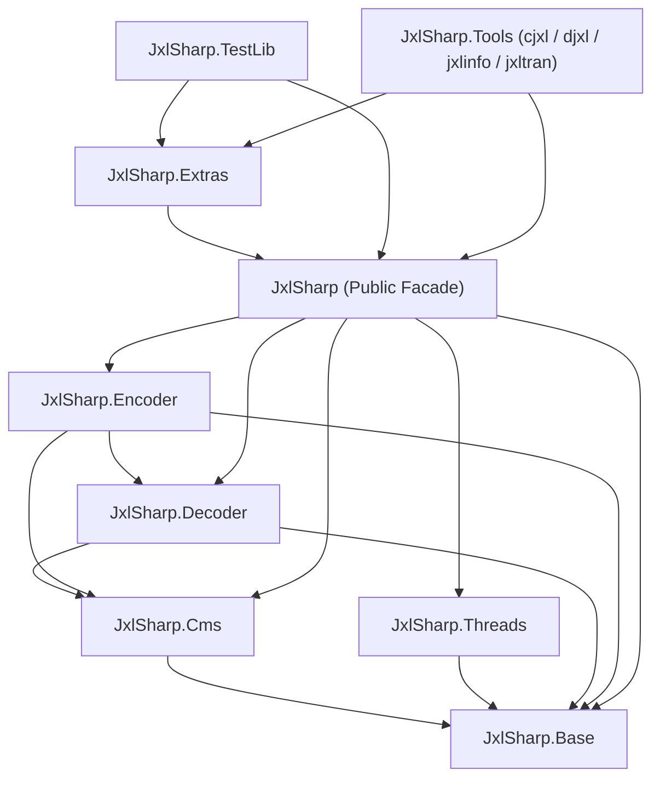

# JXL# Implementation Plan

## 1. Analysis of [project.md](file:///p:/source/jxl%23/jxl%23/plan/project.md) & `libjxl` Codebase

### 1.1 Core Requirements Summary
* **Objective**: Build a pure C#/.NET port of `libjxl` (v0.13.0) located in [libjxl](file:///p:/source/jxl%23/libjxl) inside the [jxl#](file:///p:/source/jxl%23/jxl%23) solution directory.
* **1-to-1 Fidelity**: Preserve the C++ architecture, algorithms, data structures, and file/type mapping from [jxl_lists.cmake](file:///p:/source/jxl%23/libjxl/lib/jxl_lists.cmake), applying idiomatic C# improvements (`Span<T>`, `Memory<T>`, `System.Runtime.Intrinsics`, `ArrayPool<T>`, `IDisposable`) without diverging from the reference behavior.
* **Brotli Dependency**: Use the existing C#/.NET Brotli implementation (`System.IO.Compression.BrotliDecoder` / `BrotliEncoder`) instead of porting `third_party/brotli`.
* **Modular Project Split**: Partition the solution into distinct C# class libraries and CLI projects corresponding to the C++ targets defined in [lib/CMakeLists.txt](file:///p:/source/jxl%23/libjxl/lib/CMakeLists.txt) and [tools/CMakeLists.txt](file:///p:/source/jxl%23/libjxl/tools/CMakeLists.txt).
* **Full C++ Test Parity & 90% Code Coverage**:
  * Pass all 61 C++ test suites defined in `JPEGXL_INTERNAL_TESTS` ([jxl_lists.cmake](file:///p:/source/jxl%23/libjxl/lib/jxl_lists.cmake#L489-L549) and [jxl_tests.cmake](file:///p:/source/jxl%23/libjxl/lib/jxl_tests.cmake#L33-L37)) against [testdata](file:///p:/source/jxl%23/libjxl/testdata).
  * Enforce $\ge 90\%$ code coverage across all C# source files, with a dedicated unit test class per production class in the matching `.Tests` project using **NUnit**, **Moq**, and **Shouldly**.

### 1.2 Scope Classification

| Category | `libjxl` Source Location | Status | Rationale |
| :--- | :--- | :--- | :--- |
| **Public API & Headers** | `lib/include/jxl/*.h` (18 headers) | **In Scope** | Public types, status codes, decoder/encoder state machines, CMS & parallel runner interfaces. |
| **Base Library** | `lib/jxl/base/*.h` (24 headers) | **In Scope** | Bit ops, endianness, fast math, rational polynomials, `Rect`, `Status`, `PaddedBytes`, RNG, matrix ops. |
| **Color Management (`jxl_cms`)** | `lib/jxl/cms/*` + `third_party/skcms` | **In Scope** | Transfer functions, tone mapping, opsin params, ICC profile parsing & color space transforms. |
| **Threading (`jxl_threads`)** | `lib/threads/*` | **In Scope** | `ThreadParallelRunner` and `ResizableParallelRunner` mapped to .NET thread pool / `Parallel`. |
| **Core Decoder (`jxl_dec`)** | `lib/jxl/dec_*`, `render_pipeline/*`, `modular/*`, `jpeg/*` | **In Scope** | 186 files covering container boxes, headers, ANS/Huffman, Modular, VarDCT, splines, patches, EPF, render pipeline, and JPEG reconstruction. |
| **Core Encoder (`jxl_enc`)** | `lib/jxl/enc_*`, `butteraugli/*`, `modular/*`, `jpeg/*` | **In Scope** | 112 files covering Butteraugli perceptual metric, VarDCT, Modular, fast lossless, ANS/Huffman/LZ77, adaptive quantization, and lossless JPEG transcoding. |
| **Extras & Format Codecs** | `lib/extras/*` | **In Scope** | `PackedImage`, `CodecInOut`, alpha blend, EXIF, gain maps, metrics, tone mapping, and PNM/PGX/NPY/PNG/JPEG/GIF codecs. |
| **Test Infrastructure & Suite** | `lib/jxl/*_test.cc`, `lib/extras/*_test.cc`, `lib/threads/*_test.cc` | **In Scope** | `jxl_testlib` (13 files) + all 61 test suites + `testdata` fixtures. |
| **CLI & Dev Tools** | `tools/cjxl_main.cc`, `djxl_main.cc`, `jxlinfo.cc`, `jxltran.cc`, `ssimulacra2.cc`, `gauss_blur.cc` | **In Scope** | Core user-facing CLI tools and perceptual quality metrics. |
| **Non-.NET Packaging & Docs** | `debian/`, `cmake/`, `doc/`, `flake.nix`, `BUILD.bazel`, `ci.sh`, `deps.sh` | **Skipped** | Linux/Debian packaging, CMake/Bazel/Nix scripts, and Doxygen/AsciiDoc manpages. |
| **Native/Foreign Plugins & Bindings** | `plugins/` (GIMP, gdk-pixbuf, mime), `tools/jni/`, `tools/wasm_demo/` | **Skipped** | Non-.NET ecosystem bindings (Java JNI, Emscripten WASM, GTK/GIMP plugins). |
| **Native GUI Viewers** | `tools/viewer/`, `tools/comparison_viewer/`, `tools/flicker_test/`, `tools/icc_detect/` | **Skipped** | Qt6 / Cocoa macOS / X11 native desktop evaluation viewers. |

---

## 2. Solution & Modular Project Architecture

All projects reside under `p:\source\jxl#\jxl#\` with solution file `p:\source\jxl#\jxl#\JxlSharp.slnx`, centralized `Directory.Build.props`, and `Directory.Packages.props`.

### 2.1 Production Projects (`src/`)

1. **`JxlSharp.Base`** (`src/JxlSharp.Base/JxlSharp.Base.csproj`)
   * Maps `JPEGXL_INTERNAL_BASE_SOURCES` ([jxl_lists.cmake](file:///p:/source/jxl%23/libjxl/lib/jxl_lists.cmake#L8-L32)), core shared data structures (`Image`, `Plane<T>`, `Image3<T>`, `ImageBundle`, `ImageMetadata`, `ColorEncoding`, `FrameDimensions`, `FrameHeader`, `Headers`, `Fields`, `PaddedBytes`, `MemoryManager`), public API types (`JPEGXL_INTERNAL_PUBLIC_HEADERS`), and the Highway SIMD portability layer (`Hwy`).
2. **`JxlSharp.Cms`** (`src/JxlSharp.Cms/JxlSharp.Cms.csproj`)
   * Maps `jxl_cms` ([jxl_cms.cmake](file:///p:/source/jxl%23/libjxl/lib/jxl_cms.cmake), `JPEGXL_INTERNAL_CMS_SOURCES`) and the C# port of `skcms` (`third_party/skcms/skcms.cc`) for ICC profile parsing,LUT evaluation, tone mapping (`tone_mapping-inl.h`), and transfer functions (`transfer_functions-inl.h`).
3. **`JxlSharp.Threads`** (`src/JxlSharp.Threads/JxlSharp.Threads.csproj`)
   * Maps `jxl_threads` ([jxl_threads.cmake](file:///p:/source/jxl%23/libjxl/lib/jxl_threads.cmake), `JPEGXL_INTERNAL_THREADS_SOURCES`, `JPEGXL_INTERNAL_THREADS_PUBLIC_HEADERS`): `ThreadParallelRunner` and `ResizableParallelRunner`.
4. **`JxlSharp.Decoder`** (`src/JxlSharp.Decoder/JxlSharp.Decoder.csproj`)
   * Maps `jxl_dec-obj` ([jxl.cmake](file:///p:/source/jxl%23/libjxl/lib/jxl.cmake#L115-L128), `JPEGXL_INTERNAL_DEC_SOURCES`, `JPEGXL_INTERNAL_DEC_BOX_SOURCES`, `JPEGXL_INTERNAL_DEC_JPEG_SOURCES`).
   * Sub-namespaces: `JxlSharp.Decoder`, `JxlSharp.Decoder.Modular`, `JxlSharp.Decoder.RenderPipeline`, `JxlSharp.Decoder.Jpeg`.
5. **`JxlSharp.Encoder`** (`src/JxlSharp.Encoder/JxlSharp.Encoder.csproj`)
   * Maps `jxl_enc-obj` ([jxl.cmake](file:///p:/source/jxl%23/libjxl/lib/jxl.cmake#L130-L143), `JPEGXL_INTERNAL_ENC_SOURCES`).
   * Sub-namespaces: `JxlSharp.Encoder`, `JxlSharp.Encoder.Butteraugli`, `JxlSharp.Encoder.Modular`, `JxlSharp.Encoder.Jpeg`, `JxlSharp.Encoder.FastLossless`.
6. **`JxlSharp`** (`src/JxlSharp/JxlSharp.csproj`)
   * Maps the unified public library `jxl` ([jxl.cmake](file:///p:/source/jxl%23/libjxl/lib/jxl.cmake#L216-L224)), re-exporting high-level and C-API-equivalent `JxlDecoder` and `JxlEncoder` interfaces.
7. **`JxlSharp.Extras`** (`src/JxlSharp.Extras/JxlSharp.Extras.csproj`)
   * Maps `jxl_extras` ([jxl_extras.cmake](file:///p:/source/jxl%23/libjxl/lib/jxl_extras.cmake), `JPEGXL_INTERNAL_EXTRAS_SOURCES`, `JPEGXL_INTERNAL_EXTRAS_FOR_TOOLS_SOURCES`, and format codecs: `pnm`, `pgx`, `npy`, `apng`/`png`, `jpg`, `gif`, `exr`).
8. **`JxlSharp.Tools`** (`src/JxlSharp.Tools/JxlSharp.Tools.csproj`) & CLI Executables (`src/JxlSharp.Cli.Cjxl`, `src/JxlSharp.Cli.Djxl`, `src/JxlSharp.Cli.JxlInfo`, `src/JxlSharp.Cli.JxlTran`)
   * Maps `jxl_tool`, `jxl_gauss_blur`, `ssimulacra`, `ssimulacra2`, and the CLI entry points ([tools/CMakeLists.txt](file:///p:/source/jxl%23/libjxl/tools/CMakeLists.txt)).

### 2.2 Test Projects (`tests/`)

Every production project has a corresponding `.Tests` project using **NUnit**, **Moq**, **Shouldly**, and **coverlet.collector**:
* `tests/JxlSharp.TestLib/JxlSharp.TestLib.csproj` (Port of `JPEGXL_INTERNAL_TESTLIB_FILES`: `TestImage`, `TestUtils`, `TestMemoryManager`, `FakeParallelRunner`, `DctForTest`, `TestRenderPipelineStages`)
* `tests/JxlSharp.Base.Tests/JxlSharp.Base.Tests.csproj`
* `tests/JxlSharp.Cms.Tests/JxlSharp.Cms.Tests.csproj`
* `tests/JxlSharp.Threads.Tests/JxlSharp.Threads.Tests.csproj`
* `tests/JxlSharp.Decoder.Tests/JxlSharp.Decoder.Tests.csproj`
* `tests/JxlSharp.Encoder.Tests/JxlSharp.Encoder.Tests.csproj`
* `tests/JxlSharp.Extras.Tests/JxlSharp.Extras.Tests.csproj`
* `tests/JxlSharp.Tools.Tests/JxlSharp.Tools.Tests.csproj`
* `tests/JxlSharp.Integration.Tests/JxlSharp.Integration.Tests.csproj` (Full end-to-end C++ `roundtrip_test`, `jxl_test`, `decode_test`, `encode_test`, `speed_tier_test`, and conformance runner).

---

## 3. C# Architectural & Coding Standards Rules

All generated C# code and unit tests will strictly adhere to the workspace rules:

1. **Method Complexity & Signature Constraints**:
   * Maximum cognitive complexity of **15** per method (enforced via SonarAnalyzer.CSharp / custom Roslyn analyzer configuration in `.editorconfig`). Complex C++ functions (such as `JxlDecoderProcessInput` in [decode.cc](file:///p:/source/jxl%23/libjxl/lib/jxl/decode.cc) or `FindBestPatchDictionary` in [enc_patch_dictionary.cc](file:///p:/source/jxl%23/libjxl/lib/jxl/enc_patch_dictionary.cc)) will be decomposed into small, single-purpose private helper methods while keeping the exact 1-to-1 algorithmic logic.
   * Maximum **7 parameters** per method (except DI constructors). C++ functions exceeding 7 parameters (such as `QuantizeBlockAC` or `DecodeGroup`) will group related parameters into lightweight `readonly ref struct` or `record struct` context objects.
2. **Formatting & Structural Conventions**:
   * Block-scoped namespaces (`namespace JxlSharp.Base { ... }`) in all files; no top-level statements.
   * Empty line before `return`, `if`, `for`, `foreach`, and `try` statements (unless preceded by a comment or opening brace `{`).
   * Empty line separating variable declarations/definitions from subsequent C# statements.
   * Consecutive member initializations aligned on the `=` sign.
   * All original C++ comments preserved during porting; XML documentation comments (`/// 
`) added to every class, struct, enum, interface, and method (`/// <inheritdoc />` on interface implementations).
   * All `Regex` instances (e.g., in [color_description.cc](file:///p:/source/jxl%23/libjxl/lib/extras/dec/color_description.cc) and [cmdline.cc](file:///p:/source/jxl%23/libjxl/tools/cmdline.cc)) cached as `private static readonly Regex` with `RegexOptions.Compiled`.
3. **Unit Testing & Coverage Rules**:
   * Every new C# class gets a corresponding `*Tests.cs` unit test class in the exact same namespace within the matching `.Tests` project.
   * Frameworks: **NUnit** (`[TestFixture]`, `[Test]`, `[TestCase]`), **Moq** (`Mock<T>`), and **Shouldly** (`ShouldBe`, `ShouldThrow`, etc.).
   * **No SUT class members**: Each `[Test]` method instantiates its own fresh instance of the class under test locally.
   * **Test-Fix Rule**: When fixing failing unit tests, never modify the class under test solely to make a test pass; verify against the C++ reference implementation and fix the test if the test expectation is wrong.
   * **90% Code Coverage**: Enforced per project via Coverlet MSBuild/collector thresholds (`Threshold=90`, `ThresholdType=line,branch`).
4. **Ownership Metadata (`Directory.Build.props`)**:
   * `Authors`: `Hefaistos68`
   * `Company`: `Hefaistos68`
   * `PackageProjectUrl` / `RepositoryUrl`: `https://github.com/Hefaistos68/jxl-sharp`

---

## 4. Key Technical Porting Strategies

### 4.1 Highway SIMD (`hwy`) to .NET SIMD
`libjxl` uses Google Highway (`hwy/highway.h`) across `*-inl.h` files (`fast_math-inl.h`, `rational_polynomial-inl.h`, `dct-inl.h`, `dct_block-inl.h`, `convolve-inl.h`, `dec_transforms-inl.h`, `dec_xyb-inl.h`, `transpose-inl.h`, `quantizer-inl.h`, `simd_util-inl.h`, `tone_mapping-inl.h`, `transfer_functions-inl.h`).
* **Design**: Create `JxlSharp.Base.Simd.HwyOps` providing a 1-to-1 API surface matching Highway (`Load`, `Store`, `Add`, `Sub`, `Mul`, `Div`, `MulAdd`, `MulSub`, `NegMulAdd`, `Abs`, `Min`, `Max`, `Clamp`, `Sqrt`, `Floor`, `Ceil`, `NearestInt`, `BitCast`, `ShiftLeft`, `ShiftRight`, `And`, `Or`, `Xor`, `Not`, `IfThenElse`, `ZeroIfNegative`, `TableLookupBytes`, `InterleaveLower`, `InterleaveUpper`, `Transpose8x8Block`).
* **Execution**: Backed by `Vector128<T>` / `Vector256<T>` (`System.Runtime.Intrinsics`) and `Vector<T>` (`System.Numerics`), with a deterministic scalar backend (`HwyScalar`) so every SIMD test in `libjxl` (`fast_math_test`, `rational_polynomial_test`, `dct_test`, `convolve_test`, `simd_util_test`, `transfer_functions_test`, `tone_mapping_test`) can be verified across both SIMD and scalar paths.

### 4.2 Brotli Integration
`libjxl` uses Brotli in two places:
1. **ICC Profile Compression/Decompression** ([icc_codec.cc](file:///p:/source/jxl%23/libjxl/lib/jxl/icc_codec.cc), [enc_icc_codec.cc](file:///p:/source/jxl%23/libjxl/lib/jxl/enc_icc_codec.cc))
2. **Container Box Decompression (`brob` boxes)** ([box_content_decoder.cc](file:///p:/source/jxl%23/libjxl/lib/jxl/box_content_decoder.cc)) and **JPEG Reconstruction (`jbrd`)**
* **Design**: Wrap .NET's built-in `System.IO.Compression.BrotliDecoder` and `System.IO.Compression.BrotliEncoder` in `JxlSharp.Base.Compression.BrotliWrapper`, matching the exact streaming `OperationStatus` (`Done`, `DestinationTooSmall`, `NeedMoreData`, `InvalidData`) expected by `JxlBoxContentDecoder` and `UnpredictAndBrotliDecode`.

### 4.3 Memory & Bitstream Primitives
* **`Plane<T>` & `Image3<T>`** ([image.h](file:///p:/source/jxl%23/libjxl/lib/jxl/image.h)): Backed by aligned/padded memory buffers (`IMemoryOwner<T>` / `JxlMemoryManager`) with `Span<T> Row(int y)` and `ReadOnlySpan<T> ConstRow(int y)` accessors.
* **`BitReader` & `BitWriter`** ([dec_bit_reader.h](file:///p:/source/jxl%23/libjxl/lib/jxl/dec_bit_reader.h), [enc_bit_writer.h](file:///p:/source/jxl%23/libjxl/lib/jxl/enc_bit_writer.h)): 64-bit refill buffer operating over `ReadOnlyMemory<byte>` / `Span<byte>` using `BinaryPrimitives.ReadUInt64LittleEndian` and `BitOperations.LeadingZeroCount` / `TrailingZeroCount`.

---

## 5. Phased Implementation Plan

### Phase 0: Solution Scaffolding, Build Configuration & Quality Gates
**Goal**: Initialize the multi-project .NET solution, configure static analysis for cognitive complexity ($\le 15$) and parameter counts ($\le 7$), and set up NUnit + Moq + Shouldly + Coverlet ($\ge 90\%$ coverage).
* Create `p:\source\jxl#\jxl#\Directory.Build.props` (TargetFramework `net10.0`, `LangVersion` latest, `Nullable` enable, `TreatWarningsAsErrors`, XML doc generation, Hefaistos68 ownership metadata).
* Create `p:\source\jxl#\jxl#\Directory.Packages.props` (`NUnit`, `NUnit3TestAdapter`, `Microsoft.NET.Test.Sdk`, `Moq`, `Shouldly`, `coverlet.collector`, `coverlet.msbuild`, `SonarAnalyzer.CSharp`).
* Create `.editorconfig` enforcing formatting rules, block-scoped namespaces, cognitive complexity $\le 15$, and max parameters $\le 7$.
* Scaffold all `.csproj` files and `JxlSharp.slnx`.

### Phase 1: `JxlSharp.Base` — Primitives, Math, SIMD, Fields & Headers
**Goal**: Port all foundational headers, bit readers, field encodings, and core image/header containers.
* **Files to Port**:
  * `jxl/base/*`: [bits.h](file:///p:/source/jxl%23/libjxl/lib/jxl/base/bits.h), [byte_order.h](file:///p:/source/jxl%23/libjxl/lib/jxl/base/byte_order.h), [status.h](file:///p:/source/jxl%23/libjxl/lib/jxl/base/status.h), [span.h](file:///p:/source/jxl%23/libjxl/lib/jxl/base/span.h), [rect.h](file:///p:/source/jxl%23/libjxl/lib/jxl/base/rect.h), [float.h](file:///p:/source/jxl%23/libjxl/lib/jxl/base/float.h), [fast_math-inl.h](file:///p:/source/jxl%23/libjxl/lib/jxl/base/fast_math-inl.h), [rational_polynomial-inl.h](file:///p:/source/jxl%23/libjxl/lib/jxl/base/rational_polynomial-inl.h), [matrix_ops.h](file:///p:/source/jxl%23/libjxl/lib/jxl/base/matrix_ops.h), [random.h](file:///p:/source/jxl%23/libjxl/lib/jxl/base/random.h), [exif.h](file:///p:/source/jxl%23/libjxl/lib/jxl/base/exif.h), [data_parallel.h](file:///p:/source/jxl%23/libjxl/lib/jxl/base/data_parallel.h), [scope_guard.h](file:///p:/source/jxl%23/libjxl/lib/jxl/base/scope_guard.h), [override.h](file:///p:/source/jxl%23/libjxl/lib/jxl/base/override.h).
  * `include/jxl/*`: [types.h](file:///p:/source/jxl%23/libjxl/lib/include/jxl/types.h), [codestream_header.h](file:///p:/source/jxl%23/libjxl/lib/include/jxl/codestream_header.h), [color_encoding.h](file:///p:/source/jxl%23/libjxl/lib/include/jxl/color_encoding.h), [memory_manager.h](file:///p:/source/jxl%23/libjxl/lib/include/jxl/memory_manager.h), [parallel_runner.h](file:///p:/source/jxl%23/libjxl/lib/include/jxl/parallel_runner.h), [cms_interface.h](file:///p:/source/jxl%23/libjxl/lib/include/jxl/cms_interface.h), [gain_map.h](file:///p:/source/jxl%23/libjxl/lib/include/jxl/gain_map.h), [stats.h](file:///p:/source/jxl%23/libjxl/lib/include/jxl/stats.h).
  * Core structures: [padded_bytes.h](file:///p:/source/jxl%23/libjxl/lib/jxl/padded_bytes.h), [memory_manager_internal.cc](file:///p:/source/jxl%23/libjxl/lib/jxl/memory_manager_internal.cc), [xorshift128plus-inl.h](file:///p:/source/jxl%23/libjxl/lib/jxl/xorshift128plus-inl.h), [pack_signed.h](file:///p:/source/jxl%23/libjxl/lib/jxl/pack_signed.h), [lehmer_code.h](file:///p:/source/jxl%23/libjxl/lib/jxl/lehmer_code.h), [inverse_mtf-inl.h](file:///p:/source/jxl%23/libjxl/lib/jxl/inverse_mtf-inl.h), [simd_util.cc](file:///p:/source/jxl%23/libjxl/lib/jxl/simd_util.cc), [transpose-inl.h](file:///p:/source/jxl%23/libjxl/lib/jxl/transpose-inl.h), [image.cc](file:///p:/source/jxl%23/libjxl/lib/jxl/image.cc), [image_ops.cc](file:///p:/source/jxl%23/libjxl/lib/jxl/image_ops.cc).
* **C++ Tests to Pass (`JxlSharp.Base.Tests`)**:
  * `bits_test.cc`, `byte_order_test.cc`, `fast_math_test.cc`, `rational_polynomial_test.cc`, `padded_bytes_test.cc`, `xorshift128plus_test.cc`, `lehmer_code_test.cc`, `simd_util_test.cc`, `image_ops_test.cc`, `data_parallel_test.cc`, `iaca_test.cc`.

### Phase 2: `JxlSharp.Cms` & `JxlSharp.Threads` — Color Management & Parallel Runners
**Goal**: Implement the color management system (`jxl_cms` + `skcms`) and multithreaded runner library (`jxl_threads`).
* **Files to Port**:
  * `JxlSharp.Cms`: [color_encoding_cms.h](file:///p:/source/jxl%23/libjxl/lib/jxl/cms/color_encoding_cms.h), [opsin_params.h](file:///p:/source/jxl%23/libjxl/lib/jxl/cms/opsin_params.h), [transfer_functions.h](file:///p:/source/jxl%23/libjxl/lib/jxl/cms/transfer_functions.h), [transfer_functions-inl.h](file:///p:/source/jxl%23/libjxl/lib/jxl/cms/transfer_functions-inl.h), [tone_mapping.h](file:///p:/source/jxl%23/libjxl/lib/jxl/cms/tone_mapping.h), [tone_mapping-inl.h](file:///p:/source/jxl%23/libjxl/lib/jxl/cms/tone_mapping-inl.h), [jxl_cms_internal.h](file:///p:/source/jxl%23/libjxl/lib/jxl/cms/jxl_cms_internal.h), [jxl_cms.cc](file:///p:/source/jxl%23/libjxl/lib/jxl/cms/jxl_cms.cc), and `third_party/skcms/skcms.cc`.
  * `JxlSharp.Threads`: [thread_parallel_runner.cc](file:///p:/source/jxl%23/libjxl/lib/threads/thread_parallel_runner.cc), [thread_parallel_runner_internal.cc](file:///p:/source/jxl%23/libjxl/lib/threads/thread_parallel_runner_internal.cc), [resizable_parallel_runner.cc](file:///p:/source/jxl%23/libjxl/lib/threads/resizable_parallel_runner.cc).
* **C++ Tests to Pass (`JxlSharp.Cms.Tests` & `JxlSharp.Threads.Tests`)**:
  * `cms/transfer_functions_test.cc`, `cms/tone_mapping_test.cc`, `threads/thread_parallel_runner_test.cc`.

### Phase 3: `JxlSharp.Decoder` (Part 1) — BitReader, Entropy Coding, Headers, Fields, TOC & ICC
**Goal**: Port bitstream reading, ANS & Huffman entropy decoding, bundle/codestream/frame headers, TOC, and Brotli-backed ICC & container box decoding.
* **Files to Port**:
  * Bitstream & Fields: [dec_bit_reader.cc](file:///p:/source/jxl%23/libjxl/lib/jxl/dec_bit_reader.cc), [field_encodings.h](file:///p:/source/jxl%23/libjxl/lib/jxl/field_encodings.h), [fields.cc](file:///p:/source/jxl%23/libjxl/lib/jxl/fields.cc), [headers.cc](file:///p:/source/jxl%23/libjxl/lib/jxl/headers.cc), [frame_header.cc](file:///p:/source/jxl%23/libjxl/lib/jxl/frame_header.cc), [color_encoding_internal.cc](file:///p:/source/jxl%23/libjxl/lib/jxl/color_encoding_internal.cc), [image_metadata.cc](file:///p:/source/jxl%23/libjxl/lib/jxl/image_metadata.cc), [image_bundle.cc](file:///p:/source/jxl%23/libjxl/lib/jxl/image_bundle.cc), [luminance.cc](file:///p:/source/jxl%23/libjxl/lib/jxl/luminance.cc), [opsin_params.cc](file:///p:/source/jxl%23/libjxl/lib/jxl/opsin_params.cc), [toc.cc](file:///p:/source/jxl%23/libjxl/lib/jxl/toc.cc).
  * Entropy Decoding: [ans_params.h](file:///p:/source/jxl%23/libjxl/lib/jxl/ans_params.h), [ans_common.cc](file:///p:/source/jxl%23/libjxl/lib/jxl/ans_common.cc), [huffman_table.cc](file:///p:/source/jxl%23/libjxl/lib/jxl/huffman_table.cc), [dec_huffman.cc](file:///p:/source/jxl%23/libjxl/lib/jxl/dec_huffman.cc), [dec_ans.cc](file:///p:/source/jxl%23/libjxl/lib/jxl/dec_ans.cc), [dec_context_map.cc](file:///p:/source/jxl%23/libjxl/lib/jxl/dec_context_map.cc), [entropy_coder.cc](file:///p:/source/jxl%23/libjxl/lib/jxl/entropy_coder.cc).
  * ICC & Box Decoding: [icc_codec_common.cc](file:///p:/source/jxl%23/libjxl/lib/jxl/icc_codec_common.cc), [icc_codec.cc](file:///p:/source/jxl%23/libjxl/lib/jxl/icc_codec.cc), [box_content_decoder.cc](file:///p:/source/jxl%23/libjxl/lib/jxl/box_content_decoder.cc).
* **C++ Tests to Pass (`JxlSharp.Decoder.Tests`)**:
  * `bit_reader_test.cc`, `fields_test.cc`, `ans_common_test.cc`, `toc_test.cc`, `color_encoding_internal_test.cc`, `color_management_test.cc`, `image_bundle_test.cc`.

### Phase 4: `JxlSharp.Decoder` (Part 2) — Modular Mode, Transforms, DCT, Quantization & Render Pipeline
**Goal**: Implement Modular image decoding, MA trees, Reversible Color Transforms (RCT), Palette, Squeeze, VarDCT transforms, splines, patches, noise, EPF, and the 16-stage Render Pipeline.
* **Files to Port**:
  * Modular Subsystem: [modular_image.cc](file:///p:/source/jxl%23/libjxl/lib/jxl/modular/modular_image.cc), [options.h](file:///p:/source/jxl%23/libjxl/lib/jxl/modular/options.h), [context_predict.h](file:///p:/source/jxl%23/libjxl/lib/jxl/modular/encoding/context_predict.h), [ma_common.h](file:///p:/source/jxl%23/libjxl/lib/jxl/modular/encoding/ma_common.h), [dec_ma.cc](file:///p:/source/jxl%23/libjxl/lib/jxl/modular/encoding/dec_ma.cc), [encoding.cc](file:///p:/source/jxl%23/libjxl/lib/jxl/modular/encoding/encoding.cc), [palette.cc](file:///p:/source/jxl%23/libjxl/lib/jxl/modular/transform/palette.cc), [rct.cc](file:///p:/source/jxl%23/libjxl/lib/jxl/modular/transform/rct.cc), [squeeze_params.cc](file:///p:/source/jxl%23/libjxl/lib/jxl/modular/transform/squeeze_params.cc), [squeeze.cc](file:///p:/source/jxl%23/libjxl/lib/jxl/modular/transform/squeeze.cc), [transform.cc](file:///p:/source/jxl%23/libjxl/lib/jxl/modular/transform/transform.cc), [dec_modular.cc](file:///p:/source/jxl%23/libjxl/lib/jxl/dec_modular.cc).
  * VarDCT, Quantization & Convolve: [ac_context.h](file:///p:/source/jxl%23/libjxl/lib/jxl/ac_context.h), [ac_strategy.cc](file:///p:/source/jxl%23/libjxl/lib/jxl/ac_strategy.cc), [coeff_order.cc](file:///p:/source/jxl%23/libjxl/lib/jxl/coeff_order.cc), [chroma_from_luma.cc](file:///p:/source/jxl%23/libjxl/lib/jxl/chroma_from_luma.cc), [quant_weights.cc](file:///p:/source/jxl%23/libjxl/lib/jxl/quant_weights.cc), [quantizer.cc](file:///p:/source/jxl%23/libjxl/lib/jxl/quantizer.cc), [dct_scales.cc](file:///p:/source/jxl%23/libjxl/lib/jxl/dct_scales.cc), [dct-inl.h](file:///p:/source/jxl%23/libjxl/lib/jxl/dct-inl.h), [dct_block-inl.h](file:///p:/source/jxl%23/libjxl/lib/jxl/dct_block-inl.h), [dec_transforms-inl.h](file:///p:/source/jxl%23/libjxl/lib/jxl/dec_transforms-inl.h), [convolve-inl.h](file:///p:/source/jxl%23/libjxl/lib/jxl/convolve-inl.h), [convolve_slow.cc](file:///p:/source/jxl%23/libjxl/lib/jxl/convolve_slow.cc), [convolve_symmetric5.cc](file:///p:/source/jxl%23/libjxl/lib/jxl/convolve_symmetric5.cc).
  * Features & Filters: [alpha.cc](file:///p:/source/jxl%23/libjxl/lib/jxl/alpha.cc), [blending.cc](file:///p:/source/jxl%23/libjxl/lib/jxl/blending.cc), [splines.cc](file:///p:/source/jxl%23/libjxl/lib/jxl/splines.cc), [dec_patch_dictionary.cc](file:///p:/source/jxl%23/libjxl/lib/jxl/dec_patch_dictionary.cc), [dec_noise.cc](file:///p:/source/jxl%23/libjxl/lib/jxl/dec_noise.cc), [epf.cc](file:///p:/source/jxl%23/libjxl/lib/jxl/epf.cc), [loop_filter.cc](file:///p:/source/jxl%23/libjxl/lib/jxl/loop_filter.cc), [dec_xyb.cc](file:///p:/source/jxl%23/libjxl/lib/jxl/dec_xyb.cc), [compressed_dc.cc](file:///p:/source/jxl%23/libjxl/lib/jxl/compressed_dc.cc).
  * Render Pipeline (`jxl/render_pipeline/*`): [render_pipeline_stage.cc](file:///p:/source/jxl%23/libjxl/lib/jxl/render_pipeline/render_pipeline_stage.cc), [render_pipeline.cc](file:///p:/source/jxl%23/libjxl/lib/jxl/render_pipeline/render_pipeline.cc), [simple_render_pipeline.cc](file:///p:/source/jxl%23/libjxl/lib/jxl/render_pipeline/simple_render_pipeline.cc), [low_memory_render_pipeline.cc](file:///p:/source/jxl%23/libjxl/lib/jxl/render_pipeline/low_memory_render_pipeline.cc), and all 16 `stage_*.cc` implementations (`blending`, `chroma_upsampling`, `cms`, `epf`, `from_linear`, `gaborish`, `noise`, `patches`, `splines`, `spot`, `to_linear`, `tone_mapping`, `upsampling`, `write`, `xyb`, `ycbcr`).
  * Frame/Group Decoding & JPEG Reconstruction: [passes_state.cc](file:///p:/source/jxl%23/libjxl/lib/jxl/passes_state.cc), [dec_cache.cc](file:///p:/source/jxl%23/libjxl/lib/jxl/dec_cache.cc), [dec_group_border.cc](file:///p:/source/jxl%23/libjxl/lib/jxl/dec_group_border.cc), [dec_group.cc](file:///p:/source/jxl%23/libjxl/lib/jxl/dec_group.cc), [dec_frame.cc](file:///p:/source/jxl%23/libjxl/lib/jxl/dec_frame.cc), [dec_external_image.cc](file:///p:/source/jxl%23/libjxl/lib/jxl/dec_external_image.cc), [jpeg_data.cc](file:///p:/source/jxl%23/libjxl/lib/jxl/jpeg/jpeg_data.cc), [dec_jpeg_data.cc](file:///p:/source/jxl%23/libjxl/lib/jxl/jpeg/dec_jpeg_data.cc), [dec_jpeg_data_writer.cc](file:///p:/source/jxl%23/libjxl/lib/jxl/jpeg/dec_jpeg_data_writer.cc), [decode_to_jpeg.cc](file:///p:/source/jxl%23/libjxl/lib/jxl/decode_to_jpeg.cc), [decode.cc](file:///p:/source/jxl%23/libjxl/lib/jxl/decode.cc).
* **C++ Tests to Pass (`JxlSharp.Decoder.Tests`)**:
  * `ac_strategy_test.cc`, `alpha_test.cc`, `blending_test.cc`, `coeff_order_test.cc`, `convolve_test.cc`, `dct_test.cc`, `opsin_inverse_test.cc`, `quant_weights_test.cc`, `quantizer_test.cc`, `render_pipeline/render_pipeline_test.cc`, `splines_test.cc`, `decode_test.cc`.

### Phase 5: `JxlSharp.Encoder` (Part 1) — BitWriter, Entropy Coding, Butteraugli, Modular & Fast Lossless
**Goal**: Implement bit writing, ANS/Huffman/LZ77 entropy encoding, Butteraugli perceptual distance, Modular encoding, and standalone Fast Lossless encoding.
* **Files to Port**:
  * BitWriter & Entropy Encoding: [enc_bit_writer.cc](file:///p:/source/jxl%23/libjxl/lib/jxl/enc_bit_writer.cc), [enc_fields.cc](file:///p:/source/jxl%23/libjxl/lib/jxl/enc_fields.cc), [enc_toc.cc](file:///p:/source/jxl%23/libjxl/lib/jxl/enc_toc.cc), [enc_huffman_tree.cc](file:///p:/source/jxl%23/libjxl/lib/jxl/enc_huffman_tree.cc), [enc_huffman.cc](file:///p:/source/jxl%23/libjxl/lib/jxl/enc_huffman.cc), [enc_lz77.cc](file:///p:/source/jxl%23/libjxl/lib/jxl/enc_lz77.cc), [enc_cluster.cc](file:///p:/source/jxl%23/libjxl/lib/jxl/enc_cluster.cc), [enc_context_map.cc](file:///p:/source/jxl%23/libjxl/lib/jxl/enc_context_map.cc), [enc_ans.cc](file:///p:/source/jxl%23/libjxl/lib/jxl/enc_ans.cc), [enc_ans_simd.cc](file:///p:/source/jxl%23/libjxl/lib/jxl/enc_ans_simd.cc), [enc_entropy_coder.cc](file:///p:/source/jxl%23/libjxl/lib/jxl/enc_entropy_coder.cc), [enc_icc_codec.cc](file:///p:/source/jxl%23/libjxl/lib/jxl/enc_icc_codec.cc), [enc_aux_out.cc](file:///p:/source/jxl%23/libjxl/lib/jxl/enc_aux_out.cc).
  * Butteraugli & Comparators: [butteraugli/butteraugli.cc](file:///p:/source/jxl%23/libjxl/lib/jxl/butteraugli/butteraugli.cc), [enc_comparator.cc](file:///p:/source/jxl%23/libjxl/lib/jxl/enc_comparator.cc), [enc_butteraugli_comparator.cc](file:///p:/source/jxl%23/libjxl/lib/jxl/enc_butteraugli_comparator.cc), [enc_gamma_correct.h](file:///p:/source/jxl%23/libjxl/lib/jxl/enc_gamma_correct.h), [enc_linalg.cc](file:///p:/source/jxl%23/libjxl/lib/jxl/enc_linalg.cc), [enc_optimize.h](file:///p:/source/jxl%23/libjxl/lib/jxl/enc_optimize.h), [enc_convolve_separable5.cc](file:///p:/source/jxl%23/libjxl/lib/jxl/enc_convolve_separable5.cc).
  * Modular Encoder & Fast Lossless: [enc_ma.cc](file:///p:/source/jxl%23/libjxl/lib/jxl/modular/encoding/enc_ma.cc), [enc_debug_tree.cc](file:///p:/source/jxl%23/libjxl/lib/jxl/modular/encoding/enc_debug_tree.cc), [enc_encoding.cc](file:///p:/source/jxl%23/libjxl/lib/jxl/modular/encoding/enc_encoding.cc), [enc_palette.cc](file:///p:/source/jxl%23/libjxl/lib/jxl/modular/transform/enc_palette.cc), [enc_rct.cc](file:///p:/source/jxl%23/libjxl/lib/jxl/modular/transform/enc_rct.cc), [enc_squeeze.cc](file:///p:/source/jxl%23/libjxl/lib/jxl/modular/transform/enc_squeeze.cc), [enc_transform.cc](file:///p:/source/jxl%23/libjxl/lib/jxl/modular/transform/enc_transform.cc), [enc_modular.cc](file:///p:/source/jxl%23/libjxl/lib/jxl/enc_modular.cc), [enc_modular_simd.cc](file:///p:/source/jxl%23/libjxl/lib/jxl/enc_modular_simd.cc), [enc_fast_lossless.cc](file:///p:/source/jxl%23/libjxl/lib/jxl/enc_fast_lossless.cc).
* **C++ Tests to Pass (`JxlSharp.Encoder.Tests`)**:
  * `enc_bit_writer_test.cc`, `ans_test.cc`, `entropy_coder_test.cc`, `icc_codec_test.cc`, `butteraugli/butteraugli_test.cc`, `gamma_correct_test.cc`, `enc_linalg_test.cc`, `enc_optimize_test.cc`, `modular_test.cc`.

### Phase 6: `JxlSharp.Encoder` (Part 2) — VarDCT Encoder, Heuristics, JPEG Transcoding & Public Encoder API
**Goal**: Complete VarDCT encoding, psychovisual heuristics, adaptive quantization, progressive splitting, lossless JPEG recompression, and the state-machine API in `encode.cc`.
* **Files to Port**:
  * VarDCT & Psychovisual Heuristics: [enc_xyb.cc](file:///p:/source/jxl%23/libjxl/lib/jxl/enc_xyb.cc), [enc_gaborish.cc](file:///p:/source/jxl%23/libjxl/lib/jxl/enc_gaborish.cc), [enc_transforms.cc](file:///p:/source/jxl%23/libjxl/lib/jxl/enc_transforms.cc), [enc_ac_strategy.cc](file:///p:/source/jxl%23/libjxl/lib/jxl/enc_ac_strategy.cc), [enc_adaptive_quantization.cc](file:///p:/source/jxl%23/libjxl/lib/jxl/enc_adaptive_quantization.cc), [enc_chroma_from_luma.cc](file:///p:/source/jxl%23/libjxl/lib/jxl/enc_chroma_from_luma.cc), [enc_coeff_order.cc](file:///p:/source/jxl%23/libjxl/lib/jxl/enc_coeff_order.cc), [enc_quant_weights.cc](file:///p:/source/jxl%23/libjxl/lib/jxl/enc_quant_weights.cc), [enc_progressive_split.cc](file:///p:/source/jxl%23/libjxl/lib/jxl/enc_progressive_split.cc), [enc_heuristics.cc](file:///p:/source/jxl%23/libjxl/lib/jxl/enc_heuristics.cc).
  * Features (Splines, Patches, Dots, Noise): [enc_splines.cc](file:///p:/source/jxl%23/libjxl/lib/jxl/enc_splines.cc), [enc_detect_dots.cc](file:///p:/source/jxl%23/libjxl/lib/jxl/enc_detect_dots.cc), [enc_dot_dictionary.cc](file:///p:/source/jxl%23/libjxl/lib/jxl/enc_dot_dictionary.cc), [enc_patch_dictionary.cc](file:///p:/source/jxl%23/libjxl/lib/jxl/enc_patch_dictionary.cc), [enc_noise.cc](file:///p:/source/jxl%23/libjxl/lib/jxl/enc_noise.cc), [enc_photon_noise.cc](file:///p:/source/jxl%23/libjxl/lib/jxl/enc_photon_noise.cc).
  * Frame/Group Encoding, JPEG Reader & Public API: [enc_cache.cc](file:///p:/source/jxl%23/libjxl/lib/jxl/enc_cache.cc), [enc_group.cc](file:///p:/source/jxl%23/libjxl/lib/jxl/enc_group.cc), [enc_frame.cc](file:///p:/source/jxl%23/libjxl/lib/jxl/enc_frame.cc), [enc_image_bundle.cc](file:///p:/source/jxl%23/libjxl/lib/jxl/enc_image_bundle.cc), [enc_external_image.cc](file:///p:/source/jxl%23/libjxl/lib/jxl/enc_external_image.cc), [enc_debug_image.cc](file:///p:/source/jxl%23/libjxl/lib/jxl/enc_debug_image.cc), [enc_jpeg_huffman_decode.cc](file:///p:/source/jxl%23/libjxl/lib/jxl/jpeg/enc_jpeg_huffman_decode.cc), [enc_jpeg_data_reader.cc](file:///p:/source/jxl%23/libjxl/lib/jxl/jpeg/enc_jpeg_data_reader.cc), [enc_jpeg_data.cc](file:///p:/source/jxl%23/libjxl/lib/jxl/jpeg/enc_jpeg_data.cc), [encode.cc](file:///p:/source/jxl%23/libjxl/lib/jxl/encode.cc).
* **C++ Tests to Pass (`JxlSharp.Encoder.Tests`)**:
  * `enc_gaborish_test.cc`, `enc_photon_noise_test.cc`, `enc_external_image_test.cc`, `opsin_image_test.cc`, `gradient_test.cc`, `patch_dictionary_test.cc`, `passes_test.cc`, `preview_test.cc`, `encode_test.cc`, `roundtrip_test.cc`, `speed_tier_test.cc`, `jxl_test.cc`.

### Phase 7: `JxlSharp.Extras`, `JxlSharp.TestLib` & Format Codecs
**Goal**: Port `lib/extras`, external test image codecs (PNM, PGX, NPY, APNG/PNG, JPG, GIF, EXR), and shared test utilities (`jxl_testlib`).
* **Files to Port**:
  * `JxlSharp.Extras`: [packed_image.cc](file:///p:/source/jxl%23/libjxl/lib/extras/packed_image.cc), [packed_image_convert.cc](file:///p:/source/jxl%23/libjxl/lib/extras/packed_image_convert.cc), [codec_in_out.h](file:///p:/source/jxl%23/libjxl/lib/extras/codec_in_out.h), [codec.cc](file:///p:/source/jxl%23/libjxl/lib/extras/codec.cc), [alpha_blend.cc](file:///p:/source/jxl%23/libjxl/lib/extras/alpha_blend.cc), [common.cc](file:///p:/source/jxl%23/libjxl/lib/extras/common.cc), [compressed_icc.cc](file:///p:/source/jxl%23/libjxl/lib/extras/compressed_icc.cc), [exif.cc](file:///p:/source/jxl%23/libjxl/lib/extras/exif.cc), [gain_map.cc](file:///p:/source/jxl%23/libjxl/lib/extras/gain_map.cc), [hlg.cc](file:///p:/source/jxl%23/libjxl/lib/extras/hlg.cc), [metrics.cc](file:///p:/source/jxl%23/libjxl/lib/extras/metrics.cc), [tone_mapping.cc](file:///p:/source/jxl%23/libjxl/lib/extras/tone_mapping.cc), [color_description.cc](file:///p:/source/jxl%23/libjxl/lib/extras/dec/color_description.cc), [color_hints.cc](file:///p:/source/jxl%23/libjxl/lib/extras/dec/color_hints.cc), [dec/decode.cc](file:///p:/source/jxl%23/libjxl/lib/extras/dec/decode.cc), [enc/encode.cc](file:///p:/source/jxl%23/libjxl/lib/extras/enc/encode.cc), and format codecs (`pnm`, `pgx`, `npy`, `jxl`, `apng`, `jpg`, `gif`, `exr`).
  * `JxlSharp.TestLib`: [test_utils.cc](file:///p:/source/jxl%23/libjxl/lib/jxl/test_utils.cc), [test_image.cc](file:///p:/source/jxl%23/libjxl/lib/jxl/test_image.cc), [test_memory_manager.cc](file:///p:/source/jxl%23/libjxl/lib/jxl/test_memory_manager.cc), [fake_parallel_runner_testonly.h](file:///p:/source/jxl%23/libjxl/lib/jxl/fake_parallel_runner_testonly.h), [dct_for_test.h](file:///p:/source/jxl%23/libjxl/lib/jxl/dct_for_test.h), [dec_transforms_testonly.cc](file:///p:/source/jxl%23/libjxl/lib/jxl/dec_transforms_testonly.cc), [image_test_utils.h](file:///p:/source/jxl%23/libjxl/lib/jxl/image_test_utils.h), [test_render_pipeline_stages.h](file:///p:/source/jxl%23/libjxl/lib/jxl/render_pipeline/test_render_pipeline_stages.h).
* **C++ Tests to Pass (`JxlSharp.Extras.Tests`)**:
  * `extras/codec_test.cc`, `extras/compressed_icc_test.cc`, `extras/dec/color_description_test.cc`, `extras/dec/pgx_test.cc`, `extras/gain_map_test.cc`.

### Phase 8: `JxlSharp.Tools` & CLI Utilities
**Goal**: Port the shared tool infrastructure, Gaussian blur, SSIMULACRA / SSIMULACRA2 metrics, fuzzer regression tests, and CLI tools (`cjxl`, `djxl`, `jxlinfo`, `jxltran`).
* **Files to Port**:
  * [cmdline.cc](file:///p:/source/jxl%23/libjxl/tools/cmdline.cc), [codec_config.cc](file:///p:/source/jxl%23/libjxl/tools/codec_config.cc), [no_memory_manager.cc](file:///p:/source/jxl%23/libjxl/tools/no_memory_manager.cc), [tracking_memory_manager.cc](file:///p:/source/jxl%23/libjxl/tools/tracking_memory_manager.cc), [speed_stats.cc](file:///p:/source/jxl%23/libjxl/tools/speed_stats.cc), [gauss_blur.cc](file:///p:/source/jxl%23/libjxl/tools/gauss_blur.cc), [ssimulacra.cc](file:///p:/source/jxl%23/libjxl/tools/ssimulacra.cc), [ssimulacra2.cc](file:///p:/source/jxl%23/libjxl/tools/ssimulacra2.cc), [djxl_fuzzer.cc](file:///p:/source/jxl%23/libjxl/tools/djxl_fuzzer.cc), [cjxl_main.cc](file:///p:/source/jxl%23/libjxl/tools/cjxl_main.cc), [djxl_main.cc](file:///p:/source/jxl%23/libjxl/tools/djxl_main.cc), [jxlinfo.cc](file:///p:/source/jxl%23/libjxl/tools/jxlinfo.cc), [jxltran.cc](file:///p:/source/jxl%23/libjxl/tools/jxltran.cc).
* **C++ Tests to Pass (`JxlSharp.Tools.Tests`)**:
  * `tools/gauss_blur_test.cc`, `tools/djxl_fuzzer_test.cc`, and `tools/scripts/roundtrip_test.sh` equivalent NUnit suite.

### Phase 9: Conformance Verification & $\ge 90\%$ Code Coverage Audit
**Goal**: Execute the complete test suite, verify 100% pass rate across all 61 ported C++ test suites + class-level unit tests, and enforce $\ge 90\%$ code coverage on every C# source file.
* Run `dotnet test --collect:"XPlat Code Coverage"` across `JxlSharp.slnx`.
* Generate per-file coverage reports via `ReportGenerator` and add targeted NUnit + Moq + Shouldly tests for any branch or error-handling path below 90%.
* Verify zero compiler/analyzer warnings, cognitive complexity $\le 15$ across all methods, and $\le 7$ parameters per method.
